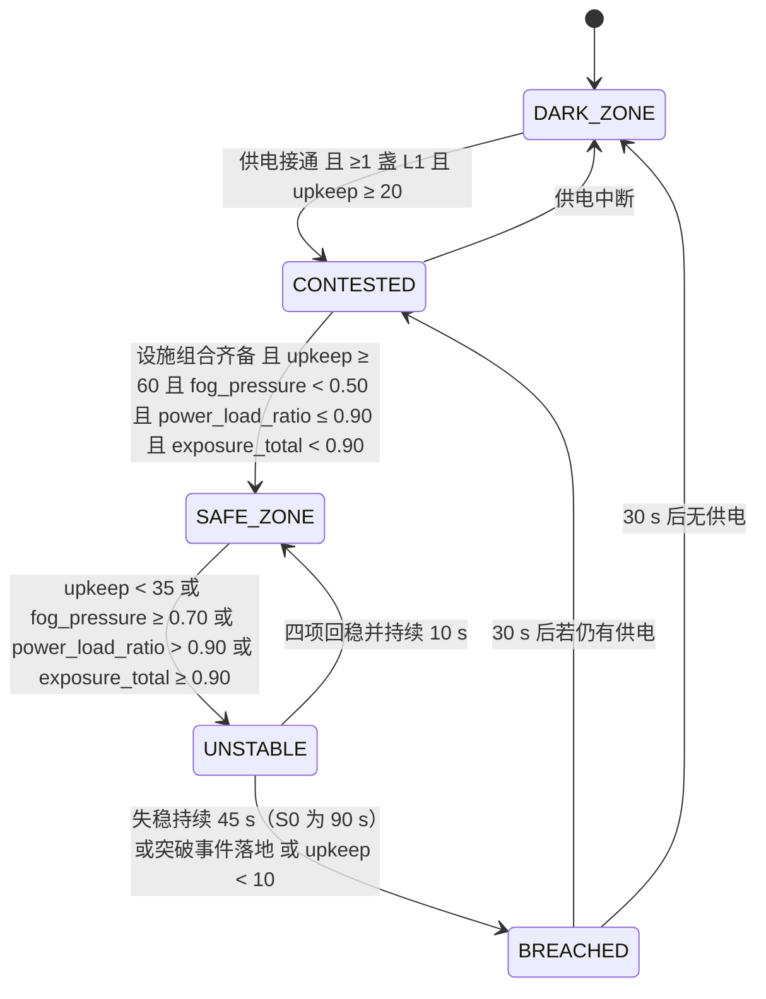
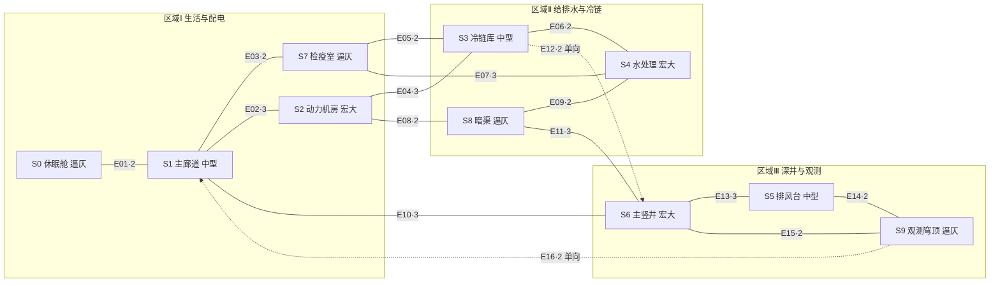

# 《暗适应》任务 A：场景拓扑、安全区扩张与危险体系的一体化设计（大型交付）

> **交付说明**：本稿为设计类大型交付，按项目 3.1 固定顺序输出：①假设清单 → ②设计意图 → ③方案 → ④数据 → ⑤验收清单（7.3 对账表）→ ⑥风险与可选扩展 → ⑦设定变更记录 → ⑧自检摘要。不含 GDScript。
> **诚实性声明**：所有数值均为「**初值，需试玩校准**」。拓扑、距离、理智窗口、供电与雾压的数字，已用离线 Python 脚本对本稿邻接表和公式推演过一遍（脚本不是 Godot `@tool`，**未在引擎中运行，也未做任何运行时测试**）。涉及 Godot 4.7.2 具体 API 的地方一律标「需核验」。本稿不自称“零偏离”：与项目文档字面口径有出入处，已集中列在 1.3，请负责人裁决。

## 一、假设清单（置顶）

### 1.1 输入基线与适配（项目 1.2）

| # | 假设 | 说明 |
|---|---|---|
| A1 | 离散视角点第一人称导航；宏观层（场景图）+ 微观层（视角点图） | 继承项目 1.2。`Edge` 在工程内可能名为 `NavEdge`，**需核验**。 |
| A2 | 玩家无常规战斗手段；反制只用**潜行、躲藏、光照、设施、夜视仪** | 7 个危险的基准反制**只依赖这五项**。凡需新增玩家手段的内容，一律移入“可选扩展”并标 `[依赖待决项3]`（见 1.2）。 |
| A3 | 既有工程基线：7 个空间（`Space 0..6`）、4 个旧威胁（趋光潜猎者、虚空听者、排风巨扇、塌陷翻板），仅主竖井达到 ≥10 视角点 | **来自任务输入，不在项目提示词内，需核验**。若实际基线不同，处置对照表（3.2、3.5）需重算。 |
| A4 | 工程里若已有 `CoreBalanceConfig`、`FogSanityController` 等，本稿新增键并入其中；否则新建 `ZoneConfig` | **需核验**。键名对齐项目 5.2 的 `SceneDef / ZoneConfig / ZoneState / BreachEventDef / ExpansionTargetDef`。 |
| A5 | 平台为 PC 单人；`fog_density ∈ [0,1]` 由现有雾控制器按场景提供 | 不假定具体雾渲染方案（见待决项2）。 |

### 1.2 依赖的待决项与候选方案（项目 1.3；不替负责人决定）

| 待决项 | 本方案的依赖程度 | 候选 A | 候选 B | 接口 |
|---|---|---|---|---|
| **1. 存档与失败重试** | 弱依赖：只预留序列化接口，不实现 | **休眠舱叙事重试**：死亡后在 `S0` 休眠舱苏醒；世界状态按死亡时快照继承并**前进一段时间**（`upkeep` 额外衰减），`S0` 若处于失守态则在警报与浓雾中被迫弹开舱盖。`S0` 照常受突破，**不是安全存档点**。 | **事件快照回溯**：只在主线节点（例如 S1 供电恢复、S2 发电机启动、S9 抵达）由事件自动落快照，**与安全区状态无关**；死亡回到最近快照，并扣除“上次快照后获得的材料”的一部分。 | `ZoneState`、威胁冷却、雾边界、理智均为可序列化 Resource。 |
| **2. 平台与渲染器** | 弱依赖：影响雾视觉表现和性能预算，不影响数值模型 | **Forward+ 体积雾**：雾线可做真实体积边界，成本高。 | **Compatibility / 屏幕空间雾 + 粒子雾墙**：雾线靠门框处的雾墙粒子与光晕表现，成本低。 | 数值层只读 `fog_density` 与 `fog_pressure`。 |
| **3. 玩家反制手段扩展** | 主体不依赖；下列仅为可选扩展 | **强光驱离**：电容闪光等一次性强光，仅对 T01 有效（标 `[依赖待决项3]`）。 | **噪声/热源诱饵**：发条蜂鸣器引开 T04，铝热信标驱散 T05 并吸引 T02（标 `[依赖待决项3]`）。 | 各档案“可选扩展”一行，默认关闭。 |
| **4. 主线真相、结局数量、搭档线终点** | 中度依赖：`S7`、`S9` 的叙事内容 | **双结局**：集齐真相后在“封井隔离 / 断供下潜”之间二选一。 | **单主线多演出**：终点固定为抵达 `S9`，结局演出按存活安全区数量分化。 | `S7`、`S9` 的线索文本全部标 **[占位叙事]**，只固定“线索指向 S9”这一层，不定真相是感染、孢子还是别的。 |

### 1.3 需负责人裁决的口径问题（非待决项，是本稿遇到的条款张力）

| # | 问题 | 本稿的处理 | 代价与替代 |
|---|---|---|---|
| Q1 | 4.1“威胁出生点到入口 ≥ 入口到最近躲藏点 + 2”对**静止型危险**（T03 悬垂体、T06 风扇、T07 地格）没有“出生点位移”的含义 | 对**会移动的威胁**（T01 / T02 / T04）逐出生点 × 入口计算；对**静止型**，改为“触发半径不含任何入口节点，入口到静止体至少有一条不经过它的路径，且首遇有隔窗观察机会”（3.5.6 列表） | 若负责人要求静止型也按字面算，需在 `S5/S6/S7` 增加更多节点，工作量上升 |
| Q2 | 4.1 的 `escape_hops` 未给出算法 | 本稿定义：**场景内离所有出口端点最远的视角点，到最近出口端点的跳数 + 该出口的最小 `hops_cost`** | 若采用别的算法，需重算 3.5.6 的校验表 |
| Q3 | 4.8“探险半径”以最近安全区计；窗口又允许“或补给点” | 节奏表按“到最近安全区”列半径，并另验“到最近安全区**或补给点**”的往返耗时 | 无 |

### 1.4 规模、分组与阶段数的论证

- **场景总数 `N = 10`**：3 个区域 × 每区 1 个核心大场景（`S2` / `S4` / `S6`），另有 7 个中型与逼仄场景。论证：流程分 6 个阶段，每个阶段至少需要 1 个新的“取材—修复—撤离”闭环场景，10 个场景刚好覆盖，再少会让后期探险半径无处递进，再多会稀释危险品质（项目第 2 节：品质优先）。
- **区域**：Ⅰ（生活与配电：`S0 S1 S2 S7`）、Ⅱ（给排水与冷链：`S3 S4 S8`）、Ⅲ（深井与观测：`S6 S5 S9`）。
- **危险系数 `k = 0.70`，`D = 7`**：`⌈0.70 × 10⌉ = 7`。取 0.70 而非 0.6，是因为三个区域各需 ≥2 类危险且“至少 1/3 随安全区状态变化”，k=0.6 时 D=6，三类配比 ≥20% 虽然可过，但区域 Ⅲ 的类别覆盖会吃紧。
- **阶段数 = 6**：苏醒首扩 → 动力与检疫 → 过度扩张与回潮 → 低压重整 → 水处理与深井灯塔 → 终局下潜。两次收缩（Ⅲ、Ⅴ）与一个低压窗口（Ⅳ）至少需要 6 段才能铺开。
- **扩张单位 = 整场景**：每个场景有硬物理边界（气密门、防洪闸、风道防火阀）。不拆分场景内分区，是因为离散视角点制下，同一混响空间拆成半安全分区，会使光晕、雾浓度和声场在一个空间内割裂，违反“空间与物理逻辑自洽”（项目第 2 节第 2 顺位）。`S6` 虽然分三层，但层间风幕联动，按整场景判定，边界落在 E10 / E11 / E12 / E13 / E15 这些入口的闸门上。
- **不可安全化场景**：`S5`（半室外风口，风压使密封不可持续）、`S8`（暗渠积水与高压电缆）、`S9`（终局场景，叙事上不是避难所）。它们最高只到**争夺区**（作为补给点），这一点是设计意图，不是遗漏。

## 二、设计意图（对应项目第 2 节核心体验）

| 核心体验 | 本方案怎样落地（可测试判据） |
|---|---|
| **恐怖** | “想恢复理智就必须制造暴露面”：安全区内只有 L2/L3 光照使理智净变化率为正（`SAFE` 下 L2 为 `+0.49/s`），但每盏灯抬高 `exposure_total`，`S2` 的 T01 和 `S4` 的 T02 会被吸向边界。玩家怕的是“灯亮多久”，不是惊吓次数。 |
| **诡异** | 熟悉的地方变得不对劲：失稳时灯光闪烁节律与警报低频同步，已修复走廊的玻璃结霜（T05 冻结设备）；T04 过境时尘埃定格、背景声被抽空。全部依靠环境细节，不用鬼脸。 |
| **压抑** | 边际成本递增：`N` 个安全区同时存在时，`upkeep` 衰减乘 `1+0.28(N−1)^1.35`（`N=5` 时 ×2.82）；供电预算 95 kW 装不下全部 7 个可安全化场景（需求 101 kW，106%）。 |
| **沉浸** | 零 UI：门槛地灯、雾线高度、通风嗡鸣、压力表指针四通道，玩家无需任何界面就能读出安全区状态与边界。 |
| **代入感** | 每个场景脱离全局也可玩：局部目标 + 至少两条路径 + 风险收益取舍；躲藏有屏息与心跳压力，夜视仪有过热与致盲代价。死亡与突破都可归因到自己的某个决策。 |

## 三、方案

> 按项目 3.6 的联动顺序展开：3.1 安全区玩法 → 3.2 宏观拓扑 → 3.3 扩张节奏曲线 → 3.4 场景填充 → 3.5 危险设计 → 对账见第五节。

### 3.1 安全区玩法（项目 4.8；先于拓扑，因为它决定边界与曲线）

#### 3.1.1 状态模型与量化变量

骨架沿用参考骨架并加一条回落规则：**暗区 → 争夺区 → 安全区 → 失稳 → 失守 →（回落到争夺区或暗区）**。状态**按场景（扩张单位）各自判定**。四个驱动变量对齐 4.8 的键名：`upkeep`、`fog_pressure`、`power_load_ratio`、`exposure_total`。



| 状态 | 进入条件 | 退出条件 | `zone_sanity_mult` | 对雾 / 光 / 威胁 / 可用交互 | 玩家察觉通道（无 UI） |
|---|---|---|---|---|---|
| **DARK_ZONE** 暗区 | 默认；失守且无供电 | 供电接通 + ≥1 盏 L1 + `upkeep ≥ 20` → 争夺区 | **1.65** | 雾 0.80；光源极少；威胁可入；仅基础交互（手动阀、手电） | 门槛地灯熄灭；门外雾线高；背景无设备声；夜视仪噪点最重 |
| **CONTESTED** 争夺区 | 供电接通 | 达成 SAFE 条件 → 安全区；断电 → 暗区 | **1.15** | 雾 0.50；L1 为主；威胁可入但受光限制；开放局部设施交互；**可作补给点** | 门槛地灯琥珀色闪烁；雾线半高；通风嗡鸣间断 |
| **SAFE_ZONE** 安全区 | 见上图 | 四项任一越阈值 → 失稳 | **0.50** | 雾 0.15；L2/L3 可用但抬高暴露；全设施交互；**仍有躲藏点，代价不减** | 门槛地灯稳定暖白；黄黑防洪线外雾墙静止；通风稳态嗡鸣；压力表指针在绿区 |
| **UNSTABLE** 失稳 | 任一越阈值 | 回稳 10 s → 安全区；超时 → 失守 | **0.95** | 雾 0.45 且抖动前压；灯具闪烁；威胁吸引半径 ×1.3；部分设施限流 | 灯光闪烁节律与警报低频同步；雾线抖动；压力表进入红区 |
| **BREACHED** 失守 | 失稳超时或事件落地 | 30 s 后回落争夺区或暗区 | **1.80** | 雾 0.80 涌入；功能损失（见各事件）；威胁可入；玩家可在 30 s 内抢修门体 | 门体变形声；灯具熄灭；雾涌入；警报电池声 |

**状态判定数据键**：`upkeep_enter_safe=60`、`upkeep_warn=50`、`upkeep_unstable=35`、`upkeep_breach=10`、`fog_warn=0.60`、`fog_unstable=0.70`、`power_warn=0.85`、`power_trip=0.90`、`exposure_warn=0.75`、`exposure_unstable=0.90`、`unstable_to_breach_sec=45`（`S0` 覆盖为 90）。**所有 `*_warn` 都是前兆线，越过后环境通道先变化，玩家有时间维护。**

#### 3.1.2 理智差异、叠加公式与探索窗口

**公式**（对齐 4.8 参考形式；各乘数均不为 0，保证安全区非零流失）：

```
理智净变化率(点/秒) = Rec(L) × zone_recover_mult − BaseLoss × zone_sanity_mult × (1 + 0.65 × F) × S_light(L)
其中 F = max(F_state, fog_pressure)
BaseLoss = 0.35；  Rec: L0=0 L1=0 L2=0.55 L3=1.10；  S_light: L0=1.00 L1=0.45 L2=0.30 L3=0.20
zone_recover_mult: SAFE 1.0 / CONTESTED 0.8 / UNSTABLE 0.6 / DARK 0.4 / BREACHED 0
F_state: SAFE 0.15 / CONTESTED 0.50 / UNSTABLE 0.45 / DARK 0.80 / BREACHED 0.80
```

**4.6 光照表中的理智效果以 `SAFE_ZONE` 为基准**。各状态 × 光照等级的净变化率（点/秒，已按上式逐格计算）：

| 状态 | L0 全暗 | L1 微光 | L2 应急/局部 | L3 全亮 |
|---|---|---|---|---|
| SAFE | −0.192 | −0.086 | **+0.492** | **+1.062** |
| CONTESTED | −0.533 | −0.240 | +0.280 | +0.773 |
| UNSTABLE | −0.430 | −0.193 | +0.201 | +0.574 |
| DARK | **−0.878** | −0.395 | −0.043 | +0.264（仅在有区域照明时） |
| BREACHED | −0.958 | −0.431 | −0.287 | −0.192 |

读表要点：
1. **暗区 / 安全区倍率 = 1.65 / 0.50 = 3.3 ≥ 3**（满足 4.8 初值要求）；同为 L0，暗区流失是安全区的 4.6 倍。
2. 安全区 L0 仍在流失（`−0.192/s`），**进入安全区不等于恢复理智**；要回理智必须开 L2/L3，也就是主动加大暴露面。
3. 在暗区里用手持灯（L2）只能把流失压到几乎为零（`−0.043/s`），**不能恢复**，且会招来威胁。

**探索窗口**：取暗区典型条件——雾 `F=0.80`，玩家一半时间 L0（夜视仪）、一半时间 L1（屏幕与指示灯微光）：
`净流失 = 0.5×0.878 + 0.5×0.395 = 0.636 点/秒` → 理智 100 → 40 需 **60 ÷ 0.636 ≈ 94 s**（全程 L0 为 **68 s**，全程 L1 为 152 s）。

**间距反推**（初值）：每跳平均耗时 `3.8 s`（过渡 1.6 s + 观察 2.2 s），每次目标操作 `12 s`；往返总耗时须 ≤ **60% × 94 s = 56.6 s**，其余 40% 留给躲藏、周旋与撤离。
→ 单程最大跳数 `(56.6 − 12) ÷ (2 × 3.8) = 5.86`，**取 5 跳**：5 跳往返耗时 `10×3.8+12 = 50.0 s`，占标准窗口 53%，占最差窗口（68 s）73%，仍有 18 s 余量。
**任一暗区探险目标到最近安全区（或补给点）不得超过 5 跳**，3.3 节奏表逐阶段核对。

#### 3.1.3 供电、雾压、暴露面的量化定义（四个驱动变量的来源）

**供电**：蓄电池 35 kW + 柴油发电机 60 kW（`S2` 启动后），**总预算 95 kW**。各场景转为安全区时的需求（kW）：`S0=6, S1=10, S2=14, S7=9, S3=14, S4=22, S6=26`，合计 101 kW，**即 106%，七个全开不可能**。争夺区按 50% 计；`S9` 作为争夺区 4 kW。`power_load_ratio = Σ需求 ÷ 当前供电预算`；阶段 Ⅰ 只有蓄电池（35 kW）。`power_priority`（跳闸时从低优先级先卸）：`S2 > S1 > S6 > S0 > S7 > S3 > S4`。

**雾压**：`fog_pressure_i = base_i + c × (N_safe − 1)`。`base`：`S0 .08, S1 .14, S2 .16, S7 .28, S3 .24, S4 .20, S6 .30`；回涌系数 `c` 初始 **0.12**，玩家完成“回风网络”（`S1` 回风阀 + `S3` 氟利昂总阀）后降为 **0.07**。这是“安全区越多，雾越往回压”的数值来源，也是阶段 Ⅲ 收缩的原因（3.3）。

**暴露面**：`e_i = 0.45×光 + 0.30×声 + 0.25×能耗`（各项 0–1 归一化）；`exposure_total_i = e_i + 0.25 × Σ(相邻安全区 j 的 e_j)`（光晕与声场叠加）。`e` 初值：`S0 0.108, S1 0.253, S2 0.550, S7 0.285, S3 0.360, S4 0.598, S6 0.786`。**`S6` 一个场景就接近 0.80**，它是“灯塔”。

#### 3.1.4 扩张条件、收支账与边际成本递增

可安全化的 7 个场景，每个都给出完整收支（模板：扩张目标档案）。**材料**以“单位”计，`实际材料 = 基础材料 × (1 + 0.15 × 当前安全区数)`。

| 目标（扩张单位） | 边界（可读物理结构） | 设施组合与材料（**暗区来源**） | 收益 | 成本（材料 / 供电 / 时间） | 新增暴露面（光/声/能耗→e） | 可能唤醒 | 边界可读性通道（≥2） |
|---|---|---|---|---|---|---|---|
| **S0** 休眠舱（初始） | 气密门框 + 门槛地灯 | 手轮（初始即有）；应急灯 | 起点；舱体压力表 | 0 / 6 kW / 0 | .15/.05/.10→**0.108** | 无 | 门槛地灯；压力表指针；舱内暖风声 |
| **S1** 主廊道 | 西端气密门 + 中段防火卷帘 | 分路断路器（熔丝×2）、应急灯带（灯具×2）、回风阀（阀垫×1）；来源 S1 暗区储物柜、S2_V0 废弃配件 | 理智区；通 S2/S7/S6 的枢纽；教学（见 3.2.4） | 基础 6 → 实际 **7** / 10 kW / ≈6 min | .35/.15/.20→**0.253** | 无 | 卷帘高度；地灯阶跃；雾线后退到门框；通风嗡鸣 |
| **S2** 动力机房 | 西/东猫道门 + 底坑闸 | 柴油发电机（燃油×3、火花塞×1）、总熔断盒（熔丝×2）、冷却泵；来源 S2 下层油桶、S1 | **供电 +60 kW**；捷径 E04 / E08 | 基础 9 → **12** / 14 kW / ≈10 min | .45/.70/.55→**0.550** | **T01**（声光）、**T02**（热）、**T07**（通电唤醒电弧网） | 机组轰鸣包络；猫道灯带；蒸汽表指针；雾线停在栏杆外 |
| **S7** 检疫室 | 玻璃气密门 + 紫外前室 | 紫外灯组（灯管×2）、负压阀密封圈×1；来源 S7、S3_V2 | 压制 T03；**[占位叙事]** 伴侣检疫记录 | 基础 5 → **7** / 9 kW / ≈6 min | .40/.10/.30→**0.285** | T03 干瘪退入顶棚（压制，不是唤醒） | 紫外冷白光晕；负压嘶嘶声；玻璃门雾线；药柜指示灯 |
| **S3** 冷链库 | 货运大门 + 货架光墙 | 冷媒滤芯×3、氟利昂总阀修复；来源 S3_V2、S4 | 回风网络（`c` 0.12→0.07）；材料枢纽 | 基础 7 → **11** / 14 kW / ≈8 min | .35/.30/.45→**0.360** | T05（冷源）、T02（制冷机余热） | 冷青光晕；压缩机低频嗡鸣；结霜线；货架指示灯 |
| **S4** 水处理大厅 | 防洪闸 + 栈桥灯带 | 泵控模块×1、磁耦合×1、探照灯组件×1；来源 S4_V9 沉箱（排水后）、S3 | 排水控制水位；T02 巢穴开放（风险）；捷径 E09 | 基础 10 → **16** / 22 kW / ≈12 min | .60/.55/.65→**0.598** | T02、T07、T01（探照灯） | 防洪线外雾墙；泵机震动；水位标尺；探照灯束 |
| **S6** 主竖井 | 五处入口闸（E10/E11/E12/E13/E15） | 风幕闸×3、照明塔灯具×4；来源 S5_V3 滤网、S8、S6 | 驱散井腔雾；到 S9 的灯塔 | 基础 12 → **21** / 26 kW / ≈14 min | .82/.68/.85→**0.786** | **T06 强化**、T04（声）、T01（光） | 照明塔光柱；风幕嗡鸣；扶手无震动；雾线退到井沿 |

**边际成本递增机制（四重叠加，满足 4.8“越大越安全”的反驳）**：
1. **材料**：`× (1 + 0.15 × 现有安全区数)`，S6 从 12 涨到 21。
2. **维护负担**：`upkeep` 衰减乘 `1 + 0.28 × (N−1)^1.35`：`N=2 → 1.28`、`3 → 1.71`、`4 → 2.23`、`5 → 2.82`、`6 → 3.46`。
3. **供电上限**：总预算 95 kW，七个全开 106%。
4. **暴露面叠加**：相邻安全区的光晕与声场会推高彼此的 `exposure_total`（`S6` 同时邻接 `S1`、`S3` 时升到 0.94，越过 0.90 失稳线）。

#### 3.1.5 `upkeep` 衰减、维护动作与突破事件

**衰减**（每分钟）：`d = d0 × scale(N) × (1 + 1.5 × max(0, power_load_ratio − 0.6)) × (1 + 1.2 × fog_pressure) × (1 + 0.8 × exposure_total)`，`d0 = 0.55`（`S0` 为 0.30，更温和）。
| 情境 | N | 供电负载 | 雾压 | 暴露 | 衰减 /min | 无维护 100→35 |
|---|---|---|---|---|---|---|
| 阶段 Ⅰ | 2 | 0.46 | 0.26 | 0.30 | 1.15 | ≈57 min |
| 阶段 Ⅱ | 4 | 0.48 | 0.50 | 0.40 | 2.59 | ≈25 min |
| 阶段 Ⅲ 峰值 | 5 | 0.56 | 0.62 | 0.55 | 3.89 | ≈17 min |
| 阶段 Ⅳ | 4 | 0.51 | 0.45 | 0.35 | 2.42 | ≈27 min |
| 阶段 Ⅴ | 5 | 0.74 | 0.45 | 0.50 | 4.06 | ≈16 min |
| 阶段 Ⅴ 峰值 | 6 | 1.02 | 0.51 | 0.60 | 约 7.4 | ≈9 min |

**维护动作**：拧手轮/紧固门栓 `upkeep +18`，代价为 **1 个维护耗材（主要来自暗区）+ 8 s + 噪声 0.30**；阶段 Ⅴ 峰值需要每个场景约每 2.5 分钟一次，耗材消耗把玩家持续推出安全区。

**突破事件（4 种来源各异；后果均为局部收缩或功能损失，不清零进度）**

| ID | 来源 | 触发条件 | 前兆（通道） | 玩家可行动窗口 | 如何通过维护避免 | 后果 | 适用单位 | 数据键 |
|---|---|---|---|---|---|---|---|---|
| **BR01_FOG_BACKFLOW** | 雾反扑 | `fog_pressure ≥ fog_unstable`；**`S0` 专属温和变体**：开局 4 分钟内未做任何维护即触发（教学） | 压力表指针持续下滑 ≥ 45 s、门缝白雾丝、耳压；通风声降调（≥3.0 s 渐变） | 60 s（`S0` 变体 90 s） | 拧手轮、开回风阀、关闲置 L2 灯 | `S0` 变体：暖风回路停 120 s（L2 恢复 ×0.5），`upkeep −12`，**不降状态**；其他场景：降为失稳并 `upkeep −20` | **S0（severity 0.4）**、S1、S2、S7、S3、S4、S6 | `breach_events/br01_fog_backflow.tres` |
| **BR02_STALKER_DOOR_RAM** | 威胁（T01） | L2/L3 连续 ≥ 45 s 且 T01 在相邻场景；**阶段 Ⅲ 前不对 `S0` 启用** | 3 跳内灯具镇流器同步低频明暗脉动；门框抓挠声（≥3.0 s 梯度） | 12 s | 灯降到 L0/L1，或拉闸后躲入 `*_H*` | 门体受损 `upkeep −25`，该场景失守 30 s 后回落争夺区 | S1、S2、S3、S4、S6（`S0` 阶段 Ⅲ 后） | `…/br02_stalker_door_ram.tres` |
| **BR03_FUSE_TRIP** | 设施故障（T02 可加剧） | `power_load_ratio > 0.90` 持续 8 s，或 T02 热暴露 > 0.65 | 灯光发黄（>0.85 即起）、配电柜嗡鸣升调 6 s、`S0_V2` 读数跳红 | 90 s | 手动卸载低优先级回路；换熔丝 | 按 `power_priority` 从低到高跳闸，直到 ≤ 0.90；被跳闸场景降为争夺区或暗区；90 s 内可换熔丝重新合闸 | 全体（`S0` 后期） | `…/br03_fuse_trip.tres` |
| **BR04_FROST_BACKFLOW** | 无形力量（T05） | `fog_pressure ≥ 0.60` 且暖风回路供电 < 70%，或 `power_load_ratio ≥ 0.85` | 镜面与镜头边缘六角冰晶、温度计指针骤跌、对讲机传出失真声（≥2.0 s） | ≥ 5 s | 保持暖风、开蒸汽/除霜 | 设备面板冻结（破冰 2.5 s，随阶段增至 4.0 s）、`upkeep −15`；**不直接降状态** | S3、S4、S7、S9、S0（阶段 Ⅲ 后） | `…/br04_frost_backflow.tres` |

**休眠舱 `S0` 的专属维护与突破条目**：维护动作是 `S0_V2` 的手轮；突破条目是 `BR01` 的温和变体（上表）。早期（阶段 Ⅰ–Ⅱ）`S0` **没有任何主动追猎者**，只有 `BR01`。

#### 3.1.6 边界可读性与系统耦合

- **边界可读性**：全部通道为内嵌通道——门槛地灯颜色与闪烁、雾线高度、通风嗡鸣音高、墙面压力表指针、设备指示灯。每个状态至少 2 条（见 3.1.1 表），玩家跨过门框的 1.5 s 内可判别状态。无 UI。
- **光**：安全区需要照明，照明就是暴露面；所有光源进 `LightRegistry`，吸引度 = 亮度 × 持续时间 × 可见面积 × `light_sensitivity`。
- **雾**：`fog_pressure` 随 `N_safe` 与事件回涌；回风网络把 `c` 从 0.12 降到 0.07。
- **设施**：每件设施以 `FacilityDef` 登记对四个变量的贡献与代价（下表）。
- **夜视仪**：在**暗区**用于索路与窥视（代价：过热、噪点、自身微光可被 T01/T02 感知）；在**安全区边缘**要在进门前关闭或降增益——跨过光阶时的致盲延迟（0.6–1.2 s）与保护延迟使“进门瞬间”成为脆弱点。
- **躲藏**：安全区内**设有躲藏点**，规则与暗区相同（代价不减）；在突破事件里只作为窥视与短暂规避，**不能使突破失效**。

**设施档案**（前置材料见 3.1.4；暴露面为对 `e_i` 的增量）

| 设施 | 供电 kW | 噪声 / 光 | 对雾 | 新增暴露面 | 可被破坏的方式与后果 | 可唤醒 | 对 `upkeep / fog_pressure / load / exposure` 的贡献与代价 | 角色 |
|---|---|---|---|---|---|---|---|---|
| `s0_hatch_wheel` 气密手轮 | 0 | 噪声 0.30 / 无 | 无 | 声 +0.05 | 门体被 T01 破坏后失效 | 无 | `upkeep +18/次`；代价 1 耗材 + 8 s | 维护 |
| `s1_subbreaker` 分路断路器 | 0 | 0.35 / 无 | 无 | 声 +0.05 | 过载熔断 → BR03 | 无 | 合闸使 `S1` 通电（→争夺区）；load 由下游决定 | 供电 |
| `s1_louvre_valve` 回风阀 | 3 | 0.20 / 无 | `c` 与 `s3_freon_valve` 组合 0.12→0.07 | 声 +0.03 | 卡死 → 雾压回升 | 无 | `fog_pressure −`；代价 3 kW | 通风 |
| `s1_emergency_strip` 应急灯带 | 3 | 0 / L2 | 无 | 光 +0.20 | 被 T01 吸引 | T01 | 理智恢复（L2）；`exposure +` | 照明 |
| `s2_diesel_gen` 柴油发电机 | **−60** | **0.90** / L2 | 无 | 声 +0.70、能耗 +0.30 | 油路中断 → 供电塌回 35 kW | **T01、T02（热）、T07** | 供电预算 35→95；`exposure` 大 | 供电 |
| `s2_main_fuse_box` 总熔断盒 | 2 | 0.20 / 无 | 无 | 能耗 +0.05 | 过载 → BR03 | T07 | 决定跳闸优先级 | 供电 |
| `s2_steam_relief` 蒸汽阀 | 0 | 0.80 / 无 | 短暂扰雾 | 声 +0.30、热 +0.60 | 一次性（12 s），需重新蓄压 90 s | 无 | **反制 T01**（设施手段）；`exposure` 短时 +0.30 | 反制 |
| `s7_uv_array` 紫外灯组 | 4 | 0.10 / L3 局部 | 无 | 光 +0.40 | 灯管炸裂 | 无 | 压制 T03；`exposure` 光项高 | 净化 |
| `s3_freon_valve` 氟利昂总阀 | 4 | 0.30 / 无 | 与回风阀组合 | 声 +0.10 | 阀芯冻死（T05） | **T05（冷源）** | 排放冷媒驱 T02；`fog` c→0.07 | 通风/反制 |
| `s4_drain_pump` 排水主泵 | 14 | 0.60 / 无 | 无 | 声 +0.30、热 +0.30 | 过热停机 | **T02（热）**、T07（水位变化） | 水位下降开放 `S4_V9/V10`；load 大 | 其他 |
| `s4_searchlight` 探照灯 | 5 | 0.15 / **L3 局部** | 无 | 光 +0.50 | 被 T01 吸引后破坏 | T01 | 可转向作**诱饵**（设施手段） | 照明 |
| `s6_airflow_curtain` 导流风幕 | 12 | 0.50 / 无 | **压制井腔雾** | 声 +0.25 | 风幕闸卡住 | **T06 强化**（抽吸期 6.2→7.5 s） | `fog_pressure −`；load 高 | 通风 |
| `s6_lighthouse` 照明塔 | 8 | 0.10 / **L3** | 局部退雾 | 光 +0.80 | 灯具破裂 | T01、T04 | 灯塔，`e_S6` 主要来源 | 照明 |
| `s5_damper` 导流阻尼闸 | 2 | 0.20 / 无 | 无 | 声 +0.05 | 无 | 无 | 操作使 T06 抽吸路径改向吸碎 T03 | 反制 |
| `s9_defroster` 电热除霜器 | 3 | 0.20 / L1 | 无 | 热 +0.20 | 无 | 无 | 压制 T05 | 其他 |

#### 3.1.7 反龟缩（两点都要说明）

**为什么不会一直待在安全区**：①材料主要来自暗区，维护耗材也是；②`upkeep` 持续衰减，安全区越多衰减越快；③搭档与设施真相线索在暗区；④安全区的理智恢复要靠开灯，开灯就招威胁，待久了反而被找上门（BR02）。
**为什么不会无视安全区**：①暗区理智流失是安全区的 4.6 倍，探索窗口只有约 94 s；②只有安全区能恢复理智；③设施与捷径只有在安全区内才开放；④争夺区之外没有可回撤的光晕，被追时缺少周旋的落脚点。

### 3.2 宏观拓扑（项目 4.1“宏观拓扑”）

#### 3.2.1 对既有空间的处置（保留 / 修订 / 新增；无删除、无合并，无孤儿）

| 原工程空间 | 新场景 | 区域 | 处置 | 尺度 / 室内外 | 理由与所服务体验（设施 / 线索 / 危险迁移） |
|---|---|---|---|---|---|
| `Space 0` 休眠舱 | **S0** 低温休眠舱室 | Ⅰ | 保留并修订 | 逼仄 / 室内 | 加入手轮、压力表与 `BR01` 温和条目，使它是“第一个安全区”而非存档点（压抑、代入感） |
| `Space 1` 主廊道 | **S1** 气密缓冲主廊道 | Ⅰ | 保留并修订 | 中型 / 室内 | 改为连接 S0/S2/S7/S6 的十字枢纽与**首个扩张教学目标**（沉浸） |
| `Space 2` 机房 | **S2** 双层重型动力机房 | Ⅰ | 扩建（大场景） | 宏大 / 室内 | 4 点扩到 11 个视角点 + 3 个躲藏点；承载发电机、T01 巢、T07（压抑、周旋） |
| *（新增）* | **S7** 医疗检疫与生化样本室 | Ⅰ | 新增 | 逼仄 / 室内 | 提供 T03 隔窗首遇与伴侣线索（**[占位叙事]**）（诡异） |
| `Space 3` 仓储区 | **S3** 高架冷链物资库 | Ⅱ | 保留并修订 | 中型 / 室内 | 核心取材场，加回风网络与单向货运滑槽 E12 |
| `Space 4` 水泵间 | **S4** 地下蓄水池与水处理大厅 | Ⅱ | 扩建（大场景） | 宏大 / 半室外溶洞 | 4 点扩到 11 个视角点 + 3 个躲藏点；水位动态地形、T02 巢（诡异、立体感） |
| *（新增）* | **S8** 渗水电缆暗渠 | Ⅱ | 新增 | 逼仄 / 半室外岩渠 | 连接 S2 底坑、S4 溢流口与 S6 井底的暗道环；T02/T07 耦合捷径 |
| `Space 6` 主竖井 | **S6** 中央三层测井主竖井 | Ⅲ | 保留并深化（大场景） | 宏大 / 半室外深井 | 12 点深化为 13 个视角点 + 4 个躲藏点；三层环廊 + 垂直环路；T04 巢、T03、T06 交界 |
| `Space 5` 排风平台 | **S5** 负压排风悬臂平台 | Ⅲ | 保留并修订 | 中型 / 半室外风口 | T06 本体；T03 悬垂点；通 S9 |
| *（新增）* | **S9** 观测穹顶与二号深井升降台 | Ⅲ | 新增 | 逼仄 / 半室外玻璃穹顶 | 终局场景；主线终端 **[占位叙事]**；单向减压滑道回 S1 |

#### 3.2.2 场景属性与跨区域反差

| 场景 | 尺度 | 室内外 | 声场基调 | 光照基调 | 动/静 · 死寂/喧嚣 |
|---|---|---|---|---|---|
| S0 | 逼仄 | 室内 | 死寂（低频嗡） | L1 冷蓝 | 静 · 死寂 |
| S1 | 中型 | 室内 | 空旷回声 | 昏黄应急 | 静 · 死寂 |
| S2 | **宏大** | 室内 | 喧嚣（重型机组） | 暖琥珀 | 动 · 喧嚣 |
| S7 | 逼仄 | 室内 | 静（负压嘶嘶） | 惨白紫外 | 静 · 死寂 |
| S3 | 中型 | 室内 | 低频压缩机嗡 | 冷青 | 动 · 中 |
| S4 | **宏大** | 半室外溶洞 | 水声混响 | 冷蓝 + 探照灯 | 动 · 喧嚣 |
| S8 | 逼仄 | 半室外岩渠 | 滴水回响 | 近全黑 | 静 · 死寂 |
| S6 | **宏大** | 半室外深井 | 风啸 | 暗红井口 | 动 · 喧嚣 |
| S5 | 中型 | 半室外风口 | 轰鸣（T06） | 灰白 | 动 · 喧嚣 |
| S9 | 逼仄 | 半室外玻璃穹顶 | 死寂（深井回声） | 深蓝终端冷光 | 静 · 死寂 |

跨区域边的三项反差核算（尺度 / 声场 / 光照，✓ 为显著反差，至少 2 项）：

| 边 | 两端 | 尺度 | 声场 | 光照 | 合计 |
|---|---|---|---|---|---|
| E04 | S2（宏大·喧嚣·暖琥珀）↔ S3（中型·低频嗡·冷青） | ✓ | ✓ | ✓ | **3** |
| E05 | S7（逼仄·静·惨白）↔ S3（中型·低频嗡·冷青） | ✓ | ✓ | ✗ | **2** |
| E07 | S7（逼仄·静·惨白）↔ S4（宏大·水声·冷蓝） | ✓ | ✓ | ✗ | **2** |
| E08 | S2（宏大·喧嚣·暖琥珀）↔ S8（逼仄·滴水·近全黑） | ✓ | ✓ | ✓ | **3** |
| E10 | S1（中型·回声·昏黄）↔ S6（宏大·风啸·暗红） | ✓ | ✓ | ✗ | **2** |
| E11 | S8（逼仄·滴水·近全黑）↔ S6（宏大·风啸·暗红） | ✓ | ✓ | ✗ | **2** |
| E12 | S3（中型·低频嗡·冷青）→ S6（宏大·风啸·暗红） | ✓ | ✓ | ✓ | **3** |
| E16 | S9（逼仄·死寂·深蓝）→ S1（中型·回声·昏黄） | ✓ | ✓ | ✓ | **3** |

**主线路径（S0→S1→S2→S7→S3→S4→S8→S6→S5→S9）的尺度序列**：逼仄 → 中型 → 宏大 → 逼仄 → 中型 → 宏大 → 逼仄 → 宏大 → 中型 → 逼仄，**没有连续 3 个同尺度**。

#### 3.2.3 宏观边表（16 条；Edge ID 稳定，可直接喂 `@tool` 校验脚本）

| Edge ID | 起点 → 终点 | 方向 | 类型 | 通行条件 | `hops_cost` | 噪声 | 跨安全区边界 | 开启时机 |
|---|---|---|---|---|---|---|---|---|
| `E01` | S0_V1 ↔ S1_V0 | 双向 | 气密门 | 手动 | 2 | 0.20 | 是 | 初始 |
| `E02` | S1_V3 ↔ S2_V0 | 双向 | 重型防爆门 | S1 通电（`S1_V2` 合闸） | 3 | 0.50 | 是 | 阶段 Ⅱ |
| `E03` | S1_V1 ↔ S7_V0 | 双向 | 玻璃气密门 | S1 通电 | 2 | 0.30 | 是 | 阶段 Ⅰ 末 |
| `E04` | S2_V3 ↔ S3_V0 | 双向 | 货运大门 | S2 发电机启动 | 3 | 0.50 | 是 | 阶段 Ⅱ |
| `E05` | S7_V2 ↔ S3_V1 | 双向 | 检疫传递舱 | S7 紫外灯组运行 | 2 | 0.20 | 是 | 阶段 Ⅱ |
| `E06` | S3_V3 ↔ S4_V1 | 双向 | 防洪闸 | S3 回风阀运行 | 2 | 0.60 | 是 | 阶段 Ⅳ |
| `E07` | S7_V3 ↔ S4_V0 | 双向 | 检修通道 | 紫外灯组运行 | 3 | 0.40 | 是 | 阶段 Ⅴ |
| `E08` | S2_V9 ↔ S8_V0 | 双向 | 底坑检修闸 + 爬梯 | 手摇阀 | 2 | 0.70 | 是 | 阶段 Ⅲ 末 |
| `E09` | S8_V1 ↔ S4_V8 | 双向 | 溢流管道 | S4 水位 < 60% | 2 | 0.50 | 是 | 阶段 Ⅴ |
| `E10` | S1_V1 ↔ S6_V4 | 双向 | 井壁闸门 | S1 处于安全区 | 3 | 0.60 | 是 | 阶段 Ⅴ |
| `E11` | S8_V2 ↔ S6_V0 | 双向 | 排水涵洞 | 无 | 3 | 0.50 | 是 | 阶段 Ⅴ |
| `E12` | S3_V3 → S6_V5 | **单向** | 货运滑槽 | 无（一次性顺滑，落地噪声大） | 2 | 0.90 | 是 | 阶段 Ⅴ |
| `E13` | S6_V6 ↔ S5_V0 | 双向 | 风井检修门 | 风幕闸不在抽吸期 | 3 | 0.60 | 是 | 阶段 Ⅴ |
| `E14` | S5_V1 ↔ S9_V1 | 双向 | 悬臂吊桥 | 无 | 2 | 0.30 | 否 | 阶段 Ⅵ |
| `E15` | S6_V11 ↔ S9_V0 | 双向 | 观测廊桥 | S6 处于安全区 | 2 | 0.40 | 是 | 阶段 Ⅵ |
| `E16` | S9_V3 → S1_V3 | **单向** | 紧急减压滑道 | 剧情触发（终端） | 2 | 1.00 | 是 | 阶段 Ⅵ |

**单向边的设定解释**：`E12`——货运滑槽由高架冷链库向深井投放物资，重力单向，爬不回去；`E16`——紧急减压滑道，主要用于撤离，由深井方向向上方管网减压，不可逆。两条都属于**扩张后解锁的捷径**，且代价明确（`E12` 落地噪声 0.90，落点 `S6_V5` 在中层，易被 T04 听见；`E16` 噪声 1.00 并引发警报）。

**拓扑性质**：
- **有向可达**：以 `S0_V0` 为源，84 个节点（含 22 个躲藏点）全部可达；每个节点也都可回到 `S0_V0`（离线脚本验证）。
- **非纯树**：宏观环路 3 条——`S1–S2–S3–S7–S1`（E02/E04/E05/E03）、`S2–S8–S4–S3–S2`（E08/E09/E06/E04）、有向大环 `S1→S6→S9→S1`（E10/E15/E16）；另有扩张后解锁的捷径 `E12`、`E16`、暗渠 `E08/E09/E11`。
- **死胡同（有设计意图）**：`S0`（起点，只有 E01 一条出口，意图是“初始舱必须被走出去”；逃生代价为回 S1 的 2 跳 + 气密门噪声）；`S5`（仅 E13/E14；风口声压掩护与 T06 利用，逃生靠 E13 的 3 跳回 S6）。
- **主线最短路径**：`S0_V0 → S9_V2` 为 **12 跳**（离线脚本计算；含宏观边按 `hops_cost` 折算）。



#### 3.2.4 休眠舱到首个扩张目标的无 UI 环境教学（项目 4.5）

路径：`S0_V0 → S0_V2 → S0_V1 →(E01)→ S1_V0 → S1_V1 → S1_V2`。三个概念依次引入，**全部由环境传达**：
1. **维护**（在 `S0_V2`）：手轮旁压力表指针随时间缓慢下滑，指针进入黄区时门缝渗入白雾丝；转动手轮指针回升。第 4 分钟左右若未触碰，触发 `BR01` 温和变体，把“指针下滑 → 雾涌入”演一遍，后果轻微、窗口 90 s。
2. **暗区流失**（在 `S0_V1` → `S1_V0`）：门内 L1 冷光、雾 0.15；门外 L0、雾 0.80，**夜视仪噪点骤增，幻听在理智 <70 时首次出现**。玩家亲历“出了门就开始掉”。
3. **扩张**（在 `S1_V2`）：断路器合闸后，走廊光阶跃迁，雾线退到门框，通风嗡鸣升音；回到门口看，门外是黑，门内是光，**状态一眼可读**。

### 3.3 扩张节奏曲线（项目 4.7；六阶段）

| 阶段 | 玩家目标（短期 / 长期线索） | 安全区规模 | 探险半径（到最近安全区；往返耗时） | 解锁 | 危险（新增/升级） | 压力 | 反扑或失守事件（前兆） |
|---|---|---|---|---|---|---|---|
| **Ⅰ 苏醒首扩** | 走出休眠舱，修复 S1 断路器 / 搭档去向、设施真相 | **2 / 10（20%）**：S0、S1 | **3**（`S1_V2`；34.8 s） | E01、E03、应急灯带 | T04 仅有**前兆**（S1 顶棚吸音带）；BR01（S0 教学） | **低** | `BR01` S0 变体（压力表下滑、门缝白雾） |
| **Ⅱ 动力与检疫** | 启动 S2 发电机、修复 S7 紫外 / 供电从哪来 | **4（40%）**：+S2、S7 | **5**（`S2_V6` 发电机；50.0 s）与 3（`S7_V1`） | E02、E04、E05、发电机、紫外灯组 | **T01 首遇**（`S2_V2` 远观，`V10` 窥视）；**T03 首遇**（`S7_V0` 玻璃隔窗）；T07 休眠态 | **高** | S7 雾压 0.64 已越 `fog_warn`：**雾线抖动、通风声降调** |
| **Ⅲ 过度扩张与回潮** | 扩张 S3 冷链库 / 雾为何回涌 | **5 → 3**：峰值 +S3；回潮后只剩 S0、S1、S2 | **4**（`S3_V2`；42.4 s） | E08、T07 通电 | **T05 首遇**（S3 面板结霜）；BR02；T07 电弧网 | **高** | **BR01 严重版**：`N=5` 时 `fog_pressure` 为 `S7 0.76`、`S3 0.72`，越过 0.70 → S7、S3 退为争夺区（前兆：雾线前压 ≥40 s） |
| **Ⅳ 低压重整** | 修回风阀、关氟利昂总阀、取材 / 为什么雾会回涌 | **4（40%）**：S0、S1、S2、S3 | **3**（`S3_V0`、`S8_V1`；34.8 s） | 回风网络（`c` 0.12→0.07）、E06 | **T02 首遇**（`S8_V1` 远观蠕动痕迹，不接触） | **低**（理智仍在流失：安全区 L0 −0.19/s，暗区 −0.88/s；`upkeep` 衰减 2.42/min） | 无强制；`BR04` 前兆可见（面板结霜）作为训练 |
| **Ⅴ 水处理与深井灯塔** | 修 S4 排水泵、点亮 S6 / 搭档信号源在深井 | **5 → 6 → 4**：S0..S4 → +S6 → S4 被跳闸、S3 主动卸载 | **5**（`S4_V4`、`S6_V1`；50.0 s，两次往返） | 排水、探照灯、风幕、E07/E09/E10/E11/E12/E13 | **T02 全面**、**T06 首遇**（`S5_V1` 玻璃亭观察节律）、T04 巢（`S6_V12`） | **高** | **BR03**：峰值负载 `102%`（前兆：灯光发黄 >0.85、配电柜嗡鸣升调 6 s）；`S6` 的 `exposure_total` 达 `0.94`（前兆：光晕叠加、灯具抖动） |
| **Ⅵ 终局下潜** | 抵达 S9 终端 / 主线真相 **[占位叙事]** | **4（40%）**：S0、S1、S2、S6 + 补给点 S3、S4、S7、S9 | **4**（`S5_V2`；42.4 s）与 3（`S9_V2`） | E14、E15、E16 | T04 + T05 + T01 联动；T06 强化（抽吸期 6.2→7.5 s） | **高** | 负载 87%（>0.85 警告线）：灯光频繁闪烁，逼玩家主动拉掉非必要的争夺区回路 |

**三条曲线汇总**：安全区数 `2 → 4 → (5→3) → 4 → (5→6→4) → 4`；探险半径 `3 → 5 → 4 → 3 → 5 → 4`；压力 `低 → 高 → 高 → 低 → 高 → 高`（阶段 Ⅵ 的威胁以 T04/T05/T01 联动为主，与阶段 Ⅴ 的 T02/T06 不重复，避免同类惊吓连续出现）。

**五项判据自证**：
1. **规模非单调**：Ⅲ（5→3）由雾压触发，Ⅴ（6→4）由供电与暴露面触发，两次收缩都有前兆（见上表）。
2. **探险半径**：`3→5→4→3→5→4`，有一次回落（阶段 Ⅳ，低压窗口）。**半径受 5 跳窗口上限约束，在阶段 Ⅱ 即触顶**；之后的递进体现为“同阶段内多次往返”（Ⅴ 连续两个 5 跳目标）与目标越来越靠近争夺区外缘（Ⅵ）。此处与“总体递进”字面有张力，已列入风险（第六节）。
3. **每阶段有短期目标，关键目标 ≥2 种内嵌通道**：Ⅰ 断路器（终端冷光 + 卷帘指示灯）；Ⅱ 发电机（机房轰鸣 + 管道震动）；Ⅲ 冷链库（结霜线 + 压缩机低频）；Ⅳ 回风阀（雾线抖动 + 面板结霜）；Ⅴ 水泵（水位标尺 + 泵机震动）；Ⅵ 终端（升降台信标灯 + 搭档录音）。
4. **首遇前先观察**：T01 `S2_V2`、T03 `S7_V0`、T05 S3 面板结霜、T02 `S8_V1`、T06 `S5_V1` 玻璃亭、T04 S1 吸音带——都是远距离、可躲藏、前兆完整。
5. **安全区变大带来新压力**：Ⅰ→Ⅱ 增加噪声与热暴露（发电机）；Ⅱ→Ⅲ 增加雾压；Ⅳ 以后增加供电与暴露叠加；`upkeep` 衰减由 1.15 升到 4.06（阶段 Ⅳ 为刻意的低压窗口），难度不因扩张递减。

### 3.4 场景填充（项目 4.1“场景内部玩法”；10 个场景）

> 统一说明：①“入口到最近躲藏点”已由离线脚本核算，**所有入口端点到最近躲藏点均为 1 跳**（每个入口旁都设了躲藏点，才能满足 4.1 决策窗口）；②“逃生跳数 `escape_hops`”按 1.3 的 Q2 口径；③每个场景脱离全局均可玩（局部目标 + ≥2 条路径 + 风险收益）；④逼仄场景不是走廊，局部循环都含环路。

#### 区域 Ⅰ：生活与配电扇区

**S0 低温休眠舱室**（起点 · 逼仄 · 室内 · 声场死寂 · 光照 L1 冷蓝）
- **结构**：视角点 3 + 躲藏点 1；环路 1（`V0–V1–V2` 三点小环）；高低差无；遮蔽：舱体与储物柜。`escape_hops = 3`；无威胁出生点（**早期没有主动追猎者，只有 BR01**）。
- **光雾基线**：L1，雾 0.10。**设施**：手轮 `s0_hatch_wheel`、应急灯、暖风、监视台。
- **叙事线索（两通道）**：搭档空舱的结霜指印与被撬开的舱盖（视觉）；舱体日志残响自行播放（声音）。
- **母题 / 角色**：观察学习 + 维护教学；过渡。
- **局部循环**：进入（醒来）→观察（舱位、压力表）→**决策**：A 先转手轮（+18，安全但耗 8 s 与噪声）/ B 先开 L2 灯恢复理智（暴露面 +0.2，BR01 提前）→执行→撤离（E01 出门）。
- **状态差异**：暗区（断电）全黑、门缝涌雾；争夺区 L1；安全区暖风与稳态嗡鸣；失守舱盖变形、警报电池声。
- **危险绑定**：无（BR01；阶段 Ⅲ 后可能 BR04）。

**S1 气密缓冲主廊道**（首个扩张目标 · 中型 · 室内 · 声场空旷回声 · 光照昏黄）
- **结构**：视角点 4 + 躲藏点 2；环路 1（`V0–V1–V3–V2` 四点环）；遮蔽：卷帘与柱；多路径：南北两侧廊道。`escape_hops = 3`。
- **光雾基线**：L0/L1，雾 0.60→0.14（修复后）。**设施**：分路断路器、卷帘、应急灯带、回风阀。
- **叙事线索**：终端冷光闪烁的维修手册残页（视觉）；卷帘后传来管道震动（声音与触觉）。
- **母题 / 角色**：修复解谜；枢纽。
- **局部循环**：进入（V0）→观察（V1 俯视吸音带前兆）→**决策**：A 走北侧廊道到 `V2` 合闸（光亮快，但噪声 0.35）/ B 走南侧绕行搜刮熔丝（慢，但暴露低）→执行（合闸，光阶跃迁）→撤离（回 E01 或去 E03/E02）。
- **状态差异**：暗区全黑，雾线贴门；争夺区应急灯；安全区灯带稳定；失守卷帘卡死。
- **危险绑定**：T04 **经过**（`S1_V1` 顶棚夹层，阶段 Ⅰ 仅前兆）、T01 **经过**（借道 E02/E10 循光，阶段 Ⅱ+）。

**S2 双层重型动力机房**（区域 Ⅰ 核心大场景 · 宏大 · 室内 · 声场喧嚣 · 光照暖琥珀）
- **结构**：视角点 **11** + 躲藏点 3；环路 **2**（6 点上下环 `V0–V1–V2–V7–V6–V5`、5 点下层环 `V5–V6–V7–V8–V9`）；高低差：上层猫道 / 下层机组 / 底坑；遮蔽：机组与管廊；多路径：三条梯连通上下。`escape_hops = 5`。
- **威胁出生点（T01 `S2_V10`）到入口**：E02 `V0`：3（需 ≥3）；E04 `V3`：4；E08 `V9`：3。**全部满足**。
- **光雾基线**：L1 暖琥珀，雾 0.45（安全后 0.16）。**设施**：发电机、总熔断盒、蒸汽阀、冷媒阀（`V8`）、隔音监控室拉闸台（`V4`）。
- **叙事线索**：机组铭牌上的“一号备用电源”与搭档手写更换记录（视觉）；机房深处周期性的柴油机喘振（声音）。
- **母题 / 角色**：修复解谜 + 周旋追逐；修复枢纽 + 危险巢穴。
- **局部循环**：进入（V0）→观察（V2 俯瞰环路，判断 T01 巢口与 V7 状态）→**决策**：A 走上层猫道到 `V6` 发电机（视野好，但绕远）/ B 走下层 `V5` 直达（近，但在 T01 巢与环路交点）→执行（启动发电机，噪声峰值）→撤离（环路周旋或躲入 `H0/H1/H2`）。
- **状态差异**：暗区全黑、机组冷；争夺区应急灯；安全区灯带 + 轰鸣包络；失守发电机熄火，T07 休眠。
- **危险绑定**：T01 **栖息**（`V10` 巢、`V1` 蒸汽阀反制）、T02 **借道**（`V9` 迁徙孔）、T07 **栖息**（`V7` 地格；`V4` 分闸）。

**S7 医疗检疫与生化样本室**（伴侣线索 · 逼仄 · 室内 · 声场静 · 光照惨白紫外）
- **结构**：视角点 4 + 躲藏点 2；环路 1（四点环）；遮蔽：药柜、隔离玻璃。`escape_hops = 3`。
- **光雾基线**：冷白，雾 0.35。**设施**：紫外灯组、负压阀、化验终端。
- **叙事线索**：终端里伴侣的检疫记录 **[占位叙事，依赖待决项4]**（视觉）；负压阀的断续嘶嘶声（声音）。
- **母题 / 角色**：观察学习 + 潜行绕行；叙事。
- **局部循环**：进入（`V0` 玻璃观察舱：隔窗看 T03 悬垂袋）→观察（滴落荧光黏液区分真假尸袋）→**决策**：A 穿尸袋长廊 `V1` 到终端 `V2`（近，须**屏息**）/ B 绕 `V3` 开紫外（远，但需先过负压阀）→执行→撤离。
- **状态差异**：暗区全黑、T03 活跃；争夺区紫外未开；安全区紫外 + T03 退顶棚；失守紫外炸裂。
- **危险绑定**：T03 **栖息**（`V1` 悬垂点）、T05 **经过**（`V2` 终端结霜）。

#### 区域 Ⅱ：给排水与冷链保障扇区

**S3 高架冷链物资库**（核心取材场 · 中型 · 室内 · 声场低频嗡 · 光照冷青）
- **结构**：视角点 4 + 躲藏点 2；环路 1（`V0–V1–V3–V2` 四点环）；高低差：货架上层 / 底层托盘。`escape_hops = 3`。
- **光雾基线**：冷青，雾 0.50。**设施**：氟利昂总阀（`V0`）、制冷机、货运滑槽。
- **叙事线索**：货架编号与搭档的取货签（视觉）；压缩机周期性启停（声音）。
- **母题 / 角色**：资源搜刮；取材。
- **局部循环**：进入（`V0` 阀门）→观察（`V1` 俯视）→**决策**：A 下底层托盘 `V2` 取材（量大，但 T02 经过时易被围）/ B 在货架上层挑选（量少，更安全）→执行（取冷媒滤芯）→撤离（`V3` 滑槽或回 `V0`）。
- **状态差异**：暗区全冷、冷媒结霜；争夺区制冷机间断；安全区回风网络；失守阀芯冻死（T05）。
- **危险绑定**：T05 **栖息**（`V0` 冷源）、T02 **经过**、T01 **经过**、T04 **经过**。

**S4 地下蓄水池与水处理大厅**（区域 Ⅱ 核心大场景 · 宏大 · 半室外溶洞 · 声场水声混响 · 光照冷蓝）
- **结构**：视角点 **11** + 躲藏点 3；环路 **2**（6 点环池大环 `V1–V2–V3–V4–V5–V6`、4 点南岸环 `V5–V7–V8–V9`）；高低差：栈桥 / 浅滩 / 池底（水位动态）；遮蔽：立管与闸机。`escape_hops = 5`。
- **威胁出生点（T02 `S4_V10`）到入口**：E06 `V1`：4；E07 `V0`：4；E09 `V8`：3。**全部满足**（`V10` 仅在水位 < 45% 时开放，由 `V4` 泵控制）。
- **光雾基线**：冷蓝，雾 0.40（安全后 0.20）。**设施**：排水主泵（`V4`）、防洪闸（`V1`）、探照灯（`V2`）、T07 分闸（`V5`）。
- **叙事线索**：水位标尺上搭档的刻痕与日期（视觉）；水泵启停时池壁的低频震动（声音与触觉）。
- **母题 / 角色**：周旋追逐 + 修复解谜；危险巢穴。
- **局部循环**：进入（`V1` 防洪闸）→观察（`V3` 俯瞰水位）→**决策**：A 走西岸栈桥 `V3` 到泵控室 `V4`（快，但在探照灯暴露下）/ B 绕东岸 `V6` 到 `V7` 浅滩（慢，要过 T07 地格）→执行（排水，水位下降，`V9/V10` 开放）→撤离（环路周旋或躲入 `H0/H1/H2`）。
- **状态差异**：暗区全黑、水位高；争夺区应急灯；安全区灯带 + 水位低；失守泵停、水位回涨。
- **危险绑定**：T02 **栖息**（`V10` 巢、`V8` 溢流口）、T07 **栖息**（`V7`）、T01 **借道**（`V2` 探照灯诱饵）、T05 **栖息**（`V4`）。

**S8 渗水电缆暗渠**（跨区域底层捷径 · 逼仄 · 半室外岩渠 · 声场滴水回响 · 光照近全黑）
- **结构**：视角点 4 + 躲藏点 2；环路 1（四点环）；高低差：水潭 / 电缆架干岩台；遮蔽：管与岩凹。`escape_hops = 3`。
- **光雾基线**：近全黑，雾 0.75。**设施**：接地开关（断电使 T07 失效）。
- **叙事线索**：岩壁上的粉笔箭头（搭档留下）（视觉）；远处水泵的节拍（声音）。
- **母题 / 角色**：潜行绕行；捷径。
- **局部循环**：进入（`V0` 迁徙孔）→观察（`V3` 干岩台俯视水潭）→**决策**：A 走水潭 `V1`（近，但踩 T07 地格）/ B 走电缆架 `V3` 绕行（要在 L0 下依赖夜视仪）→执行→撤离（E11 或回 E08）。
- **状态差异**：暗区全黑、水没踝；争夺区点亮应急灯，作**补给点**；安全区与失守**不适用**（不可安全化，设计意图见 1.4）。
- **危险绑定**：T07 **栖息**（`V1`）、T02 **经过**（暗渠迁徙）。

#### 区域 Ⅲ：深井排风与观测核心扇区

**S6 中央三层测井主竖井**（区域 Ⅲ 核心大场景 · 宏大 · 半室外深井 · 声场风啸 · 光照暗红）
- **结构**：视角点 **13**（F0 井底 `V0–V3`、F1 中层 `V4–V7`、F2 上层 `V8–V11`、导流柱检修腔 `V12`）+ 躲藏点 4；环路 **4**（F0、F1、F2 各一个四点环 + 8 点垂直大环 `V0–V4–V8–V11–V10–V6–V2–V1`）；高低差：三层 + 深井；遮蔽：导流柱；多路径：爬梯与吊笼。`escape_hops = 5`。
- **威胁出生点（T04 `S6_V12`）到入口**：E10 `V4`：3；E11 `V0`：4；E12 `V5`：4；E13 `V6`：3；E15 `V11`：3。**全部 ≥3（每个入口都有 1 跳躲藏点，需 ≥3）**。
- **光雾基线**：暗红，雾 0.75（安全后 0.30）。**设施**：声诱喇叭（`V3`）、总风幕闸（`V9`）、照明塔、F0 控制箱（`V1`）。
- **叙事线索**：井壁刻着的搭档下潜日期与二号深井方位（视觉）；井底扩音器偶发的搭档录音（声音）。
- **母题 / 角色**：周旋追逐 + 修复解谜 + 观察节律；危险巢穴。
- **局部循环**：进入（`V4` 或 `V0`）→观察（`V10` 俯瞰井腔，观察 T04 吸音带）→**决策**：A 爬 F2 到 `V9` 合风幕闸（光与噪声大，成为灯塔）/ B 留在 F1 绕行取滤网（暴露低，但耗时）→执行→撤离（垂直大环周旋，或躲入 `H0..H3`）。
- **状态差异**：暗区全黑、深井风啸；争夺区应急灯；安全区照明塔 + 风幕嗡鸣；失守风幕卡死、T06 抽吸期延长。
- **危险绑定**：T04 **栖息**（`V12`、`V3` 声诱）、T03 **栖息**（`V7` 风口悬垂）、T07 **栖息**（`V1`）、T06 **栖息**（`V6` 与 S5 交界）、T01 **借道**（`V2` 盲区）。

**S5 负压排风悬臂平台**（声压节律与高空风口 · 中型 · 半室外 · 声场轰鸣 · 光照灰白）
- **结构**：视角点 4 + 躲藏点 2；环路 1（四点环）；高低差：悬臂平台 / 爬梯；遮蔽：防风亭。`escape_hops = 3`；**不可安全化**（风压使密封不可持续，见 1.4）。
- **光雾基线**：灰白，雾 0.40。**设施**：导流阻尼闸（`V0`）、排风巨扇。
- **叙事线索**：扇罩上的振动警示牌（视觉）；T06 周期性抽吸时扶手震动与铁链拉直（触觉与视觉）。
- **母题 / 角色**：观察学习节律；过渡。
- **局部循环**：进入（`V0`）→观察（`V1` 玻璃亭隔窗看爬梯口 T03、记 T06 节律）→**决策**：A 趁 T06 全速期（轰鸣掩护）冲向 `V2` 取材（T04 听不到，但被吸力卷入风险）/ B 拉阻尼闸改向抽吸，再慢速通过（T03 被吸碎，但要过一次抽吸）→执行→撤离。
- **状态差异**：暗区轰鸣；争夺区亭灯；其余不适用。
- **危险绑定**：T06 **栖息**（`V2` 风扇）、T03 **栖息**（`V3` 爬梯风口）、T04 **经过**。

**S9 观测穹顶与二号深井升降台**（终局高潮 · 逼仄 · 半室外玻璃穹顶 · 声场死寂 · 光照深蓝）
- **结构**：视角点 4 + 躲藏点 1；环路 1（四点环）；遮蔽：观测球舱。`escape_hops = 3`；**不可安全化**（终局场景，叙事上不是避难所）。
- **光雾基线**：深蓝，雾 0.30。**设施**：电热除霜器、升降台信标。
- **叙事线索**：主终端上搭档的最后留言 **[占位叙事，依赖待决项4]**（视觉）；升降台信标有节奏的声音（声音）。
- **母题 / 角色**：叙事收束 + 高压撤离。
- **局部循环**：进入（`V0`）→观察（球舱外环）→**决策**：A 先开除霜器再读终端（耗电，T05 被压制）/ B 直接读终端（快，面板结霜需 2.5–4.0 s 破冰）→执行→撤离（`V3` 滑道回 S1，噪声 1.00）。
- **状态差异**：暗区深蓝；争夺区终端亮起，作补给点；其余不适用。
- **危险绑定**：T05 **栖息**（`V2`）、T04 **借道**（`V1` 信标声诱）、T01 **借道**。

#### 3.4.1 视角点与躲藏点登记（全部 84 个节点，邻接由脚本从同一张图生成）

> 微边 ID 约定 `e_<起点>__<终点>`（自动生成，双向，过渡曲线与净空由 `@tool` 校验脚本检测）；宏边使用 `E01..E16`。同一场景内被标为“躲藏”的节点，其 `exposure_profile` 见 3.4.2。

**S0 低温休眠舱室 — 节点登记**

| ID | 类型 | 战术/信息价值 | 邻接（微边 `e_<起>__<止>`；宏边 Edge ID） | 光·雾·夜视仪 |
|---|---|---|---|---|
| `S0_V0` | 交互 | 舱位前：搭档空舱、被撬开的舱盖与结霜指印，叙事锚点；读舱体压力表 | V1, V2 | L1 冷光·雾0.10·NV可见舱盖内壁划痕 |
| `S0_V1` | 衔接 | 气密门内侧：经 E01 出舱；观察门外雾线与光阶差（教学：暗区更伤理智） | H0_LOCKER, V0, V2 ｜ E01→S1_V0 | L1→门外L0·雾0.15→0.80·NV噪点随雾升高 |
| `S0_V2` | 交互 | 配电监视台与维护手轮：维护动作点（upkeep+18），监视全网供电（读数即 power_load_ratio） | H0_LOCKER, V0, V1 | L2 应急灯可开·雾0.10·NV过曝风险 |
| `S0_H0_LOCKER` | 躲藏 | 宇航服储物柜：窥视气密门与走廊光晕；BR01 门缝涌雾时的临时回避点 | V1, V2 | 窄缝视野·铁皮回声 acoustic0.88 |

**S1 气密缓冲主廊道 — 节点登记**

| ID | 类型 | 战术/信息价值 | 邻接（微边 `e_<起>__<止>`；宏边 Edge ID） | 光·雾·夜视仪 |
|---|---|---|---|---|
| `S1_V0` | 衔接 | 西端气密门：来自 S0；门外首个暗区体验点，雾线随 S1 状态移动 | H0_NICHE, V1, V2 ｜ E01→S0_V1 | L0/L1·雾0.80→0.30·NV可看雾线轮廓 |
| `S1_V1` | 衔接 | 十字中枢：连 E03/E10；仰视顶棚检修夹层（T04 经过时尘埃定格） | H0_NICHE, V0, V2, V3 ｜ E03→S7_V0, E10→S6_V4 | L0·雾0.60·NV见夹层扫描线撕裂 |
| `S1_V2` | 交互 | 防火卷帘控制箱与分路断路器：首个修复点；合闸后走廊光阶跃迁与雾线后退（教学：扩张） | H1_DUCT, V0, V1, V3 | 合闸后 L2·雾0.60→0.14 |
| `S1_V3` | 衔接 | 东端观察窗：隔窗看见 S2 方向暖光；连 E02/E16（E16 为单向到达） | H1_DUCT, V1, V2 ｜ E02→S2_V0, E16←S9_V3(单向到达) | L1 窗光·雾0.50·NV窗光光晕 |
| `S1_H0_NICHE` | 躲藏 | 承重柱敞口壁龛（双侧出口）：靠近 V0/V1，混凝土隔热 | V0, V1 | 视野宽·olfactory0.92 thermal0.30 |
| `S1_H1_DUCT` | 躲藏 | 管线检修窄槽：靠近 V2/V3，狭长易被困（出口1） | V2, V3 | 窄条视野·被困风险高 |

**S2 双层重型动力机房 — 节点登记**

| ID | 类型 | 战术/信息价值 | 邻接（微边 `e_<起>__<止>`；宏边 Edge ID） | 光·雾·夜视仪 |
|---|---|---|---|---|
| `S2_V0` | 衔接 | 西侧猫道入口：来自 S1；俯瞰机组全貌并读 T01 巡窝盲区 | H1_CABINET, V1, V4, V5 ｜ E02→S1_V3 | L1 暖琥珀·雾0.45·NV可见机组余热 |
| `S2_V1` | 交互 | 蒸汽阀台：释放蒸汽射流逼退 T01（设施反制）；同时抬高噪声与热暴露 | H1_CABINET, V0, V2, V6 | 蒸汽遮挡视线·NV过曝 |
| `S2_V2` | 观察 | 上层猫道中段：俯瞰下层环路，判断 T01 路线与 V7 电弧网状态 | H2_PIPE, V1, V3, V7 | L1·雾0.40·NV清晰 |
| `S2_V3` | 衔接 | 东侧猫道出口：去 S3（E04）；出口前设跳板栅格可垫步 | H2_PIPE, V2, V8 ｜ E04→S3_V0 | L1·雾0.40 |
| `S2_V4` | 交互 | 隔音监控室（半层）：拉电弧分闸，使 T07 电击 T01/T02；室内静音但被困风险 | V0, V5, V9 | 玻璃窗窄视野·acoustic隔绝 |
| `S2_V5` | 观察 | 下层机组西：环路枢纽，三向分岔，周旋追逐的决策点 | H0_BEHIND, V0, V4, V6, V9 | L0·雾0.55·NV噪点中等 |
| `S2_V6` | 交互 | 发电机控制台：主发电机启动（供电 +60 kW，噪声峰值） | H0_BEHIND, V1, V10, V5, V7 | 机组灯L2·雾0.35·轰鸣掩护 |
| `S2_V7` | 交互 | 东走廊：T07 地格所在；断电时垫步通行，通电后周期电弧 | V2, V6, V8 | 积水反光·NV白斑过曝 |
| `S2_V8` | 衔接 | 机组东端：冷却回路冷媒阀（压制 T02）；经梯连 V3 | V3, V7, V9 | L0·雾0.55·NV见冷媒结霜 |
| `S2_V9` | 衔接 | 底坑迁徙口：经 E08 通 S8（T02 借道孔）；也是撤向暗渠的捷径 | H0_BEHIND, V4, V5, V8 ｜ E08→S8_V0 | L0·雾0.70·NV见黏液脉络 |
| `S2_V10` | 观察 | 曲轴箱检修井（死胡同，仅 V6 一边）：T01 栖息出生点；可远距离观察其休眠，但无出口 | V6 | L0·雾0.70·NV可见甲壳反光（风险） |
| `S2_H0_BEHIND` | 躲藏 | 发电机背面：轰鸣掩护 acoustic，但紧贴热源 thermal0.95 | V5, V6, V9 | 窄缝·近热源 |
| `S2_H1_CABINET` | 躲藏 | 上层配电柜夹缝：靠近 V0/V1，电磁高 electromagnetic0.80 | V0, V1 | 单缝·出口1 |
| `S2_H2_PIPE` | 躲藏 | 上层管廊：靠近 V2/V3，管壁共鸣放大声音 | V2, V3 | 双端出口·acoustic0.70 |

**S7 医疗检疫与生化样本室 — 节点登记**

| ID | 类型 | 战术/信息价值 | 邻接（微边 `e_<起>__<止>`；宏边 Edge ID） | 光·雾·夜视仪 |
|---|---|---|---|---|
| `S7_V0` | 衔接 | 隔离玻璃观察舱（E03）：隔窗观察 T03 悬垂袋，气密不传气味，首遇观察机会 | H1_ANTEROOM, V1, V3 ｜ E03→S1_V1 | 冷白 UV·雾0.15·NV可见气道搏动 |
| `S7_V1` | 观察 | 尸袋长廊：T03 悬垂点；真假尸袋区分（滴落荧光黏液） | H0_CABINET, V0, V2 | L0·雾0.35·NV见叶脉 |
| `S7_V2` | 交互 | 化验终端与加热灯台：读搭档检疫记录（占位叙事，依赖待决项4）；E05 | H0_CABINET, V1, V3 ｜ E05→S3_V1 | 终端L1·雾0.30·T05冻结处 |
| `S7_V3` | 交互 | 负压阀与紫外控制台：开紫外灯压制 T03；E07 | H1_ANTEROOM, V0, V2 ｜ E07→S4_V0 | UV 强光·雾0.25·NV强制保护 |
| `S7_H0_CABINET` | 躲藏 | 气密不锈钢药柜：气味隔绝 olfactory0.16，近 V1/V2 | V1, V2 | 缝视野·内部闷热 |
| `S7_H1_ANTEROOM` | 躲藏 | 消毒前室柜：近 V0/V3，可绕开 V1 观察 | V0, V3 | 窄缝·出口2 |

**S3 高架冷链物资库 — 节点登记**

| ID | 类型 | 战术/信息价值 | 邻接（微边 `e_<起>__<止>`；宏边 Edge ID） | 光·雾·夜视仪 |
|---|---|---|---|---|
| `S3_V0` | 交互 | 氟利昂总阀（E04 入口）：冷媒回收；压制 T02，是 T05 的冷源 | H0_TARP, V1, V2 ｜ E04→S2_V3 | 冷青·雾0.45·NV冷媒白雾 |
| `S3_V1` | 观察 | 货架上层：俯瞰托盘区；连 E05 | H1_CRATE, V0, V3 ｜ E05→S7_V2 | L1·雾0.40·NV清晰 |
| `S3_V2` | 交互 | 底层托盘区：取材（冷凝线圈、保温布、冷媒滤芯） | H0_TARP, V0, V3 | L0·雾0.50·NV热点可见 |
| `S3_V3` | 衔接 | 货运滑槽口：去 S4（E06）与单向滑入 S6（E12）；货车残骸作遮蔽 | H0_TARP, H1_CRATE, V1, V2 ｜ E06→S4_V1, E12→S6_V5 | L0·雾0.50·滑槽风声 |
| `S3_H0_TARP` | 躲藏 | 油布货堆：薄油布不隔热 thermal0.86；近 V0/V2/V3 | V0, V2, V3 | 宽视野·易被翻查 |
| `S3_H1_CRATE` | 躲藏 | 高层货柜夹缝：近 V1/V3，视野窄但保温 | V1, V3 | 窄缝·出口1 |

**S4 地下蓄水池与水处理大厅 — 节点登记**

| ID | 类型 | 战术/信息价值 | 邻接（微边 `e_<起>__<止>`；宏边 Edge ID） | 光·雾·夜视仪 |
|---|---|---|---|---|
| `S4_V0` | 衔接 | 北栈桥口（E07）：悬空栈桥起点 | H1_GATE, V1, V2 ｜ E07→S7_V3 | 冷蓝·雾0.40·NV水面反光 |
| `S4_V1` | 衔接 | 防洪闸台（E06）：防洪闸与水位表 | H1_GATE, V0, V2, V6 ｜ E06→S3_V3 | L1·雾0.35 |
| `S4_V2` | 交互 | 探照灯台：可转向探照灯诱饵，把 T01 引向栈桥另一端 | V0, V1, V3 | L3 局部·暴露大·NV强致盲 |
| `S4_V3` | 观察 | 西岸栈桥：俯瞰池面水位与 T02 蠕动痕迹 | V2, V4, V5 | L0·雾0.55·NV见生物荧光 |
| `S4_V4` | 交互 | 水泵控制室：排水主泵启停（水位门控 V10/V9）；T05 绑定点 | V10, V3, V5, V9 | 窄窗·水雾·NV热噪点 |
| `S4_V5` | 观察 | 池心检修岛：环路枢纽；T07 分闸点，观察 V7 浅滩 | H0_ALCOVE, V3, V4, V6, V7, V9 | L0·雾0.50 |
| `S4_V6` | 观察 | 东岸栈桥：连防洪闸与浅滩，绕行路径 | H0_ALCOVE, V1, V5, V7 | L0·雾0.50 |
| `S4_V7` | 交互 | 南浅滩：T07 地格；水位>60% 导电扩散到相邻涉水节点 | H0_ALCOVE, V5, V6, V8 | 积水·NV白斑 |
| `S4_V8` | 衔接 | 溢流堰口（E09）：T02 迁徙口；水位低时露出 | H2_SPILLWAY, V7, V9 ｜ E09→S8_V1 | L0·雾0.60·NV黏液脉络 |
| `S4_V9` | 观察 | 池底沉箱：排水后可达；取材（泵体磁耦合） | H2_SPILLWAY, V4, V5, V8 | L0·雾0.60·水位低时可达 |
| `S4_V10` | 观察 | 水下泵坑（死胡同，仅 V4 连通，水位<45% 才开放）：T02 栖息出生点 | V4 | L0·雾0.70·NV热点密集 |
| `S4_H0_ALCOVE` | 躲藏 | 冷水立管壁龛：thermal0.18；近 V5/V6/V7 | V5, V6, V7 | 缝视野·阴湿体温流失 |
| `S4_H1_GATE` | 躲藏 | 防洪闸机柜：近 V0/V1，电磁高 | V0, V1 | 单缝 |
| `S4_H2_SPILLWAY` | 躲藏 | 溢流堰壁龛：近 V8/V9，水位高时被淹（被困风险） | V8, V9 | 缝视野·水声掩护 |

**S8 渗水电缆暗渠 — 节点登记**

| ID | 类型 | 战术/信息价值 | 邻接（微边 `e_<起>__<止>`；宏边 Edge ID） | 光·雾·夜视仪 |
|---|---|---|---|---|
| `S8_V0` | 衔接 | 底坑迁徙孔（E08）：爬入暗渠，水深没踝 | H1_NICHE, V1, V3 ｜ E08→S2_V9 | 全黑·雾0.80·NV必需 |
| `S8_V1` | 交互 | 暗渠水潭（E09）：T07 地格；T02 巢口附近 | H0_PIPE, V0, V2 ｜ E09→S4_V8 | 积水·NV白斑 |
| `S8_V2` | 衔接 | 井底出口（E11）：通 S6 井底；高压电缆贴壁 | H0_PIPE, V1, V3 ｜ E11→S6_V0 | L0·雾0.75 |
| `S8_V3` | 观察 | 电缆架干岩台：跳台绕开水潭，俯视水面反光 | H1_NICHE, V0, V2 | L0·雾0.70 |
| `S8_H0_PIPE` | 躲藏 | 厚铸铁管：thermal0.18；近 V1/V2 | V1, V2 | 单缝·被困风险高 |
| `S8_H1_NICHE` | 躲藏 | 岩壁凹陷：近 V0/V3 | V0, V3 | 宽缝 |

**S6 中央三层测井主竖井 — 节点登记**

| ID | 类型 | 战术/信息价值 | 邻接（微边 `e_<起>__<止>`；宏边 Edge ID） | 光·雾·夜视仪 |
|---|---|---|---|---|
| `S6_V0` | 衔接 | 西排水口（E11）：井底入口；连 F1 爬梯 | H0_ALCOVE, V1, V3, V4 ｜ E11→S8_V2 | 暗红井口·雾0.75 |
| `S6_V1` | 交互 | 井底汇水坑：T07 地格；F0 控制箱（节点电闸） | H0_ALCOVE, V0, V2 | 积水·NV白斑 |
| `S6_V2` | 观察 | 导流柱基座：视线遮挡盲区（T01 路线）；经副梯上 F1 | V1, V3, V6 | L0·雾0.70 |
| `S6_V3` | 交互 | 声诱喇叭台：广播喇叭声诱 T04 调虎离山 | H0_ALCOVE, V0, V2 | L1 指示灯·雾0.70 |
| `S6_V4` | 衔接 | 中层西廊（E10）：爬梯枢纽，连 F0/F2 | H1_F1NAV, V0, V5, V7, V8 ｜ E10→S1_V1 | L0·雾0.60 |
| `S6_V5` | 衔接 | 中层北廊（E12 单向到达）：滑槽落点，落地即有噪声 | H1_F1NAV, V4, V6 ｜ E12←S3_V3(单向到达) | L0·雾0.60 |
| `S6_V6` | 衔接 | 中层东风口（E13）：T06 交界，副梯连 F0/F2 | H2_F1BAFFLE, V10, V2, V5, V7 ｜ E13→S5_V0 | 风啸·雾0.55 |
| `S6_V7` | 观察 | 中层南悬挑：T03 悬垂风口；仰视 F2 | H2_F1BAFFLE, V4, V6 | L0·雾0.55·NV见气道 |
| `S6_V8` | 衔接 | 上层西平台：吊笼与爬梯，连 F1 | H3_F2RAIL, V11, V4, V9 | L0·雾0.50 |
| `S6_V9` | 交互 | 上层北：总风幕闸（三层导流风幕）；连 V12 | V10, V12, V8 | L1·雾0.45 |
| `S6_V10` | 观察 | 上层东：俯瞰整个井腔，观察 T04 吸音带 | V11, V6, V9 | L0·雾0.45 |
| `S6_V11` | 衔接 | 上层南（E15）：通 S9，栏杆外是深井 | H3_F2RAIL, V10, V8 ｜ E15→S9_V0 | 深蓝·雾0.50 |
| `S6_V12` | 观察 | 导流柱检修腔（死胡同，仅 V9 连通）：T04 Latent 起点；可远观吸音带 | V9 | L0·雾0.60·NV扫描线撕裂 |
| `S6_H0_ALCOVE` | 躲藏 | 导流柱背面壁龛：近 V0/V1/V3 | V0, V1, V3 | 中心柱遮挡·acoustic0.30 |
| `S6_H1_F1NAV` | 躲藏 | 中层管线夹缝：近 V4/V5 | V4, V5 | 缝视野 |
| `S6_H2_F1BAFFLE` | 躲藏 | 风口检修箱：近 V6/V7，T06 抽吸时被迫离开 | V6, V7 | 缝视野·风压大 |
| `S6_H3_F2RAIL` | 躲藏 | 栏杆下吊笼夹缝：近 V8/V11，悬空被困 | V11, V8 | 窄条视野·深井回声 |

**S5 负压排风悬臂平台 — 节点登记**

| ID | 类型 | 战术/信息价值 | 邻接（微边 `e_<起>__<止>`；宏边 Edge ID） | 光·雾·夜视仪 |
|---|---|---|---|---|
| `S5_V0` | 衔接 | 风井入口平台（E13）：导流阻尼闸；T06 抽吸前扶手震动 | H0_DUCT, V1, V2 ｜ E13→S6_V6 | 灰白·风啸·雾0.40 |
| `S5_V1` | 衔接 | 防风控制亭（E14）：玻璃亭，隔窗观察爬梯风口 T03；T06 规避点 | H0_DUCT, H1_CLIMB, V0, V2, V3 ｜ E14→S9_V1 | L1 亭灯·雾0.40 |
| `S5_V2` | 交互 | 排风巨扇前：T06 本体；可借轰鸣冲刺 | V0, V1, V3 | 琥珀警示灯·雾0.35 |
| `S5_V3` | 观察 | 悬臂爬梯风口：T03 悬垂点；取材（风口滤网） | H1_CLIMB, V1, V2 | L0·雾0.50·NV见气道 |
| `S5_H0_DUCT` | 躲藏 | 旁路支管：近 V0/V1，逆风吹散气味 olfactory0.16，但共鸣 acoustic0.94 | V0, V1 | 窄缝·风声 |
| `S5_H1_CLIMB` | 躲藏 | 爬梯根部凹槽：近 V1/V3 | V1, V3 | 缝视野·近 T03 |

**S9 观测穹顶与二号深井升降台 — 节点登记**

| ID | 类型 | 战术/信息价值 | 邻接（微边 `e_<起>__<止>`；宏边 Edge ID） | 光·雾·夜视仪 |
|---|---|---|---|---|
| `S9_V0` | 衔接 | 穹顶外环（E15）：玻璃穹顶外是深井；观察终端房动静 | H0_POD, V1, V2 ｜ E15→S6_V11 | 深蓝·雾0.30·NV玻璃反射 |
| `S9_V1` | 衔接 | 升降台信标（E14）：声诱信标（T04 借道）；二号深井升降台 | H0_POD, V0, V2, V3 ｜ E14→S5_V1 | L1 信标·雾0.30 |
| `S9_V2` | 交互 | 深井观测主终端：主线终端（占位叙事，依赖待决项4）；T05 绑定 | H0_POD, V0, V1, V3 | 终端冷光·雾0.25·结霜 |
| `S9_V3` | 衔接 | 紧急减压滑道口：单向到 S1（E16） | V1, V2 ｜ E16→S1_V3 | 红警示灯·强噪声 |
| `S9_H0_POD` | 躲藏 | 观测球舱：近 V0/V1/V2，球舱回声 | V0, V1, V2 | 单缝·深井回声 |

#### 3.4.2 躲藏点登记：`exposure_profile` 与代价

**通道系数**含义：数值越低遮蔽越好；**≤0.40 为有效通道，≥0.70 为无效通道**；每个躲藏点至少 2 项有效、至少 1 项无效（已由脚本断言）。

**屏息与心跳压力（所有躲藏点通用）**：屏息最长 9 s（`breath_hold_max_sec=9`）；屏息期间压力 `+0.11/s`、静伏期间 `+0.04/s`；威胁在 ≤3 跳内时再叠加心跳压力 `+0.05/s × (4 − 跳数)`；压力满 1.0 触发 `snd_gasp`（声学脉冲 `+0.28`，会引爆 T03、吸引 T04）。躲藏期间额外理智代价 `−0.3/s`（压抑）。**被困风险**：出口 1 个为 0.35，2 个为 0.15（被威胁堵住出口时的概率修正）。**没有任何躲藏点是 100% 安全。**

| 躲藏点 | 视觉 | 声 | 气味 | 体温 | 电磁 | 出口数 | 被困风险 | 有效通道(≤0.40) | 无效通道(≥0.70) |
|---|---|---|---|---|---|---|---|---|---|
| `S0_H0_LOCKER` | 0.15 | 0.88 | 0.30 | 0.35 | 0.50 | 1 | 0.35 | 视觉、气味、体温 | 声 |
| `S1_H0_NICHE` | 0.55 | 0.45 | 0.92 | 0.30 | 0.20 | 2 | 0.15 | 体温、电磁 | 气味 |
| `S1_H1_DUCT` | 0.20 | 0.72 | 0.35 | 0.45 | 0.25 | 1 | 0.35 | 视觉、气味、电磁 | 声 |
| `S2_H0_BEHIND` | 0.25 | 0.22 | 0.50 | 0.95 | 0.70 | 1 | 0.35 | 视觉、声 | 体温、电磁 |
| `S2_H1_CABINET` | 0.20 | 0.45 | 0.35 | 0.50 | 0.80 | 1 | 0.35 | 视觉、气味 | 电磁 |
| `S2_H2_PIPE` | 0.50 | 0.70 | 0.40 | 0.30 | 0.30 | 2 | 0.15 | 气味、体温、电磁 | 声 |
| `S7_H0_CABINET` | 0.20 | 0.40 | 0.16 | 0.72 | 0.35 | 1 | 0.35 | 视觉、声、气味、电磁 | 体温 |
| `S7_H1_ANTEROOM` | 0.30 | 0.35 | 0.45 | 0.40 | 0.75 | 2 | 0.15 | 视觉、声、体温 | 电磁 |
| `S3_H0_TARP` | 0.40 | 0.50 | 0.45 | 0.86 | 0.30 | 2 | 0.15 | 视觉、电磁 | 体温 |
| `S3_H1_CRATE` | 0.25 | 0.72 | 0.35 | 0.30 | 0.30 | 1 | 0.35 | 视觉、气味、体温、电磁 | 声 |
| `S4_H0_ALCOVE` | 0.35 | 0.50 | 0.72 | 0.18 | 0.30 | 2 | 0.15 | 视觉、体温、电磁 | 气味 |
| `S4_H1_GATE` | 0.30 | 0.45 | 0.35 | 0.40 | 0.85 | 1 | 0.35 | 视觉、气味、体温 | 电磁 |
| `S4_H2_SPILLWAY` | 0.75 | 0.30 | 0.50 | 0.45 | 0.35 | 2 | 0.15 | 声、电磁 | 视觉 |
| `S8_H0_PIPE` | 0.20 | 0.35 | 0.40 | 0.18 | 0.70 | 1 | 0.35 | 视觉、声、气味、体温 | 电磁 |
| `S8_H1_NICHE` | 0.55 | 0.45 | 0.35 | 0.35 | 0.72 | 2 | 0.15 | 气味、体温 | 电磁 |
| `S6_H0_ALCOVE` | 0.15 | 0.74 | 0.45 | 0.40 | 0.50 | 2 | 0.15 | 视觉、体温 | 声 |
| `S6_H1_F1NAV` | 0.25 | 0.45 | 0.38 | 0.35 | 0.70 | 1 | 0.35 | 视觉、气味、体温 | 电磁 |
| `S6_H2_F1BAFFLE` | 0.30 | 0.72 | 0.20 | 0.45 | 0.30 | 2 | 0.15 | 视觉、气味、电磁 | 声 |
| `S6_H3_F2RAIL` | 0.70 | 0.40 | 0.35 | 0.30 | 0.30 | 1 | 0.35 | 声、气味、体温、电磁 | 视觉 |
| `S5_H0_DUCT` | 0.25 | 0.94 | 0.16 | 0.40 | 0.40 | 2 | 0.15 | 视觉、气味、体温、电磁 | 声 |
| `S5_H1_CLIMB` | 0.40 | 0.50 | 0.70 | 0.35 | 0.30 | 1 | 0.35 | 视觉、体温、电磁 | 气味 |
| `S9_H0_POD` | 0.20 | 0.74 | 0.35 | 0.30 | 0.45 | 1 | 0.35 | 视觉、气味、体温 | 声 |

#### 3.4.3 场景级校验表（脚本核算，口径见 1.3）

| 场景 | 入口端点 → 最近躲藏点 | `escape_hops` | 本场景威胁 `sense_hops` | `sense < escape`？ |
|---|---|---|---|---|
| S0 | E01 `V1`：1 | 3 | 无 | — |
| S1 | E01 `V0`、E02 `V3`、E03 `V1`、E10 `V1`、E16 `V3`：均 1 | 3 | T04 经过 2、T01 经过 2 | ✓（2<3） |
| S2 | E02 `V0`、E04 `V3`、E08 `V9`：均 1 | 5 | T01 2、T02 2 | ✓ |
| S7 | E03 `V0`、E05 `V2`、E07 `V3`：均 1 | 3 | T03 0（仅 `snd_gasp` 时 1） | ✓ |
| S3 | E04 `V0`、E05 `V1`、E06 `V3`：均 1 | 3 | T02 2、T01 2、T04 2 | ✓ |
| S4 | E06 `V1`、E07 `V0`、E09 `V8`：均 1 | 5 | T02 2、T01 2 | ✓ |
| S8 | E08 `V0`、E09 `V1`、E11 `V2`：均 1 | 3 | T02 2 | ✓ |
| S6 | E10 `V4`、E11 `V0`、E12 `V5`、E13 `V6`、E15 `V11`：均 1 | 5 | T04 2、T03 0/1、T01 2 | ✓ |
| S5 | E13 `V0`、E14 `V1`：均 1 | 3 | T03 0/1、T04 2 | ✓ |
| S9 | E14 `V1`、E15 `V0`：均 1 | 3 | T04 2、T01 2 | ✓ |

### 3.5 危险设计（项目 4.3；与 3.4 同步预留危险位）

#### 3.5.1 总量、配比与分布核算

- `N = 10`，`k = 0.70`，要求 `D ≥ ⌈0.70 × 10⌉ = 7`，实际落地 **`D = 7`**。
- **类别配比**（每类须 ≥20%，即 ≥1.4 个，取整 ≥2）：实体怪物 **3**（T01 T02 T03，42.9%）、无形力量 **2**（T04 T05，28.6%）、机械陷阱 **2**（T06 T07，28.6%）。
- **区域类别覆盖**（须每区 ≥2 类；栖息 + 借道 + 经过合计）：Ⅰ：实体（T01 T03）+ 无形（T04 T05）+ 机械（T07）＝3 类；Ⅱ：实体（T01 T02）+ 无形（T04 T05）+ 机械（T07）＝3 类；Ⅲ：实体（T01 T03）+ 无形（T04 T05）+ 机械（T06 T07）＝3 类。
- **随安全区状态变化的危险**：T01（BR02 破门）、T02（BR03 热跳闸）、T03（S7 紫外压制后退场）、T05（BR04 回涌）、T06（S6 风幕强化）、T07（通电唤醒）＝ **6 / 7**，远超 1/3。
- **不靠堆数量**：七个危险的感知通道、行为模式、反制方式组合各自独立（见 3.5.4 对比表）。
- **休眠舱与早期安全区没有主动追猎者，只有突破事件**：`S0` 在阶段 Ⅰ–Ⅱ 内无任何威胁；T05 仅在阶段 Ⅲ 后作为设备冻结事件出现（作用于设备，**不是追猎**）。

#### 3.5.2 旧危险 → 新危险处置

| 旧威胁 | 新 ID | 类别 | 处置 | 理由 |
|---|---|---|---|---|
| `phototropic_stalker` 趋光潜猎者 | **T01** | 实体 | 保留并深化 | 保留“光暴露面积×时间”驱动；去掉原“Patrol 常驻巡逻”（违反“主动追猎实体不得常驻”红线）；新增 BR02 与蒸汽阀 / T07 联动 |
| *（新增）* | **T02** 趋温盲螈群 | 实体 | 新增 | 填补热与电磁感知通道；迫使玩家决定是否关夜视仪 |
| *（新增）* | **T03** 拟态气囊蛹 | 实体 | 新增 | 填补气味与气压通道；把“屏息”变成移动中的核心操作 |
| `void_listener` 虚空听者 | **T04** | 无形 | 保留并改造 | 保留纯声学；**限定为只作用于理智**（项目要求每个无形力量只作用理智 / 设备 / 环境之一） |
| *（新增）* | **T05** 霜蚀残响 | 无形 | 新增 | **限定为只作用于设备**；原版同时作用于设备、感官、理智，已拆分：假声假影改为理智系统的幻觉层 |
| `exhaust_turbine` 负压排风巨扇 | **T06** | 机械 | 保留并深化 | 保留 7.0/2.8/6.2/1.8 s 节律，加入掩护与清障价值 |
| `floor_pit_trap` 腐蚀塌陷翻板 | **T07** | 机械 | 改造并合并 | 单一踩踏玩法单薄；并入通电电弧与积水导电，通电时是“被修复唤醒的新危险” |

#### 3.5.3 通用参数与幻觉规则

`warning_hops = 3`；`jump_tell_min_sec = 1.0`；`kill_telegraph_min_sec = 1.5`；`jumpscare_per_chapter_max = 2`；`decision_buffer_hops = 2`；`entry_grace_sec = 3.0`（进入新场景后 3 s 内，静止型危险不会进入致命阶段）。声音预警梯度（Far / Mid / Near / Imminent = 3 / 2 / 1 / 同节点）与“声音骤停”仅用于实体怪物与 T04 的关键时刻。**每个音频预警都配一个非音频内嵌通道**（灯具脉动、仪表抖动、手柄震动、环境变化）。

**幻觉规则（项目 4.5）**：幻听（理智 <70）、幻视与闪回（理智 <40）只欺骗**感官**，不得误导主线，不得欺骗系统规则；幻影**不会指向致命地形或威胁**，且玩家依据幻觉做出的合理反应不会受到无法归因的惩罚（例如伴侣假声只出现在已清理区域，不会诱导玩家走向 T07 电弧网）。T05 原版的“假残影诱骗”已从 T05 移出，不再作为它的机制。

#### 3.5.4 七份威胁档案

> 数值均为初值，需试玩校准。反制全部只依赖现有五项手段（潜行、躲藏、光照、设施、夜视仪）；凡需新增玩家手段的内容均标 `[依赖待决项3]`，默认关闭。

**T01_PHOTOTROPIC_STALKER · 趋光潜猎者 · 实体怪物**
- **触发**：任一场景 `Attraction = 亮度 × 持续时间 × 可见面积 × light_sensitivity(1.15) > 0.65`。
- **感知通道**：`visual 0.92, acoustic 0.78, thermal 0.35, olfactory 0.25, electromagnetic 0.45`。
- **状态机**：`Dormant → Triggered → Approach → Search →（Engage → Kill）或（LoseInterest → Withdraw → Cooldown）`。无常驻巡逻；`Approach` 上限 45 s，超时即 `LoseInterest`。
- **移动**：沿节点图断续跳转，间隔 3.0 ± 0.8 s；跨场景按 `hops_cost` 折算并在门边有前兆；`ignores_graph = false`。
- **声纹**：锈蚀手术骨锯刮擦混凝土 + 湿喘息；巡逻期 0.8 Hz 拖步，追猎期 2.2 Hz 撞击；140 Hz–1.8 kHz。`warning_hops = 3`：Far 环境声轻度扭曲 → Mid 声纹片段、方位清晰 → Near 完整声纹、环境声闪避 → Imminent 骤停。
- **前兆与视觉**：3 跳内灯具镇流器同步低频明暗脉动；跳转前 `jump_tell = 1.0 s` 门框抓挠 / 扶手震动；只露剪影与反光甲壳。
- **夜视仪**：躯干强反光，呈刺眼白绿轮廓；1 跳内直视产生 0.25 局部光晕。
- **反制**：关灯至 L0/L1；躲入 `S2_H0_BEHIND`（轰鸣掩护）、`S6_H0_ALCOVE`（中心柱遮挡）；蒸汽阀 `S2_V1`；拉 T07 分闸（`S2_V4` / `S4_V5`）电击；`S4_V2` 探照灯诱饵转向。**`[依赖待决项3]` 可选扩展：强光驱离（默认关闭）。**
- **搜索与退场**：`Search` 14 s → 兴趣衰减 → `Withdraw`（退入雾中 6 s）→ `Cooldown` 28 s；冷却期内不在玩家附近再现。
- **致死与公平性**：`Engage` 追逐中每次跳转前 ≥1.0 s 前兆；`Kill` 前摇 **2.4 s**（照明骤暗 + 低吼），反制窗口 2.4 s 内可躲入躲藏点、触发蒸汽或电击。
- **重复遭遇变异**：第 2 次起 `Mutated`：优先搜查玩家上次用过的同类躲藏点（`repeat_hide_penalty_step = 0.25`），门外假退走并驻留 2.0 s 窥视窄缝。
- **无障碍替代通道**：灯具脉动、窄缝黑影横掠（`u_hide_shadow_sweep`）、手柄震动。
- **有效 / 失效躲藏**：有效 `S2_H0_BEHIND`、`S6_H0_ALCOVE`（关夜视仪时视觉 0.15）；失效：躲藏时开夜视仪（`nv_light_leakage` 使视觉升至 0.78+）、躲入未关灯房间的浅遮挡处。
- **栖息与范围**：栖息 `S2_V10`；活动 `S1 S2 S3 S4 S6 S9`。**节律**：被光触发；`Withdraw` 后冷却。**偏好 / 厌恶**：偏好持续 L2/L3 与金属高频声；厌恶蒸汽射流与 T07 电击。**绑定点**：`S2_V1`、`S4_V2`、`S6_V2`。
- **对安全区扩张的反应**：被光吸引；L2/L3 连续 ≥45 s 触发 `BR02`。
- **数据文件键**：`threats/t01_phototropic_stalker.tres`。
- **最相近的现有威胁**：T04（无形·声）。感知（光 vs 声）、行为（循光潜猎 vs 声源聚拢）、反制（关灯 / 蒸汽 / 电击 vs 静默 / 声掩护）三项全异。

**T02_THERMAL_LEECH_SWARM · 趋温盲螈群 · 实体怪物**
- **触发**：发热设施运转（`S2` 发电机、`S4` 水泵），或玩家夜视仪 `nv_heat > 0.40`。
- **感知通道**：`thermal 0.95, electromagnetic 0.85, acoustic 0.42, olfactory 0.30, visual 0.00（全盲）`。
- **状态机**：`Dormant → Triggered（HeatSensing）→ Approach（SwarmCreep）→ Search（FacilityLeech，啃设施与电缆）→（Engage（ThermalLunge）→ Kill）或（LoseInterest → Withdraw（Disperse）→ Cooldown）`。
- **移动**：群体断续跳转，间隔 2.5 ± 0.6 s，沿管道与涵洞；`ignores_graph = false`；迁徙孔 `S2_V9 ↔ S8_V0`。
- **声纹**：数十条湿滑软体拍打金属管壁的啪嗒声 + 高频静电嘶嘶；3.5–6.0 Hz 碎拍群落蠕动；2.4–6.5 kHz。`warning_hops = 3`，梯度同上。
- **前兆与视觉**：`jump_tell = 1.2 s` 管道黏液滴落声；靠近时地面与管壁浮现暗红色生物荧光黏液脉络。
- **夜视仪**：盲螈体内导电电解质在夜视下呈脉冲星点；**但开启夜视仪累积 `nv_heat`，反而把它们引来**（信息差 + 代价）。
- **反制**：关夜视仪冷态潜行（夜视仪 / 潜行）；开氟利昂冷媒阀 `S2_V8` / `S3_V0` 排放冷气（设施）；彻底断电；拉 T07 分闸电击水体。**`[依赖待决项3]` 可选扩展：铝热 / 冷光信标（默认关闭）。**
- **搜索与退场**：`Search` 12 s → 兴趣衰减 → `Disperse` 退回暗渠 8 s → `Cooldown` 40 s。
- **致死与公平性**：`Kill` 前摇 **1.8 s**（高频电磁啸叫 + 热浪模糊），窗口内可开冷媒、躲入隔热躲藏点。
- **重复遭遇变异**：第 2 次起优先包裹并啃咬分路电缆盒，企图制造短路取暖（推高 BR03 风险）。
- **无障碍替代通道**：黏液脉络、夜视画面热噪点条纹、手柄震动。
- **有效 / 失效躲藏**：有效 `S8_H0_PIPE`（0.18）、`S4_H0_ALCOVE`（0.18）、`S1_H0_NICHE`（0.30）；失效 `S2_H0_BEHIND`（0.95）、`S3_H0_TARP`（0.86），或躲藏时 `nv_heat > 0.35`。
- **栖息与范围**：栖息 `S4_V10`（水下泵坑，水位 <45% 开放）与 `S4_V8` 溢流口；活动 `S2 S3 S4 S8`。**偏好**：发热电机、裸露电缆、体温；**厌恶**：冷气、断电、水体电击。**绑定点**：`S2_V9↔S8_V0`、`S3_V0`、`S4_V8`。
- **对安全区扩张的反应**：顺着安全区发热供电线缆逆向入侵；热暴露 >0.65 触发 `BR03`。
- **数据文件键**：`threats/t02_thermal_leech_swarm.tres`。
- **最相近**：T01。感知（热/电磁 vs 光）、行为（群体蔓延 + 啃设施 vs 单体潜猎）、反制（冷媒 / 断电 vs 关灯 / 蒸汽）三项全异。

**T03_BAROMETRIC_MIMIC · 拟态气囊蛹 · 实体怪物（静止伏击型）**
- **触发**：玩家**未屏息停留在其悬垂节点**，或出现 `snd_gasp` / 房间气压突变（1 跳内）。`sense_hops = 0`（仅 `snd_gasp` 时为 1）。
- **感知通道**：`olfactory 0.96, acoustic 0.65, thermal 0.28, visual 0.12, electromagnetic 0.10`。
- **状态机**：`Dormant（CamouflageHang 拟态悬垂）→ Triggered（BaroPulse）→ Approach（InflateBlock 膨胀封堵本节点与出口）→ Search（观测 4 s）→（Engage（SporeBurst）→ Kill）或（LoseInterest → Withdraw（DeflateRetreat 12 s 干瘪缩回换位）→ Cooldown 20 s）`。静止伏击，不主动追猎。
- **移动**：不位移；`Withdraw` 时换到相邻另一风口（跨节点）。`ignores_graph = false`。
- **声纹**：湿皮革气囊充气摩擦 + 肺叶拉风箱喘鸣；休眠期每 5.0 s 一次搏动，警戒期 1.5 Hz 急促鼓胀；65–320 Hz 超低频。`warning_hops = 3`（≤3 跳可听见休眠搏动）。
- **前兆与视觉**：`jump_tell = 1.4 s` 皮革拉伸嘎吱与气压骤降耳鸣；悬垂袋底部滴落荧光琥珀色黏液，与普通尸袋可区分。
- **夜视仪**：普通尸袋死寂暗灰，活体内部网状气道搏动，可透视叶脉（信息差）。
- **反制**：屏息通过（潜行）；开负压阀 / 紫外灯（设施）；拉 `S5_V0` 阻尼闸使 T06 抽吸路径改向吸碎它（设施）；躲入 `S7_H0_CABINET`、`S5_H0_DUCT`（气味 0.16）并屏息。
- **搜索与退场**：见状态机；冷却期内不在同节点再次封堵。
- **致死与公平性**：**无直接致死**。`SporeBurst`：理智 −25 与视野扭曲 6 s；若理智因此 <15 则触发崩溃事件（前摇 1.8 s）。前兆 1.4 s、喷发前摇 **1.8 s**（气囊裂开荧光气孔、剧烈抽吸）、窗口内可屏息退出节点。
- **重复遭遇变异**：喷发后换位到相邻风口重新悬垂；第二次触发阈值降低（气压突变更敏感）。
- **无障碍替代通道**：苍白孢子微粒、黏液滴落、手柄震动。
- **有效 / 失效躲藏**：有效 `S7_H0_CABINET`、`S5_H0_DUCT`（0.16，须屏息）；失效 `S1_H0_NICHE`（0.92），或屏息耗尽 `snd_gasp`。
- **栖息与范围**：`S7_V1`、`S5_V3`、`S6_V7`（均非入口节点）。**偏好**：二氧化碳气流与喘息声；**厌恶**：强负压抽吸、紫外强光。**绑定点**：`S7_V0`（隔窗观察）、`S7_V1`、`S5_V3`、`S6_V7`。
- **对安全区扩张的反应**：被通风净化唤醒或被紫外压制；`S7` 转为安全区并开紫外后 T03 干瘪退入顶棚。
- **数据文件键**：`threats/t03_barometric_mimic.tres`。
- **最相近**：T02。感知（气味 / 呼吸 vs 热）、行为（静止伏击 + 封路 vs 群体蔓延）、反制（屏息 + 负压 vs 冷气）三项全异。

**T04_VOID_LISTENER · 虚空听者 · 无形力量（作用于：理智）**
- **触发**：玩家产生脚步声、跑动衣物声、屏息破功 `snd_gasp`（+0.28）、拉闸声；声源保持静默 9.0 s 或出现更强稳态机械声则散去。
- **感知通道**：`acoustic 0.98, electromagnetic 0.40`，其余 0。
- **状态机**：`Latent → Manifest（征兆）→ Active（Converge：理智抽取）→ Fade → Cooldown 35 s`。
- **移动**：沿“吸音带”做断续漂移，一次 1–2 跳，间隔 4.0 s；`ignores_graph = false`；无实体模型。
- **声纹**：反相消音场（吃掉水滴声与风声的“绝对死寂”）+ 48 Hz 耳膜压迫低频 + 碎玻璃般空气电离声；随噪声累积呈指数收紧的心跳反拍；35–110 Hz + 8 kHz 耳鸣。
- **前兆与视觉**：`jump_tell = 1.2 s` 背景底噪被瞬间抽空；尘埃定格；吸音带处画面向内拉扯（`u_vacuum`）。
- **夜视仪**：其盘踞节点出现增像管扫描线横向撕裂（`u_tear`）与环形暗斑。
- **反制**：静默与屏息（潜行）；躲入 `S2_H0_BEHIND`（噪声掩蔽 0.22）；借 T06 全速期 / 柴油机轰鸣掩护移动（设施）；`S6_V3` 声诱喇叭、`S9_V1` 信标调虎离山（设施）。**`[依赖待决项3]` 可选扩展：发条蜂鸣器（默认关闭）。**
- **搜索与退场**：`Active` 最长 6 s；静默或更强稳态声 → `Fade`（3 s 渐隐）→ `Cooldown` 35 s。
- **致死与公平性**：**无直接致死**。`Active` 时理智以 −6 点/秒抽取，最长 3 s（总计 −18）；若理智因此 <15 触发崩溃事件。前兆 1.2 s、抽取前摇 **1.6 s**（耳膜负压尖啸、视野向中心坍缩），窗口内静默或躲藏即可中止。
- **重复遭遇变异**：高腐蚀阶段（`stage ≥ 3`）`Manifest` 的衰减变慢，需要更长静默或更强掩护声。
- **无障碍替代通道**：画面四周暗紫色球面畸变、尘埃定格、仪表指针抖动、手柄低频震动。
- **有效 / 失效躲藏**：有效 `S2_H0_BEHIND`；失效 `S5_H0_DUCT`（0.94）、`S0_H0_LOCKER`（0.88）、`S6_H0_ALCOVE`（0.74）。
- **栖息与范围**：栖息 `S6_V12`；经过 `S1 S3 S5 S9`。**偏好**：突发瞬态声；**厌恶**：高分贝稳态轰鸣与远端声诱。**绑定点**：`S1_V1` 顶棚、`S6_V3`、`S5`（借 T06 轰鸣）。
- **对安全区扩张的反应**：借道反扑；安全区气密门隔音削弱其听力 55%，但内部合闸 / 警报会把它引到门外守候。
- **数据文件键**：`threats/t04_void_listener.tres`。
- **最相近**：T01。感知（声 vs 光）、行为（无形漂移 + 理智抽取 vs 实体潜猎）、反制（静默 / 声掩护 vs 关灯 / 蒸汽）三项全异。

**T05_CHRONO_HYPOTHERMIA_TIDE · 霜蚀残响 · 无形力量（作用于：设备）**
- **触发**：局部雾浓度 >0.55，或冷媒开启（`S3`），或暖风回路欠压 / `power_load_ratio ≥ 0.85`。
- **感知通道**：`thermal 0.88（逆向：趋向低温高湿）, electromagnetic 0.72, visual 0.50, acoustic 0.20, olfactory 0.15`（仅用于判断“哪个设备最先被冻”）。
- **状态机**：`Latent → Manifest（FrostCreep 征兆）→ Active（PanelFreeze）→ Fade（ThawRecede）→ Cooldown 30 s`。
- **移动**：按雾浓度梯度在场景间扩散，不做节点跳转；`ignores_graph` 不适用（环境类）。
- **声纹**：冰层在玻璃表面龟裂的清脆咔嚓声；不规则晶格生长噼啪声（1.2–3.0 Hz）；3.2–9.0 kHz。`warning_hops = 3`：Far 高频底噪、Mid 咔嚓声浮现、Near 完整。
- **前兆与视觉**：`jump_tell = 1.5 s` 镜面与镜头边缘结出六角冰晶、温度计指针骤跌；面板覆盖白霜。
- **夜视仪**：冰晶在夜视下呈亮白反光，**面板结霜在夜视下更早可见**（信息差）。
- **反制**：保持暖风供电、开蒸汽 / 除霜 / 紫外加热灯（设施）；开局部加热；躲入 `S2_H0_BEHIND`（余热）。**`[依赖待决项3]` 可选扩展：铝热信标（默认关闭）。**
- **搜索与退场**：暖源出现 5 s 内进入 `Fade`；`Cooldown` 30 s。
- **致死与公平性**：**无直接致死**；通过冻结气密门锁、拉闸面板或终端，使玩家无法执行反制而**间接**致命。冻结前兆 **2.0 s**（对讲机传出失真声 + 灯光色温变惨青），反制窗口 ≥5 s（开暖风 / 蒸汽 / 除霜），破冰需 2.5 s（随腐蚀阶段增至 4.0 s）。
- **重复遭遇变异**：阶段越高破冰越久；冻结目标从非关键面板扩到关键面板。
- **无障碍替代通道**：面板白霜、温度计读数、冰晶视觉、手柄轻微震动。
- **有效 / 失效躲藏**：有效 `S2_H0_BEHIND`、`S0_H0_LOCKER`（暖风）；失效 `S4_H0_ALCOVE`（阴湿冷水立管旁）、`S3_H0_TARP`（冷库深处）——此处“失效”指躲在其中不能避开设备冻结，**不再附带体温或理智惩罚（那属于理智系统而非 T05）**。
- **栖息与范围**：栖息 `S3_V0`、`S4_V4`、`S7_V2`、`S9_V2`；经过 `S0 S1`（回涌）。**偏好**：高湿浓雾、冷库低温、孤立终端；**厌恶**：热蒸汽、电热除霜、暖风。**绑定点**：`S7_V2`、`S3_V0`、`S4_V4`、`S9_V2`。
- **对安全区扩张的反应**：随浓雾回涌；暖风不足触发 `BR04`。
- **数据文件键**：`threats/t05_chrono_hypothermia_tide.tres`。
- **最相近**：T04（同为无形）。感知（温 / 电磁 vs 声）、行为（冻结设备 vs 聚拢声源）、反制（暖源 vs 静默）三项全异。

**T06_EXHAUST_TURBINE_HAZARD · 负压排风巨扇与风道闸门 · 机械陷阱**
- **触发 / 驱动**：随电网与通风回路按固定节律循环；`S6` 风幕闸合闸会强化它（被设施操作唤醒）。
- **感知通道**：无（纯节律机械，不索敌）。
- **状态机**：`Idle 7.0 s → Primed（PreSpin 2.8 s）→ Cycle（HighSuction 6.2 s）→ Reset（Coast 1.8 s）`，周期 **17.8 s**。
- **移动**：固定安装，不位移。
- **声纹**：重型轴承摩擦起转的金属尖啸 → 涡轮撕裂空气的低频咆哮；严格 17.8 s 周期；50–400 Hz 全频段。`warning_hops = 3`：整个 S5 与 S6 中层可听。
- **前兆**：扇前琥珀警示灯在 `Primed` 期爆闪 2.8 s；风道内铁链与布条被水平拉直；扶手震动。预兆 2.8 s ≥ `kill_telegraph_min_sec`（1.5 s）。
- **夜视仪**：高速旋转叶片切碎后方红光，形成频闪光栅；抽空的雾使扇后视野短暂变清。
- **反制 / 利用**：①**规避**：吸力范围只有 `S5_V2`；在 `Cycle` 期离开该节点，或退入 `S5_V1` 玻璃亭、`S5_H0_DUCT` 旁路支管（**代价**：风管内声学 0.94，T04 在附近时暴露；屏息压力 `+0.11/s`）。②**声学掩护**：全速期的巨响盖住脚步，使 T04 无法锁定。③**清障**：拉 `S5_V0` 阻尼闸，抽吸路径改向，把 `S5_V3` 的 T03 吸碎。
- **搜索与退场**：不适用（机械）；每个周期自然 `Reset`。
- **致死与公平性**：玩家处于 `S5_V2` 且处于 `Cycle` 时被卷入。前兆 + 前摇 **2.8 s**，反制窗口 = 前摇 2.8 s 内离开该节点。
- **重复遭遇变异**：阶段 Ⅴ 点亮 `S6` 并合上三层风幕后，`Cycle` 由 6.2 s 延长到 7.5 s，掩护窗口随之变宽，致命窗口也同步变宽。
- **无障碍替代通道**：灯光爆闪、铁链拉直、手柄震动。
- **有效 / 失效躲藏**：有效 `S5_V1`、`S5_H0_DUCT`（躲避吸力，但引入 T04 与 T03 风险）；**不存在绝对安全**。
- **栖息与范围**：`S5_V2`；交界 `S6_V6`。**绑定点**：`S5_V0` 阻尼闸、`S5_V2` 巨扇。
- **对安全区扩张的反应**：被 `S6` 通风工程强化唤醒。
- **数据文件键**：`threats/t06_exhaust_turbine_hazard.tres`。
- **最相近**：T07（同为机械）。感知（无 vs 电磁 / 踩踏）、行为（固定节律吸力 vs 通电后周期电弧 + 松动翻板）、反制（避入旁路 + 借声掩护 vs 垫步 / 拉闸）三项全异。

**T07_ARC_SURGE_FLOOR_GRID · 高压漏电地格与失稳翻板 · 机械陷阱**
- **触发 / 驱动**：区域通电（安全区合闸）与水位导电；断电时只是松动翻板。
- **感知通道**：踩踏重力（acoustic 0.50）、电磁（electromagnetic 1.00，驱动源）。
- **状态机**：`Idle（Deenergized 松动，垫步可过）→ Primed（WeightCreakTell 1.6 s 或 SurgeChargingTell 2.0 s）→ Cycle（ArcDischarge 2.5 s；通电周期 6.5 s = 充能 2.0 + 放电 2.5 + 间歇 2.0）→ Reset`。
- **移动**：固定于地格节点；水位 >60% 时导电范围从单节点扩散到相邻涉水节点。
- **声纹**：断电态为锈蚀钢板承重弯曲的酸牙金属呻吟；通电态为 60 Hz 变压器嗡鸣 + 蓝白电弧噼啪；60 Hz 基频 + 4.5 kHz 高频。
- **前兆**：放电前 2.0 s 格栅缝隙或积水表面浮现蓝白爬电电晕、水体冒泡；塌陷前 1.6 s 钢板弯曲声。
- **夜视仪**：充能与放电期产生强烈局部白斑过曝（`u_overexpose`），隔雾也能认出电网位置。
- **反制 / 利用**：跳上干岩台或上层猫道；**修复唤醒**：安全区合闸后注入高压电流，使它变成周期性电弧网；**主动反制实体**：在 `S2_V4` 或 `S4_V5` 观察到 T01 / T02 踏入格栅时拉合分闸，电击逼退；`S8` 接地开关可断电。
- **搜索与退场**：不适用。
- **致死与公平性**：放电期踩在通电格栅上。前兆 **2.0 s**、反制窗口 = 前兆内离开 / 跳台；`entry_grace_sec = 3.0` 保证刚进入场景时（如 `E09` 抵达 `S8_V1`）不会被即时击中。
- **重复遭遇变异**：水位越高导电范围越大；排水后收缩回单个格栅节点。
- **无障碍替代通道**：爬电电晕、水面冒泡、变压器嗡鸣、手柄震动。
- **有效 / 失效躲藏**：不适用（地形陷阱）。
- **栖息与范围**：`S2_V7`、`S4_V7`、`S8_V1`、`S6_V1`。**绑定点**：`S2_V4` / `S4_V5` 分闸、`S8` 接地开关。
- **对安全区扩张的反应**：被安全区合闸唤醒（扩张唤醒新危险）。
- **数据文件键**：`threats/t07_arc_surge_floor_grid.tres`。

#### 3.5.5 非重复性检验（感知 / 行为 / 反制，与最相近者对比，须 ≥2 项不同）

| 威胁 | 最相近 | 感知 | 行为 | 反制 | 差异项数 | 独特机制（迫使玩家做出的独有决策） |
|---|---|---|---|---|---|---|
| T01 | T04 | 光 vs 声 | 循光潜猎 vs 声聚漂移 | 关灯 / 蒸汽 / 电击 vs 静默 / 声掩护 | **3** | 在“灯多亮、亮多久”上做取舍 |
| T02 | T01 | 热 / 电磁 vs 光 | 群体蔓延 + 啃设施 vs 单体潜猎 | 冷媒 / 断电 vs 关灯 / 蒸汽 | **3** | 是否关掉夜视仪、冷态潜行 |
| T03 | T02 | 气味 / 呼吸 vs 热 | 静止伏击 + 封路 vs 蔓延 | 屏息 + 负压 vs 冷气 | **3** | 在移动中管理屏息 |
| T04 | T01 | 声 vs 光 | 无形漂移 + 理智抽取 vs 实体潜猎 | 静默 / 声掩护 vs 关灯 / 蒸汽 | **3** | 何时借巨响掩护冲刺、何时保持绝对静默 |
| T05 | T04 | 温 / 电磁 vs 声 | 冻结设备 vs 聚拢声源 | 暖源 vs 静默 | **3** | 提前给设备预热，还是承担暖源暴露 |
| T06 | T07 | 无 vs 踩踏 / 电磁 | 固定节律吸力 vs 通电周期电弧 | 避入旁路 / 借声 vs 垫步 / 拉闸 | **3** | 把危险的节律当掩护工具使用 |
| T07 | T06 | 踩踏 / 电磁 vs 无 | 通电唤醒 vs 固定节律 | 拉闸电击实体 vs 避入旁路 | **3** | 扩张安全区会唤醒它：是否为了灯而通电 |

#### 3.5.6 场景 × 危险归属矩阵（栖息 / 经过 / 借道，括号内为所利用的结构点）

| 场景 | T01 | T02 | T03 | T04 | T05 | T06 | T07 | 压力阶段 |
|---|---|---|---|---|---|---|---|---|
| S0 | — | — | — | — | 经过（面板，阶段 Ⅲ 后） | — | — | Ⅰ 低 |
| S1 | 借道（`V3`→E02 / E10） | — | — | 经过（`V1` 顶棚） | 经过（`V0` 门框回涌） | — | — | Ⅰ–Ⅱ |
| S2 | **栖息**（`V10` 巢、`V1` 蒸汽阀） | 借道（`V9` 迁徙孔） | — | — | — | — | **栖息**（`V7`、`V4` 分闸） | Ⅱ 高 |
| S7 | — | — | **栖息**（`V1`；`V0` 隔窗） | — | 经过（`V2` 终端） | — | — | Ⅱ |
| S3 | 经过（`V2` 托盘） | 经过（`V0` 冷媒阀） | — | 经过（`V3` 滑槽） | **栖息**（`V0`） | — | — | Ⅲ 高 |
| S4 | 借道（`V2` 探照灯） | **栖息**（`V10` 巢、`V8` 溢流口） | — | — | **栖息**（`V4`） | — | **栖息**（`V7`） | Ⅳ 低 / Ⅴ 高 |
| S8 | — | 经过（`V0` 迁徙孔） | — | — | — | — | **栖息**（`V1`） | Ⅳ 低 |
| S6 | 借道（`V2` 盲区） | — | **栖息**（`V7`） | **栖息**（`V12`、`V3` 声诱） | — | **栖息**（`V6` 交界） | **栖息**（`V1`） | Ⅴ 高 |
| S5 | — | — | **栖息**（`V3`） | 经过 | — | **栖息**（`V2`） | — | Ⅴ–Ⅵ |
| S9 | 借道（E15） | — | — | 借道（`V1` 信标声诱） | **栖息**（`V2`） | — | — | Ⅵ 高 |

**按压力曲线分布，不做均匀摊派**：`S0` 无危险；`S1` 仅经过；`S2/S6` 各栖息 3–4 个；中小场景 1–2 个。孤儿检查：七个危险的每个栖息点都在上表出现，没有悬空引用。

#### 3.5.7 出生点与决策窗口校验（脚本核算；口径见 1.3 Q1）

**会移动的威胁（逐入口核算：出生点到入口 ≥ 入口到最近躲藏点 + 2）**

| 威胁 | 出生点 | 入口 | 入口→最近躲藏 | 出生点→入口 | 需 ≥ | 结果 |
|---|---|---|---|---|---|---|
| T01 | `S2_V10` | E02 `V0` / E04 `V3` / E08 `V9` | 1 / 1 / 1 | 3 / 4 / 3 | 3 / 3 / 3 | ✓ ✓ ✓ |
| T02 | `S4_V10` | E06 `V1` / E07 `V0` / E09 `V8` | 1 / 1 / 1 | 4 / 4 / 3 | 3 / 3 / 3 | ✓ ✓ ✓ |
| T04 | `S6_V12` | E10 `V4` / E11 `V0` / E12 `V5` / E13 `V6` / E15 `V11` | 均 1 | 3 / 4 / 4 / 3 / 3 | 均 3 | ✓ ✓ ✓ ✓ ✓ |

T01 / T02 / T04 的出生点都是**死胡同节点**（只有 1 条邻接），既保证与入口拉开距离，也使“潜伏巢”本身成为可观察、可远离的结构。T02 迁入 `S2` 经 E08（`V9`）是“借道”，不是出生，且有迁徙孔前兆（黏液滴落 `jump_tell 1.2 s`）。

**静止型危险（口径 Q1：触发半径不含任何入口节点；入口到静止体至少有一条不经过它的路径；首遇有隔窗观察）**

| 静止体 | 位置 | 触发半径 | 邻近入口距离 | 绕行路径 | 隔窗观察 |
|---|---|---|---|---|---|
| T03 | `S7_V1` | 0（`snd_gasp` 时 1） | E03 `V0`：1；E05 `V2`：1；E07 `V3`：2 | `V0–V3` 直接相邻，不经 `V1` | `V0` 玻璃观察舱 |
| T03 | `S5_V3` | 0（`snd_gasp` 时 1） | E13 `V0`：2；E14 `V1`：1 | `V0–V2` 不经 `V3` | `V1` 玻璃亭 |
| T03 | `S6_V7` | 0（`snd_gasp` 时 1） | E10 `V4`：1；E13 `V6`：1；E12 `V5`：2 | F1 环另一侧 `V4–V5–V6` 不经 `V7` | `V10`（F2）仰视 |
| T06 | `S5_V2` | 0（吸力只作用于该节点） | E13 `V0`：1；E14 `V1`：1 | `V0–V1` 相邻，不经 `V2` | `V1` 玻璃亭 |
| T07 | `S2_V7 / S4_V7 / S6_V1 / S8_V1` | 0（水位 >60% 时扩散一跳） | `S4_V7` 邻 E09 的 `V8`（E09 仅在水位 <60% 开放，故不叠加）；`S8_V1` 即 E09 抵达点（用 `entry_grace_sec = 3.0` 兜底） | 均有绕行（`S8_V3` 干岩台等） | 分闸台 / 干岩台 |

## 四、数据（键名对齐 `ThreatProfile / FacilityDef / ViewNode / Edge`，新增类自拟）

> 全部为初值，需试玩校准；写入 Resource 或 JSON，**脚本里不出现魔法数字**。是否并入工程已有的 `CoreBalanceConfig`，**需核验**。宏观边表见 3.2.3，场景规格见 3.4，节奏表见 3.3，归属矩阵见 3.5.6，威胁档案见 3.5.4，视角点登记见 3.4.1。

### 4.1 新增资源类

**`ZoneConfig`（状态阈值与全局系数）**

| 键 | 值 | 键 | 值 |
|---|---|---|---|
| `zone_sanity_mult` | DARK 1.65 / CONTESTED 1.15 / SAFE 0.50 / UNSTABLE 0.95 / BREACHED 1.80 | `zone_recover_mult` | SAFE 1.0 / CONTESTED 0.8 / UNSTABLE 0.6 / DARK 0.4 / BREACHED 0 |
| `fog_state_density` | SAFE .15 / CONTESTED .50 / UNSTABLE .45 / DARK .80 / BREACHED .80 | `fog_coeff` | 0.65 |
| `sanity_base_loss` | 0.35 | `light_slow` | L0 1.00 / L1 0.45 / L2 0.30 / L3 0.20 |
| `light_recover` | L0 0 / L1 0 / L2 0.55 / L3 1.10 | `hop_sec` / `op_sec` / `window_margin` | 3.8 / 12 / 0.60 |
| `upkeep_enter_safe` / `warn` / `unstable` / `breach` | 60 / 50 / 35 / 10 | `fog_warn` / `fog_unstable` | 0.60 / 0.70 |
| `power_warn` / `power_trip` | 0.85 / 0.90 | `exposure_warn` / `exposure_unstable` | 0.75 / 0.90 |
| `unstable_to_breach_sec` | 45（`S0` 覆盖 90） | `unstable_recover_sec` / `breach_fallback_sec` | 10 / 30 |
| `battery_kw` / `generator_kw` | 35 / 60 | `contested_draw_ratio` | 0.5 |
| `scene_power_draw` | S0 6 / S1 10 / S2 14 / S7 9 / S3 14 / S4 22 / S6 26 / S9 8 | `power_priority` | S2, S1, S6, S0, S7, S3, S4 |
| `fog_base` | S0 .08 / S1 .14 / S2 .16 / S7 .28 / S3 .24 / S4 .20 / S6 .30 | `fog_backpressure_coef` | 0.12（回风网络后 0.07） |
| `exposure_weights` | 光 0.45 / 声 0.30 / 能耗 0.25 | `exposure_neighbor_coef` | 0.25 |
| `upkeep_decay_base` | 0.55（`S0` 0.30） | `upkeep_scale` | 系数 0.28 / 指数 1.35 |
| `upkeep_load_coef` / `load_ref` | 1.5 / 0.6 | `upkeep_fog_coef` / `expo_coef` | 1.2 / 0.8 |
| `maintain_gain` / `sec` / `noise` | 18 / 8 / 0.30 | `expand_cost_growth` | 0.15 |

**`ZoneState`（运行时，须可序列化，给待决项1留接口）**：`scene_id`、`state`、`upkeep`、`fog_pressure`、`power_load_ratio`、`exposure_total`、`unstable_timer`、`breach_cooldowns{}`、`fallback_timer`。

**`SceneDef`**：`scene_id`、`region`、`is_core`、`scale`、`indoor_outdoor`、`sound_tone`、`light_tone`、`node_count`、`hide_count`、`loop_count`、`escape_hops`、`expansion_unit`、`loop_role`、`safe_capable`（`S5/S8/S9 = false`）、`contested_supply`（补给点）。

**`ExpansionTargetDef`**：`target_scene`、`boundary_structure`、`facility_set[]`、`materials{item: n}`、`material_source_scenes[]`、`gains{}`、`cost{materials, power_kw, minutes}`、`exposure_delta{light, sound, energy}`、`wakes[]`、`boundary_cues[]`（≥2）、`unlock_stage`。

**`BreachEventDef`**：`id`、`source`、`trigger{}`、`tells[]`、`tell_sec`、`window_sec`、`avoidable_by[]`、`consequence{}`、`applies_to[]`（含 `S0` 专属变体与 `severity`）、`cooldown_sec`、`data_key`。

### 4.2 对现有类新增的字段

| 类 | 新增键 |
|---|---|
| `ThreatProfile` | `category`、`acts_on`（sanity / device / environment / none）、`sense_hops`、`warning_hops`、`perception_weights{}`、`state_names{}`、`jump_tell_min_sec`、`kill_telegraph_min_sec`、`ignores_graph` + `ignores_graph_reason`、`search_limit_sec`、`withdraw_sec`、`cooldown_sec`、`lair_nodes[]`、`range_scenes[]`、`static_trigger_hops`、`zone_reaction`、`breach_event_id`、`variant_rules`、`accessibility_cues[]`、`nv_signature`、`hide_effective[]`、`hide_ineffective[]` |
| `FacilityDef` | `power_kw`、`noise`、`light_level`、`fog_effect`、`exposure_delta{light,sound,energy}`、`upkeep_delta`、`fog_pressure_delta`、`load_kw`、`wakes[]`、`counters[]`、`destroy_condition`、`role` |
| `ViewNode` / `HideSpot` | `node_type`、`value_note`、`nv_profile`、`light_fog_baseline`、`exposure_profile{visual, acoustic, olfactory, thermal, em}`、`exits`、`trap_risk`、`breath_hold_max_sec`、`breath_pressure_rate`、`heartbeat_pressure_rate` |
| `Edge` | 微观：`transition_curve`、`clearance_check`、`door_state`、`noise`；宏观：`edge_id`、`direction`、`kind`、`condition`、`hops_cost`、`noise`、`crosses_safe_boundary`、`unlock_stage` |
| 全局通用 | `warning_hops=3`、`jump_tell_min_sec=1.0`、`kill_telegraph_min_sec=1.5`、`decision_buffer_hops=2`、`entry_grace_sec=3.0`、`jumpscare_per_chapter_max=2`、`breath_hold_max_sec=9` |

### 4.3 编辑器端 `@tool` 校验项（Godot API 与节点行为**需核验**）

孤立节点；未声明单向边；边穿模 / 过渡净空；视线与邻接矛盾；宏观边有向可达；单向边是否声明；跨区域边三项反差（尺度 / 声场 / 光照 ≥2）；孤儿引用（危险、设施、线索）；`N / D / k` 与三类 ≥20%；每区域大场景节点 ≥10、环路 ≥4；出生点决策窗口与 `sense_hops < escape_hops`；各阶段暗区目标到最近安全区（补给点）的往返耗时 ≤ `window_margin × 探索窗口`。本稿第 3 节中的数字已由离线脚本按同一口径推演过，**但该脚本不是 `@tool`，也未在引擎中运行**。

## 五、验收清单（项目 7.3 闭环对账 · 11 项逐项核算）

| # | 项 | 实际值 / 计算 | 结果 |
|---|---|---|---|
| 1 | N、D、k 与分区域、分类别计数 | `N=10`、`k=0.70`、`D=7 ≥ ⌈7.0⌉`；区域：Ⅰ 4 场景 / Ⅱ 3 场景 / Ⅲ 3 场景；类别：实体 3（42.9%）、无形 2（28.6%）、机械 2（28.6%）；各区域涉及的独立危险：Ⅰ 5（T01 T03 T04 T05 T07）、Ⅱ 5（T01 T02 T04 T05 T07）、Ⅲ 6（T01 T03 T04 T05 T06 T07） | ✓ |
| 2 | 大场景节点数与环路节点数 | `S2`：11 视角点，环路 6 点 + 5 点；`S4`：11，环路 6 点 + 4 点；`S6`：13，环路 4 + 4 + 4 + 8 点 | ✓（均 ≥10 与 ≥4） |
| 3 | 每区域危险类别数 | Ⅰ、Ⅱ、Ⅲ 均为 3 类 | ✓（≥2） |
| 4 | 边表连通、单向边、跨区域反差 | 16 条边；84 节点由 `S0_V0` 全部可达且可回；单向边 `E12`、`E16` 均有设定解释；跨区域 8 条边反差 3/2/2/3/2/2/3/3 | ✓ |
| 5 | 决策窗口与 `sense < escape` | 见 3.5.7（T01 / T02 / T04 全部满足；静止型按 Q1 口径）与 3.4.3（所有场景 `sense ≤ 2 < escape ≥ 3`） | ✓（Q1 口径待裁决） |
| 6 | 非重复性 | 7 个威胁与各自最相近者三项全异（差异项 = 3） | ✓ |
| 7 | 红线命中数 | **0**（见下方 14 项自查；为自查结论，不是外部审计） | ✓ |
| 8 | 探索窗口与补给点间距 | 窗口 94 s（最差 68 s）；往返预算 ≤56.6 s；各阶段半径 3/5/4/3/5/4，往返耗时 34.8/50.0/42.4/34.8/50.0/42.4 s，均 ≤56.6 s，最差窗口下余量 ≥18 s | ✓ |
| 9 | 突破事件公平性 | 4 个事件均有前兆（BR01 ≥45 s；BR02 ≥3.0 s；BR03 6 s；BR04 ≥2.0 s）、窗口（60/12/90/5 s）、可通过维护避免；后果为局部功能损失或降级，不清零进度 | ✓ |
| 10 | 节奏曲线五项判据 | 见 3.3（规模两次收缩、半径有一次回落、每阶段有目标与双通道、首遇前观察、扩张带来新压力） | ✓（判据 2 的“总体递进”有张力，见风险） |
| 11 | 数值已入数据键 | 4.1 / 4.2 | ✓ |

**红线（项目 7.1）逐项自查**

| 红线 | 本稿如何避免 |
|---|---|
| 小房间 + 走廊同质模板 | 3 个大场景（11/11/13 点，含环路与高低差）；逼仄场景也有环路与局部循环 |
| 主动追猎的常驻怪物 | T01 去掉 Patrol；T01 / T02 / T04 必须由条件触发，会 `Withdraw` + 冷却；T03 为静止伏击，非追猎 |
| 平滑滑行式追击 | 全部断续跳转，`jump_tell ≥1.0 s` |
| 无前摇的跳脸 | 所有致死前摇 ≥1.5 s（T01 2.4 / T02 1.8 / T03 1.8 / T04 1.6 / T05 2.0 / T06 2.8 / T07 2.0）；每章完整跳脸 ≤2 |
| UI 箭头 / 任务列表 / UI 提示安全区状态 | 状态与目标全部走环境通道（3.1.1） |
| 躲进去绝对安全 | 22 个躲藏点均有无效通道、被困风险与屏息 / 心跳压力 |
| 夜视仪只是亮度滤镜 | 过热、噪点、致盲延迟、自身发热被 T02 感知、夜视限定异常 |
| 换皮 / 堆数量 | 3.5.5 对比表三项全异 |
| 穿模与生硬平移 | 边含预制曲线与净空校验；受阻回起点（继承项目 4.4） |
| 绝对安全屋；安全区等同存档点 / 回血站 | 安全区有非零流失（L0 −0.19/s）、会失稳失守；**待决项1 的候选均不绑定安全区状态** |
| 无预兆瞬杀 | 同上，致死路径均有前兆 + 前摇 + 窗口 |
| 敷衍建模与音效 | 声纹独立（音色 / 节奏 / 频段）；原型占位须标 `[PLACEHOLDER]` |
| 扩张只是数值升级 / 清怪就安全 | 3.1.4 四重边际成本 + 新暴露面；T07 通电唤醒 |
| 把待决问题当已定 | 1.2 列出 4 项各 ≥2 候选；`S7/S9` 叙事全标占位 |

## 六、风险与可选扩展

**风险**
1. **探险半径被窗口封顶**：5 跳上限使半径在阶段 Ⅱ 触顶，与 4.7 判据 2“总体递进”存在字面张力。缓解：用“同阶段多次往返”与目标移向争夺区外缘表达递进；若负责人要求半径持续增长，需提高窗口（增大 `light_slow` 或降低 `zone_sanity_mult`）或增加补给点。
2. **`S6` 灯塔效应**：`e_S6 = 0.786` 单点即近警戒线，若 T01 吸引过强，阶段 Ⅴ–Ⅵ 可能过难；优先校准 `exposure_neighbor_coef` 与 T01 的 `light_sensitivity`。
3. **供电预算 95 kW、需求 101 kW**（106%）：留给玩家的取舍空间小；试玩时先调 `scene_power_draw` 与 `generator_kw`。
4. **口径 Q1、Q2**：静止型危险与 `escape_hops` 的算法需负责人裁决（见 1.3）。
5. **工作量**：10 场景、84 节点、7 个危险；按项目第 2 节，若资源不足应缩减场景（如 `N=8, D=6`）或取 `k` 下限，而非换皮凑数。
6. **叙事占位**：`S7/S9` 的线索文本在待决项4 裁决前不可定稿。
7. **未运行**：所有数字由离线脚本推演；`@tool` 校验脚本、引擎内行为、Godot 4.7.2 API 均**需核验**。

**可选扩展（均不进主体）**：`[依赖待决项3]` 的强光 / 诱饵 / 信标；`S5` 的“可安全化”变体（需处理风压密封）；`S8` 暗渠作为长期补给点；终局双结局（待决项4 候选 A）。

## 七、设定变更记录（Setting Change Log）

**A. 相对上一版（v1）的修订**

| ID | 内容 | 影响面 |
|---|---|---|
| R01 | 删除“零红线违背、零条款偏离”的绝对声明，改为诚实性声明 + 口径问题 Q1–Q3 | 全稿头部、1.3 |
| R02 | 待决项1 候选 A（“从最近安全区终端苏醒”）等同把安全区当存档点，违反 1.1 与 7.1 → 改为“休眠舱叙事重试”与“事件快照回溯”，均不绑定安全区状态 | 1.2、`ZoneState` 序列化 |
| R03 | 电容闪光、电容微光、铝热信标、发条蜂鸣器属新增玩家手段，原版写进主体机制 → 移出，仅作 `[依赖待决项3]` 可选扩展 | T01、T04、T05 档案 |
| R04 | “孢子感染 / 转移至 S9 / 封井下潜”等叙事定论触及待决项4 → 改为占位 | S7、S9 |
| R05 | 原理智模型自相矛盾（公式实算窗口约 28 s，却写 92.3 s）且 9–10 跳半径无法往返 → 按 4.8 参考式重建，窗口 94 s，半径 ≤5 | 3.1.2、3.3 |
| R06 | 原版把理智数值标注为“`CoreBalanceConfig` 定义”，项目文档中没有这些数 → 改为本方案初值 | 4.1 |
| R07 | 原版称阶段 Ⅲ 供电逼近 90%，与其自身数字（≈55%）不符 → 阶段 Ⅲ 收缩改由**雾压**驱动、阶段 Ⅴ 收缩由**过载 + 暴露叠加**驱动，全部可复算 | 3.1.3、3.3 |
| R08 | 机制 B 倍率误算（2.27 / 2.95）→ 2.23 / 2.82 | 3.1.4 |
| R09 | 变量与类名对齐项目 4.8 / 5.2：`power_load_ratio`、`exposure_total`、`SceneDef`、`ZoneConfig`、`ZoneState`、`ExpansionTargetDef`；`SafeZoneStateResource` 取消 | 第四节 |
| R10 | 状态机名对齐 4.3 骨架；T01 去掉 `Patrol`（常驻巡逻） | 3.5.4 |
| R11 | T04 限定作用于理智；T05 限定作用于设备；“假残影诱骗”移出 T05（违反幻觉规则） | T04、T05、3.5.3 |
| R12 | 拓扑校验：原多处“入口到躲藏点 1 跳”实为 2–3 跳（如 `S1` 壁龛与 `V0/V3` 不邻接）；S2 的出生点 `V9` 本身就是入口 E08，决策窗口为负 → 为每个入口补躲藏点（共 22 个），并新增死胡同巢穴节点 `S2_V10`、`S4_V10`、`S6_V12` | 3.4、3.5.7 |
| R13 | `E06 hops_cost` 3→2；`E14` 端点 `S5_V3`→`S5_V1`（玻璃亭）；`S2` 10→11 点、`S4` 10→11 点、`S6` 12→13 点 | 3.2.3、3.4 |
| R14 | `BR04` 触发由“`grid_load_ratio > 0.88`”改为“`fog_pressure ≥ 0.60` 且暖风欠压，或 `power_load_ratio ≥ 0.85`”；`BR01` 改为“雾反扑”，含 `S0` 温和变体；`BR02` 阶段 Ⅲ 前不对 `S0` 启用 | 3.1.5 |
| R15 | 节奏表重排：安全区数 `2→4→(5→3)→4→(5→6→4)→4`，半径 `3→5→4→3→5→4` | 3.3 |

**B. 新增设定条目**

| ID | 内容 | 影响面 |
|---|---|---|
| N01 | 理智净变化率公式、`zone_recover_mult`、`F = max(F_state, fog_pressure)` | 理智 / 雾系统 |
| N02 | `exposure_total` 邻接叠加（系数 0.25）；`fog_pressure` 随 `N_safe` 回涌（`c` 0.12 / 0.07）；`power_priority` | 安全区、供电 |
| N03 | 22 个躲藏点的 `exposure_profile`、屏息与心跳压力参数、被困风险 | 躲藏系统 |
| N04 | `entry_grace_sec = 3.0`（静止型危险的入场保护） | T03 / T06 / T07 |
| N05 | 新增节点：`S2_V10`、`S4_V10`、`S6_V12`（死胡同巢穴）；新增躲藏点 12 个（`S1_H1`、`S2_H1/H2`、`S7_H1`、`S3_H1`、`S4_H1/H2`、`S8_H1`、`S6_H1/H2/H3`、`S5_H1`），躲藏点合计 22 个（每场景原有 1 个 `H0`，共 10 个，需与工程现状核对） | 场景、`ViewNode` |
| N06 | 威胁档案新增字段：`acts_on`、`sense_hops`、`lair_nodes`、`static_trigger_hops` 等（4.2） | `ThreatProfile` |
| N07 | `S5 / S8 / S9` 声明为不可安全化，最高到争夺区（补给点） | `SceneDef.safe_capable` |

## 八、自检摘要

1. 三个系统相互咬合：安全区的四个变量（`upkeep / fog_pressure / power_load_ratio / exposure_total`）直接决定拓扑上的收缩时机（阶段 Ⅲ 由雾压、阶段 Ⅴ 由过载与暴露叠加），危险的栖息与分布又反过来抬高暴露面与维护成本。
2. 11 项对账均已逐项计算并填表；其中静止型危险的决策窗口（Q1）与 `escape_hops` 算法（Q2）属于口径问题，已列出，**请负责人裁决**。
3. 数值全部为初值；推演脚本为离线 Python，**未在引擎中运行，未做运行时测试**；Godot API 与工程现状（`NavEdge`、`CoreBalanceConfig`、7 空间 / 4 威胁基线）**需核验**。
4. 四个待决项均未替负责人决定；`S7/S9` 叙事为占位，玩家新增手段仅作可选扩展并标依赖待决项3。